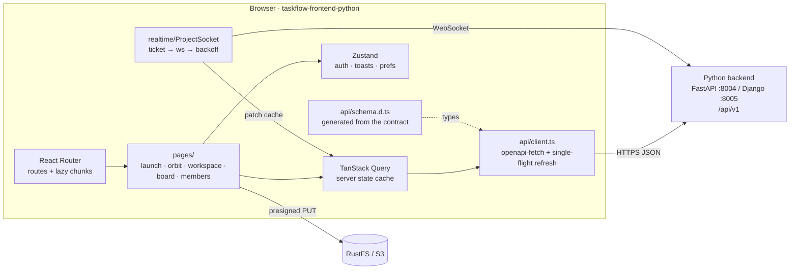

# STEPS · Rebuild `taskflow-frontend-python` from an empty folder

You'll build the **TaskFlow web app** (the "Orbit" UI: a 3D Kanban board in a starfield) with **React 19, Vite 8, TanStack Query 5, Zustand 5, React Router 8, react-hook-form + zod 4, Tailwind CSS 4 and shadcn/ui**, by hand, one small step at a time. At the end your repo behaves exactly like this one: same screens, same tests, same CI.

This frontend talks to **either Python backend** (`taskflow-fastapi` on port 8004, `taskflow-django` on 8005). They implement the same contract as the Node backends, so the only thing that changes is `VITE_API_URL`.

## The second time round: what's different from `taskflow-frontend-node`

You've built this UI once already (or you can: this guide doesn't assume it). The screens, the Orbit design and the client-side patterns are the same, because the contract is the same. This guide is complete on its own, so every file is here again, but four things are built differently, and they're the reason to build it twice:

| | `taskflow-frontend-node` | this repo |
|---|---|---|
| **Wire types** | Written by hand in `types.ts` from reading the contract | **Generated** from `contract/openapi.yaml` by `openapi-typescript`; CI fails if they drift (Step 1.3) |
| **HTTP client** | A hand-rolled `request<T>(method, path)`: the path is a string and `T` is a promise you make | **`openapi-fetch`**: the path, its parameters, the body and the response type are all checked against the contract at compile time (Steps 2.2–2.3) |
| **Scaffold** | `npm create vite`, then replace most of what it generated | **No generator.** You write every file yourself, so you know what each one is for (Part 0) |
| **Previewing UI** | A temporary `App.tsx`, deleted in Part 4 | A **dev-only `/kit` route**: a living style guide that never ships to production (Steps 1.2, 1.4) |

And one ordering change: **Real-time (Part 8) comes before the board page (Part 9)**, so the board is written once, with live updates from the start.

The idea behind the first two rows is called **contract-first**: the OpenAPI file is the source of truth, and the code that talks to it is derived from it. FastAPI works the same way from the other end (it *generates* its OpenAPI from Pydantic models), which makes this a natural pairing: you'll see the same schema names in both repos.

You already know React and TypeScript well, so this guide skips React basics and spends its words on:

1. **The libraries' specifics:** what TanStack Query owns versus Zustand, React Router 8's data router and `lazy` routes, react-hook-form with zod, Tailwind 4's CSS-first config, `openapi-typescript` + `openapi-fetch`, MSW 3, Vitest 5, Playwright.
2. **The production patterns** the backend contract forces on a client: a *single-flight* token refresh, cursor pagination, optimistic drag-and-drop with rollback, a WebSocket that reconnects with jittered backoff and refetches to close the gap, and RFC 9457 errors mapped onto form fields.
3. **The data structures and algorithms**, in a 🧠 box under every non-trivial piece.

> **Design docs you'll want open:** [`../README.md`](../README.md) (the TaskFlow design: auth, RBAC, real-time protocol) and [`contract/openapi.yaml`](contract/openapi.yaml) (the API). The visual design is the **TaskFlow Orbit** canvas; the colors, type and motion below come from it.

## What you'll build



**Who owns which state** is the most important design decision in a React app, so here it is up front:

| State | Lives in | Why |
|---|---|---|
| Anything the server owns (workspaces, the board, comments) | **TanStack Query cache** | It's a *cache* of remote data: it needs deduping, refetching, invalidation and optimistic updates, which is exactly what Query does |
| The access token, the current user | **Zustand** (`stores/auth.ts`) | Read by non-React code (the fetch client) as well as components; kept in memory only |
| Toasts, the 3D/flat toggle | **Zustand** | Global UI state; the toggle persists to `localStorage` |
| The open task | **The URL** (`?task=…`) | Survives reload, shareable, and the back button closes it |
| Form fields, drag targets | **Component state** | Nobody else needs them |

## Prerequisites

| Tool | Version used | Check |
|---|---|---|
| Node.js | 24 (npm 11.17+) | `node -v && npm -v` |
| Docker + Compose | Compose v5 | `docker compose version` |
| One Python backend | `taskflow-fastapi` (or `-django`) | its STEPS.md, Part 13 |
| A GitHub account | | |

## The finished repo

```text
taskflow-frontend-python/
├── .github/            dependabot.yml, workflows/ci.yml, workflows/codeql.yml
├── contract/           openapi.yaml (copy of the master contract)
├── e2e/                Playwright end-to-end spec
├── public/             favicon.svg
├── src/
│   ├── main.tsx        mounts QueryClientProvider + RouterProvider
│   ├── router.tsx      route table (lazy chunks behind sign-in, /kit in dev only)
│   ├── index.css       Tailwind 4 + the Orbit theme
│   ├── config.ts       VITE_API_URL → API and WebSocket base URLs
│   ├── components/
│   │   ├── ui/         shadcn/ui primitives (generated)
│   │   ├── orbit/      app chrome: brand, starfield, fields, dialogs, presence, toaster
│   │   └── board/      card, column, search, task dialog and its tabs
│   ├── hooks/          useDebouncedValue, useProjectRealtime
│   ├── lib/
│   │   ├── api/        schema.d.ts (generated), types, typed client, endpoints
│   │   ├── queries/    TanStack Query hooks, one file per feature
│   │   ├── realtime/   ProjectSocket + backoff
│   │   └── …           pure logic: board-cache, carousel, headline, permissions, format
│   ├── pages/          one component per route, plus the dev-only kit page
│   ├── stores/         Zustand: auth, toasts, preferences
│   └── test/           MSW server, fixtures, render helper
├── Dockerfile          build with Node, serve with unprivileged nginx
├── nginx.conf          SPA fallback + caching + security headers
└── playwright.config.ts
```

**Parts:** 0 Repo setup · 1 Styling & the Orbit theme · 2 Talking to the API · 3 Server state & client state · 4 Routing & the launch screen · 5 Workspaces & projects · 6 Board building blocks · 7 Task details · 8 Real-time · 9 The board page · 10 Members & invitations · 11 End-to-end tests · 12 Docker · 13 CI/CD · 14 Full stack & next steps

**How to read the code blocks:** each block names its file and where the code goes: **new file**, **continue** (append to the end), **add after / before `<line>`** (insert next to that existing line), or **add at the top**. Files only ever grow: no block asks you to replace or delete a line you typed earlier, so if your file and the guide disagree, the difference is a typo, not a missed edit. Type them in order and your files will match the repo exactly.

Every checkpoint that runs tests states the exact count you should see. Every one of them was verified by replaying this guide against the finished repo: the replay rebuilds the repo from an empty folder in guide order, runs each checkpoint's type check, lint and tests, and ends with every file byte-identical to this repo.

---
## Part 0 · Repo setup

### Step 0.1 · Create the project by hand

**Goal:** an empty git repository with a `package.json` and the four packages every React + Vite app needs, pinned to exact versions. No generator this time.

**Files:** `package.json`

Run this from the folder that holds your TaskFlow repos (`learning-programming/taskflow/`):

```bash
mkdir taskflow-frontend-python && cd taskflow-frontend-python
git init -b main
npm init -y
npm pkg set name=taskflow-frontend-python version=0.0.0 type=module
npm pkg set private=true --json
npm pkg delete main keywords author license description scripts.test
```

Now the runtime and the build tool:

```bash
npm install --save-exact react@19.3.1 react-dom@19.3.1
npm install -D --save-exact vite@8.3.8 @vitejs/plugin-react@6.3.0 typescript@6.0.3 \
  @types/react@19.3.0 @types/react-dom@19.3.0 @types/node@24.19.2
```

| Package | Why |
|---|---|
| `react`, `react-dom` | The UI library, and its renderer for the browser DOM |
| `vite` | Dev server (native ES modules, instant hot reload) and production bundler |
| `@vitejs/plugin-react` | Teaches Vite JSX and React Fast Refresh (edit a component, keep its state) |
| `typescript` 6.0.3 | Type checking. Not 7: `typescript-eslint` supports only TypeScript below 6.1 so far |
| `@types/*` | Type definitions for React, ReactDOM and Node (Node's are for the config files, which run in Node) |

**What's new (vs. `taskflow-frontend-node`)**
- **No `npm create vite`.** In the first frontend the template wrote a dozen files and you replaced most of them. Here you write each one in the step that needs it, so nothing in the repo is there "because the template put it there". This is also what the backend guides do (`npm init`, then one file at a time).
- **`"type": "module"`** makes every `.js` file an ES module, so `vite.config.ts` and `eslint.config.js` use `import`, not `require`.
- **`private: true`** stops an accidental `npm publish`; an app is never a package.
- **`--save-exact`** writes `"react": "19.3.1"` instead of `"^19.3.1"`. The lockfile already pins the whole tree, but exact top-level versions make `package.json` honest about what you actually run, and make Dependabot PRs one clear version bump each.

**✅ Checkpoint**

```bash
npm pkg get name type private && npx vite --version
```

Expected: `"name": "taskflow-frontend-python"`, `"type": "module"`, `"private": true`, then `vite/8.3.8 linux-x64 node-v24…`.

**Commit:** wait until Step 0.4; Step 0.3 adds the `.gitignore` first.

### Step 0.2 · TypeScript and Vite settings

**Goal:** strict TypeScript everywhere and an `@/` import alias, so `import { cn } from '@/lib/utils'` works from any depth.

**Files:** `tsconfig.json`, `tsconfig.app.json`, `tsconfig.node.json`, `vite.config.ts`

`vite.config.ts` loads Tailwind's Vite plugin. Install it now, so this file is written once; Part 1 explains Tailwind:

```bash
npm install -D --save-exact tailwindcss@4.3.5 @tailwindcss/vite@4.3.5
```

**`tsconfig.json`** · new file

```json
{
  "files": [],
  "references": [
    {
      "path": "./tsconfig.app.json"
    },
    {
      "path": "./tsconfig.node.json"
    }
  ],
  "compilerOptions": {
    "paths": {
      "@/*": ["./src/*"]
    }
  }
}
```

**`tsconfig.app.json`** · new file

```json
{
  "compilerOptions": {
    "tsBuildInfoFile": "./node_modules/.tmp/tsconfig.app.tsbuildinfo",
    "target": "es2023",
    "lib": ["ES2023", "DOM"],
    "module": "esnext",
    "types": ["vite/client"],
    "allowArbitraryExtensions": true,
    "skipLibCheck": true,
    "moduleResolution": "bundler",
    "allowImportingTsExtensions": true,
    "verbatimModuleSyntax": true,
    "moduleDetection": "force",
    "noEmit": true,
    "jsx": "react-jsx",
    "noUnusedLocals": true,
    "noUnusedParameters": true,
    "erasableSyntaxOnly": true,
    "noFallthroughCasesInSwitch": true,
    "paths": {
      "@/*": ["./src/*"]
    },
    "strict": true,
    "noUncheckedIndexedAccess": true
  },
  "include": ["src"]
}
```

**`tsconfig.node.json`** · new file

```json
{
  "compilerOptions": {
    "tsBuildInfoFile": "./node_modules/.tmp/tsconfig.node.tsbuildinfo",
    "target": "es2023",
    "lib": ["ES2023"],
    "types": ["node"],
    "skipLibCheck": true,
    "module": "nodenext",
    "allowImportingTsExtensions": true,
    "verbatimModuleSyntax": true,
    "moduleDetection": "force",
    "noEmit": true,
    "strict": true,
    "noUnusedLocals": true,
    "noUnusedParameters": true,
    "erasableSyntaxOnly": true,
    "noFallthroughCasesInSwitch": true
  },
  "include": ["vite.config.ts", "playwright.config.ts", "e2e"]
}
```

**`vite.config.ts`** · new file

```ts
import tailwindcss from '@tailwindcss/vite';
import react from '@vitejs/plugin-react';
import { fileURLToPath, URL } from 'node:url';
import { defineConfig } from 'vite';

export default defineConfig({
  plugins: [react(), tailwindcss()],
  resolve: {
    alias: { '@': fileURLToPath(new URL('./src', import.meta.url)) },
  },
  server: { port: 5173, strictPort: true },
  preview: { port: 5173, strictPort: true },
```

**`vite.config.ts`** · continue

```ts
});
```

**What's new**
- **Three tsconfigs.** `tsconfig.json` is only a *solution file*: `"files": []` plus `references` to two real projects. `tsconfig.app.json` type-checks `src/` for the browser (DOM types, JSX). `tsconfig.node.json` type-checks the build tooling (`vite.config.ts`, later `playwright.config.ts` and `e2e/`) for Node. `tsc -b` ("build mode") checks both. It's like a monorepo with two packages that never import each other.
- **`"types": ["vite/client"]`** types `import.meta.env` and CSS/asset imports. (Older Vite templates had a `vite-env.d.ts` file with a `/// <reference>` for this.)
- **`"paths": { "@/*": ["./src/*"] }`** teaches *TypeScript* the alias; `resolve.alias` in `vite.config.ts` teaches *Vite* (and Vitest) the same thing. You need both: tsc doesn't bundle, and Vite doesn't read `paths`. It sits in `tsconfig.json` too because shadcn's CLI (Part 1) reads the root file to find your aliases.
- **`noUncheckedIndexedAccess`** makes `items[i]` typed as `T | undefined`. It's the strictness flag that catches the most real bugs in UI code (empty lists, out-of-range indexes), and you'll see `?.` and `??` throughout the code because of it.
- **`erasableSyntaxOnly`** forbids TypeScript features that emit JavaScript (enums, namespaces, `constructor(private x)` parameter properties). The code stays plain JavaScript plus erasable types, which is what Node's own type stripping and modern bundlers expect.
- **`strictPort: true`** makes Vite fail instead of silently moving to 5174 when 5173 is busy. The backend's CORS allows exactly `http://localhost:5173`, so a silent port change would break every request.
- **`fileURLToPath(new URL('./src', import.meta.url))`** is the ES-module way to say `path.resolve(__dirname, 'src')`; `__dirname` doesn't exist in ESM.

**✅ Checkpoint**

`src/` is still empty, so check the Node-side project only (`tsc -b` would say *No inputs were found* for the app project until Step 0.4):

```bash
npx tsc -p tsconfig.node.json && echo "types ok"
```

Expected: `types ok`.

**Commit:** together with Step 0.4.

### Step 0.3 · Lint, format, editor settings, ignores

**Goal:** the same quality gates the backends use: type-aware ESLint (`strictTypeChecked`), Prettier for formatting, and ESLint and Prettier never fighting each other.

**Files:** `eslint.config.js`, `.prettierrc.json`, `.prettierignore`, `.editorconfig`, `.gitignore`

```bash
npm install -D --save-exact eslint@10.15.0 @eslint/js@10.0.1 typescript-eslint@8.72.2 globals@17.14.0 \
  eslint-plugin-react-hooks@7.1.1 eslint-plugin-react-refresh@0.5.7 \
  prettier@3.10.1 eslint-config-prettier@10.1.8
```

| Package | Why |
|---|---|
| `eslint`, `@eslint/js` | The linter and its built-in recommended rules |
| `typescript-eslint` | Parser + rules that understand TypeScript, including the type-aware ones |
| `globals` | The list of browser globals (`window`, `document`) so ESLint doesn't call them undefined |
| `eslint-plugin-react-hooks` | Enforces the Rules of Hooks and checks effect dependency arrays |
| `eslint-plugin-react-refresh` | Warns when a file would break Fast Refresh (more below) |
| `prettier`, `eslint-config-prettier` | Prettier formats; the config switches off every ESLint rule that would argue with it |

**`eslint.config.js`** · new file

```js
import js from '@eslint/js';
import prettier from 'eslint-config-prettier';
import reactHooks from 'eslint-plugin-react-hooks';
import reactRefresh from 'eslint-plugin-react-refresh';
import globals from 'globals';
import tseslint from 'typescript-eslint';

export default tseslint.config(
  {
    ignores: [
      'dist/',
      'coverage/',
      'playwright-report/',
      'test-results/',
      'src/lib/api/schema.d.ts',
    ],
  },
  js.configs.recommended,
  ...tseslint.configs.strictTypeChecked,
  reactHooks.configs.flat.recommended,
  reactRefresh.configs.vite,
  {
    languageOptions: {
      globals: globals.browser,
      parserOptions: { projectService: true, tsconfigRootDir: import.meta.dirname },
    },
    rules: {
      '@typescript-eslint/restrict-template-expressions': ['error', { allowNumber: true }],
      '@typescript-eslint/no-unused-vars': ['error', { argsIgnorePattern: '^_' }],
      // Event handlers like onSubmit={handleSubmit(fn)} return promises React ignores on purpose.
      '@typescript-eslint/no-misused-promises': [
        'error',
        { checksVoidReturn: { attributes: false } },
      ],
    },
  },
  // shadcn/ui files export components and their variants together; that's the generator's layout.
  { files: ['src/components/ui/**'], rules: { 'react-refresh/only-export-components': 'off' } },
  { files: ['eslint.config.js'], extends: [tseslint.configs.disableTypeChecked] },
  prettier,
);
```

**`.prettierrc.json`** · new file

```json
{
  "printWidth": 100,
  "singleQuote": true,
  "trailingComma": "all"
}
```

**`.prettierignore`** · new file

```gitignore
dist/
coverage/
playwright-report/
test-results/
package-lock.json
contract/
STEPS.md
README.md
src/lib/api/schema.d.ts
```

**`.editorconfig`** · new file

```ini
root = true

[*]
charset = utf-8
end_of_line = lf
indent_style = space
indent_size = 2
insert_final_newline = true
trim_trailing_whitespace = true

[*.md]
trim_trailing_whitespace = false
```

**`.gitignore`** · new file

```gitignore
node_modules/
dist/
coverage/
playwright-report/
test-results/
blob-report/
*.tsbuildinfo
*.log

.env
.env.*
!.env.example

.DS_Store
.idea/
.vscode/*
!.vscode/extensions.json
```

**What's new**
- **`strictTypeChecked`** turns on rules that need type information, which is why `parserOptions.projectService: true` is set: ESLint asks the TypeScript language service for the type of every expression. That's how it can flag a floating promise or a `${obj}` that would print `[object Object]`. It's slower than syntax-only linting, and worth it.
- **`no-misused-promises` with `checksVoidReturn: { attributes: false }`:** `onSubmit={form.handleSubmit(async …)}` hands React a function that returns a promise. React ignores the return value, which is exactly what we want for event handlers, so the rule is relaxed for JSX attributes only.
- **`reactRefresh.configs.vite`** warns when a component file also exports non-components. Vite's Fast Refresh can only hot-swap files that export components. Mixing them silently turns every save into a full reload. That's why shared constants like `PRIORITY` live in `lib/visuals.ts` (Step 1.4), not next to `<PriorityPill>`.
- **`.env.*` ignored, `!.env.example` kept:** the example documents every variable; real values never reach git.
- **`src/lib/api/schema.d.ts` is ignored by both tools before it exists.** Step 1.3 *generates* it from the contract; formatting or linting generated code would only make `npm run api:check` (which compares it byte for byte) fail.

**✅ Checkpoint**

```bash
npx eslint . && npx prettier --check .
```

Expected: ESLint prints nothing, then `All matched files use Prettier code style!`.

**Commit:** together with Step 0.4.

### Step 0.4 · Scripts, configuration and the contract

**Goal:** the npm scripts CI will call, the one environment variable and the module that reads it, and the API contract this app is written against.

**Files:** `package.json` (scripts), `.env.example`, `src/config.ts`, `contract/openapi.yaml`

```bash
npm pkg set scripts.dev="vite" \
  scripts.build="tsc -b && vite build" \
  scripts.preview="vite preview" \
  scripts.typecheck="tsc -b --noEmit" \
  scripts.lint="eslint ." \
  scripts.format="prettier --write ." \
  scripts.format:check="prettier --check ." \
  scripts.test="vitest run" \
  scripts.test:watch="vitest" \
  scripts.test:coverage="vitest run --coverage" \
  scripts.e2e="playwright test"
npm pkg set engines.node=">=24"
```

`test` and `e2e` won't work until their tools arrive (Steps 2.4 and 11.1); defining every script now means CI's shape is settled from the first commit.

**`.env.example`** · new file

```bash
# Where the backend lives. Either taskflow-fastapi or taskflow-django works: they share one contract.
# Each publishes its own port: fastapi 8004, django 8005.
# Vite only exposes variables prefixed with VITE_ to browser code, and inlines them at BUILD time.
VITE_API_URL=http://localhost:8004
```

**`src/config.ts`** · new file

```ts
const apiUrl = (import.meta.env.VITE_API_URL as string | undefined) ?? 'http://localhost:8004';

export const config = {
  apiUrl: apiUrl.replace(/\/$/, ''),
  /** Same host as the API, with ws:// or wss:// instead of http(s)://. */
  wsUrl: apiUrl.replace(/\/$/, '').replace(/^http/, 'ws'),
};
```

Copy the master contract into the repo (each repo keeps its own copy, so it works after `git clone` on its own):

```bash
mkdir -p contract && cp ../openapi.yaml contract/openapi.yaml
```

**What's new**
- **Only `VITE_`-prefixed variables reach browser code**, and Vite *inlines* them at build time: `import.meta.env.VITE_API_URL` becomes a string literal in the bundle. That has two consequences you'll meet again in Part 12. A secret in a `VITE_` variable is public, and changing the backend URL means rebuilding.
- **Port 8004 is FastAPI's** in the workspace's port scheme (Django is 8005). Both Python backends allow CORS from `http://localhost:5173`, so you switch between them by editing one line in `.env` (copy `.env.example` to `.env` when you need a different value).
- **`config.wsUrl`** swaps `http` for `ws` (and `https` for `wss`): the WebSocket lives on the same host and port as the API.
- **`build` runs `tsc -b` first.** Vite strips types without checking them (it's fast because it doesn't type-check), so the build script adds the check.

**✅ Checkpoint**

```bash
npm run typecheck && npm run lint && npm run format:check
```

Expected: all three succeed; the last line is `All matched files use Prettier code style!`.

**Commit:**

```bash
git add -A && git commit -m "chore: set up Vite, React and TypeScript by hand with strict lint and format"
```

### Step 0.5 · Push to GitHub

**Goal:** the repo on GitHub, so CI (Part 13) has somewhere to run.

```bash
gh repo create taskflow-frontend-python --public --source . --push
```

(Or create an empty repo on github.com, then `git remote add origin git@github.com:<you>/taskflow-frontend-python.git && git push -u origin main`.)

**✅ Checkpoint:** `git status -sb` shows `## main...origin/main` with nothing to commit.

**Commit:** nothing new; this step publishes the commits you have.

---

## Part 1 · Styling & the Orbit theme

### Step 1.1 · Tailwind CSS 4 and shadcn/ui

**Goal:** Tailwind compiled by Vite, and four accessible primitives (`Button`, `Dialog`, `Input`, `Label`) from shadcn/ui.

**Files:** `src/index.css` (for now one line), `components.json` and `src/components/ui/*` (generated), `src/lib/utils.ts`

Tailwind's plugin is already in `vite.config.ts` (Step 0.2). shadcn's CLI checks that Tailwind is wired up, so give `index.css` its one essential line now (Step 1.2 rewrites the whole file):

```bash
mkdir -p src && echo "@import 'tailwindcss';" > src/index.css
```

Now initialise shadcn/ui and add the four components:

```bash
npx shadcn@4.23.0 init --base radix --preset nova --no-monorepo
npx shadcn@4.23.0 add button dialog input label
```

`init` writes `components.json` (where components go, which style) and rewrites `index.css`; `add` copies the component sources into `src/components/ui/`. Both also install packages this repo doesn't keep: the `shadcn` CLI itself, a font (Geist; Orbit uses Inter) and a micro-package called `cn`. Swap them for the classic helpers, pinned:

```bash
npm uninstall shadcn cn @fontsource-variable/geist
npm install --save-exact class-variance-authority@0.7.1 clsx@2.1.1 lucide-react@1.73.0 radix-ui@1.8.1 tailwind-merge@3.7.0
npm install -D --save-exact tw-animate-css@1.4.0
```

`init` also generated a one-line `src/lib/utils.ts` that re-exports `cn` from that package. Delete it and write the classic version, so you can see what it does:

```bash
rm src/lib/utils.ts
```

**`src/lib/utils.ts`** · new file

```ts
import { clsx, type ClassValue } from 'clsx';
import { twMerge } from 'tailwind-merge';

export function cn(...inputs: ClassValue[]) {
  return twMerge(clsx(inputs));
}
```

…and point the generated components at it, then format them with the repo's Prettier settings:

```bash
sed -i 's#from "cn"#from "@/lib/utils"#' src/components/ui/*.tsx
npx prettier --write src/components/ui
```

Finally, in `src/components/ui/dialog.tsx`, find the `DialogTitle` class list `'font-heading text-base leading-none font-medium'` and delete `font-heading ` (Orbit's theme doesn't define a heading font; the title gets its font from the caller).

**What's new**
- **Tailwind 4 has no `tailwind.config.js`.** Configuration lives in CSS (`@theme`, Step 1.2), and the Vite plugin scans your source files for class names. `@import 'tailwindcss'` pulls in the preflight reset and all utilities.
- **shadcn/ui is not a dependency; it's a code generator.** The components become *your* source files (built on Radix UI primitives, which handle focus traps, `Esc`, `aria-*`). You own them and can edit them, which is exactly what we just did. That's the opposite of an npm UI kit you can't change.
- **`cn()`** = `clsx` (join class names conditionally: `cn('a', cond && 'b')`) + `tailwind-merge` (resolve conflicts, so `cn('px-2', 'px-4')` gives `'px-4'` and not both). Every component accepts a `className` and merges it with `cn()`, so callers can override styles.
- **`radix-ui`** is the single umbrella package for all Radix primitives (`import { Dialog } from 'radix-ui'`). Older guides install `@radix-ui/react-dialog` and friends one by one.
- **shadcn found Vite without a template.** It recognises the project from `vite.config.ts`, the Tailwind version from `package.json`, and the alias from `tsconfig.json`, all of which you wrote in Part 0.

**✅ Checkpoint**

```bash
ls src/components/ui && grep -c "@/lib/utils" src/components/ui/*.tsx && npm run typecheck
```

Expected: `button.tsx  dialog.tsx  input.tsx  label.tsx`, then each file reporting `1` match, then no type errors.

**Commit:**

```bash
git add -A && git commit -m "feat: add Tailwind CSS 4 and shadcn/ui primitives"
```

### Step 1.2 · The Orbit theme, and a page to see it on

**Goal:** the design system from the Orbit canvas, as CSS: the palette, three typefaces, the radii and every animation. Plus the app's entry point and a **dev-only `/kit` page** to look at it.

**Files:** `src/index.css`, `index.html`, `public/favicon.svg`, `src/main.tsx`, `src/router.tsx`, `src/pages/kit-page.tsx`

Self-hosted variable fonts (no request to Google at runtime, no layout shift from a late font swap):

```bash
npm install --save-exact @fontsource-variable/inter@5.3.0 @fontsource-variable/space-grotesk@5.3.0 @fontsource-variable/jetbrains-mono@5.3.0
```

shadcn's `init` filled `src/index.css` with its default theme. Empty it; you'll write Orbit's from scratch:

```bash
: > src/index.css
```

The imports and the palette:

**`src/index.css`** · new file

```css
@import 'tailwindcss';
@import 'tw-animate-css';
@import '@fontsource-variable/inter';
@import '@fontsource-variable/space-grotesk';
@import '@fontsource-variable/jetbrains-mono';

/* shadcn/ui reads these variables. The values are the Orbit palette: one dark theme. */
:root {
  color-scheme: dark;
  --radius: 0.875rem;
  --background: #06070b;
  --foreground: #eef1f7;
  --card: #10131c;
  --card-foreground: #eef1f7;
  --popover: #121622;
  --popover-foreground: #eef1f7;
  --primary: #c8ff4d;
  --primary-foreground: #06070b;
  --secondary: #1a1f2c;
  --secondary-foreground: #eef1f7;
  --muted: #1a1f2c;
  --muted-foreground: #9aa3b5;
  --accent: #1f2534;
  --accent-foreground: #eef1f7;
  --destructive: #ff9b6a;
  --border: rgb(255 255 255 / 0.1);
  --input: rgb(255 255 255 / 0.14);
  --ring: #c8ff4d;
  --sky: #7fd8ff;
  --amber: #ffd166;
  --coral: #ff9b6a;
}
```

The `@theme` block turns those variables into Tailwind utilities (`bg-primary`, `text-coral`, `font-display`, `animate-rise`):

**`src/index.css`** · continue

```css

@theme inline {
  --font-sans: 'Inter Variable', system-ui, sans-serif;
  --font-display: 'Space Grotesk Variable', 'Inter Variable', sans-serif;
  --font-mono: 'JetBrains Mono Variable', ui-monospace, monospace;
  --color-background: var(--background);
  --color-foreground: var(--foreground);
  --color-card: var(--card);
  --color-card-foreground: var(--card-foreground);
  --color-popover: var(--popover);
  --color-popover-foreground: var(--popover-foreground);
  --color-primary: var(--primary);
  --color-primary-foreground: var(--primary-foreground);
  --color-secondary: var(--secondary);
  --color-secondary-foreground: var(--secondary-foreground);
  --color-muted: var(--muted);
  --color-muted-foreground: var(--muted-foreground);
  --color-accent: var(--accent);
  --color-accent-foreground: var(--accent-foreground);
  --color-destructive: var(--destructive);
  --color-border: var(--border);
  --color-input: var(--input);
  --color-ring: var(--ring);
  --color-sky: var(--sky);
  --color-amber: var(--amber);
  --color-coral: var(--coral);
  --radius-sm: calc(var(--radius) - 6px);
  --radius-md: calc(var(--radius) - 4px);
  --radius-lg: var(--radius);
  --radius-xl: calc(var(--radius) + 6px);
  --animate-drift: drift 120s linear infinite;
  --animate-ring-1: ring-1 28s linear infinite;
  --animate-ring-2: ring-2 36s linear infinite;
  --animate-ring-3: ring-3 44s linear infinite;
  --animate-float: float 7s ease-in-out infinite;
  --animate-rise: rise 0.7s cubic-bezier(0.2, 0.8, 0.2, 1) both;
  --animate-flip: flip 0.75s cubic-bezier(0.2, 0.9, 0.25, 1) both;
  --animate-orbit: orbit 18s linear infinite;
  --animate-counter-orbit: counter-orbit 18s linear infinite;
  --animate-pulse-ring: pulse-ring 2.4s ease-out infinite;
```

The keyframes, straight from the design canvas:

**`src/index.css`** · continue

```css

  @keyframes drift {
    to {
      background-position:
        -600px 300px,
        -300px 600px,
        -900px -300px;
    }
  }
  @keyframes ring-1 {
    from {
      transform: rotateX(72deg) rotateZ(0deg);
    }
    to {
      transform: rotateX(72deg) rotateZ(360deg);
    }
  }
  @keyframes ring-2 {
    from {
      transform: rotateY(64deg) rotateZ(0deg);
    }
    to {
      transform: rotateY(64deg) rotateZ(-360deg);
    }
  }
  @keyframes ring-3 {
    from {
      transform: rotateX(18deg) rotateY(-40deg) rotateZ(0deg);
    }
    to {
      transform: rotateX(18deg) rotateY(-40deg) rotateZ(360deg);
    }
  }
  @keyframes float {
    0%,
    100% {
      transform: translate3d(0, 0, var(--z, 0px));
    }
    50% {
      transform: translate3d(0, -14px, var(--z, 0px));
    }
  }
  @keyframes rise {
    from {
      opacity: 0;
      transform: translateZ(-120px) translateY(24px);
    }
  }
  @keyframes flip {
    0% {
      opacity: 0;
      transform: perspective(1400px) rotateY(-100deg) scale(0.85);
    }
    60% {
      opacity: 1;
    }
  }
  @keyframes orbit {
    to {
      transform: rotate(360deg);
    }
  }
  @keyframes counter-orbit {
    to {
      transform: rotate(-360deg);
    }
  }
  @keyframes pulse-ring {
    0%,
    100% {
      box-shadow: 0 0 0 0 rgb(200 255 77 / 0.45);
    }
    50% {
      box-shadow: 0 0 0 10px rgb(200 255 77 / 0);
    }
  }
}
```

Base styles, the card glow, and the reduced-motion switch:

**`src/index.css`** · continue

```css

@layer base {
  * {
    @apply border-border outline-ring/50;
  }
  body {
    @apply bg-background font-sans text-foreground antialiased;
  }
}

/*
 * A card glows when hovered or keyboard-focused. It deliberately does NOT move: on the tilted
 * plane a translateZ shifts the card out from under the pointer (the hover ends, it drops back,
 * it flickers), and while the transform animates Chrome hit-tests the 3D layers against stale
 * depths, so clicks land on the board behind the card.
 */
@utility glow-card {
  transition:
    box-shadow 0.35s,
    border-color 0.35s;
  &:hover,
  &:has(:focus-visible) {
    border-color: rgb(200 255 77 / 0.55);
    box-shadow:
      0 40px 60px -20px rgb(0 0 0 / 0.8),
      0 0 0 1px rgb(200 255 77 / 0.55);
  }
}

@media (prefers-reduced-motion: reduce) {
  *,
  *::before,
  *::after {
    animation-duration: 0.01ms !important;
    animation-iteration-count: 1 !important;
    transition-duration: 0.01ms !important;
  }
}
```

The HTML shell Vite serves, and the favicon:

**`index.html`** · new file

```html
<!doctype html>
<html lang="en">
  <head>
    <meta charset="UTF-8" />
    <link rel="icon" type="image/svg+xml" href="/favicon.svg" />
    <meta name="viewport" content="width=device-width, initial-scale=1.0" />
    <meta name="theme-color" content="#06070b" />
    <title>TaskFlow</title>
  </head>
  <body>
    <div id="root"></div>
    <script type="module" src="/src/main.tsx"></script>
  </body>
</html>
```

**`public/favicon.svg`** · new file

```text
<svg xmlns="http://www.w3.org/2000/svg" viewBox="0 0 32 32"><rect width="32" height="32" rx="9" fill="#c8ff4d"/><g fill="none" stroke="#06070b" stroke-width="2.4"><ellipse cx="16" cy="16" rx="12" ry="5" transform="rotate(-30 16 16)"/></g><circle cx="16" cy="16" r="3.2" fill="#06070b"/></svg>
```

**What's new**
- **Two layers of variables.** `:root` holds the raw palette under the names shadcn/ui components expect (`--primary`, `--muted-foreground`). `@theme inline` maps them to Tailwind's namespaces (`--color-*`, `--font-*`, `--animate-*`), and that mapping is what *generates* utilities: `--color-coral` gives you `text-coral`, `bg-coral/10` and `border-coral/40`. `inline` makes the utility use `var(--coral)` directly, so a runtime change to `:root` restyles everything.
- **`@utility glow-card`** defines a custom utility with nested states (`&:hover`), usable in `className` like any built-in. The comment explains why the card *glows* but doesn't *move* on hover. On a 3D-tilted board, a hover transform moves the card out from under the pointer; you'll see the tilt in Part 9.
- **`prefers-reduced-motion`**: one media query cuts every animation and transition to ~0 for people who ask their OS for less motion. It's also what makes the end-to-end tests deterministic (Part 11).
- **`color-scheme: dark`** tells the browser to draw native controls (scrollbars, the date picker, `<select>` menus) dark.
- **`index.html` is the entry, not a template.** Vite starts from it and follows `<script type="module" src="/src/main.tsx">`, so the TypeScript file is part of the module graph from the first request.

Now something to render the theme on. In the first frontend this was a throwaway `App.tsx`; here it's a route you keep. React Router renders the pages from now on, so install it now:

```bash
npm install --save-exact react-router@8.5.1
```

The entry point mounts the router. Two provider lines join it in Step 3.1, which is why `<RouterProvider>` is indented one level deeper than it needs to be today:

**`src/main.tsx`** · new file

```tsx
import { StrictMode } from 'react';
import { createRoot } from 'react-dom/client';
import { RouterProvider } from 'react-router';
```

**`src/main.tsx`** · continue

```tsx
import { router } from '@/router';
import './index.css';

const root = document.getElementById('root');
if (!root) throw new Error('index.html is missing <div id="root">');

createRoot(root).render(
  <StrictMode>
```

**`src/main.tsx`** · continue

```tsx
      <RouterProvider router={router} />
```

**`src/main.tsx`** · continue

```tsx
  </StrictMode>,
);
```

The route table starts with one route, `/kit`, that exists only in development:

**`src/router.tsx`** · new file

```tsx
import { createBrowserRouter, type RouteObject } from 'react-router';
```

**`src/router.tsx`** · continue

```tsx

// The style guide exists only in development. A production build replaces import.meta.env.DEV
// with `false`, so the bundler drops this route and the kit page's chunk entirely.
const devRoutes: RouteObject[] = import.meta.env.DEV
  ? [
      {
        path: '/kit',
        lazy: async () => ({ Component: (await import('@/pages/kit-page')).KitPage }),
      },
    ]
  : [];

// The launch page ships in the first bundle. Everything behind sign-in is split into chunks
// that load when first visited: `lazy` returns the route's Component from a dynamic import().
export const routes: RouteObject[] = [
  ...devRoutes,
```

**`src/router.tsx`** · continue

```tsx
];

export const router = createBrowserRouter(routes);
```

And the kit page itself. For now it shows the palette swatches and the three typefaces; Step 1.4 adds every building block to it:

**`src/pages/kit-page.tsx`** · new file

```tsx
const SWATCHES = [
  'bg-background',
  'bg-card',
  'bg-muted',
  'bg-primary',
  'bg-sky',
  'bg-amber',
  'bg-coral',
];
```

**`src/pages/kit-page.tsx`** · continue

```tsx

/** The dev-only style guide at /kit: the theme and every Orbit building block on one page. */
export function KitPage() {
  return (
    <main className="flex min-h-svh flex-col items-start gap-6 p-10">
```

**`src/pages/kit-page.tsx`** · continue

```tsx
      <h1 className="font-display text-3xl font-semibold">Orbit kit</h1>
      <div className="flex flex-wrap gap-3">
        {SWATCHES.map((swatch) => (
          <div key={swatch} className="flex flex-col items-center gap-1 text-xs">
            <span className={`size-12 rounded-xl border border-border ${swatch}`} />
            {swatch.slice(3)}
          </div>
        ))}
      </div>
      <p className="text-muted-foreground">
        Inter for text, <span className="font-display">Space Grotesk for display</span>,{' '}
        <span className="font-mono">JetBrains Mono for TF-42</span>.
      </p>
```

**`src/pages/kit-page.tsx`** · continue

```tsx
    </main>
  );
}
```

**What's new**
- **`import.meta.env.DEV`** is `true` under `vite` (dev server) and the literal `false` in `vite build`. The bundler sees `false ? [...] : []`, removes the dead branch, and with it the only `import('@/pages/kit-page')`, so the kit page isn't even emitted as a chunk. A style guide that costs production nothing. (Bigger teams use Storybook for this; one route is enough here, and it renders inside the real app with the real CSS.)
- **`lazy: async () => ({ Component })`** is React Router's code-splitting hook: the route's module is fetched the first time the route is visited. Part 4 uses it for every signed-in page.
- **`...devRoutes`** spreads the dev-only list into the route table. Every route you add later goes *after* it.
- **`if (!root) throw …`** instead of `document.getElementById('root')!`: the strict lint rules reject the `!` non-null assertion, and a missing root should fail loudly anyway.
- **`` `size-12 … ${swatch}` ``** builds a class name at runtime, which normally doesn't work with Tailwind: it only generates classes it finds *written out* in your source. It works here because every full name (`'bg-card'`, `'bg-coral'`) appears literally in `SWATCHES`.

**✅ Checkpoint:** `npm run dev`, open http://localhost:5173/kit: a near-black page, **Orbit kit** in Space Grotesk, seven swatches (near-black, two greys, lime, sky, amber, coral) and the three typefaces, plus the lime favicon in the tab. Then:

```bash
npm run build
```

Expected: ends with `✓ built in …`, and the list of files has no `kit-page` chunk.

**Commit:**

```bash
git add -A && git commit -m "feat: add the Orbit theme and a dev-only /kit page"
```

### Step 1.3 · Wire types, generated from the contract

**Goal:** TypeScript types for every JSON shape in the contract, **generated** from `contract/openapi.yaml`, plus a check that fails when they go stale. They come before the building blocks because even an avatar needs a `UserSummary`.

**Files:** `package.json`, `src/lib/api/schema.d.ts` (generated), `src/lib/api/types.ts`

```bash
npm install -D --save-exact openapi-typescript@7.13.0
```

That fails with `ERESOLVE`: `openapi-typescript` declares `typescript@^5.x` as a peer dependency, and you have 6.0.3. It works fine with 6 (it only uses the compiler's printer), so tell npm to use *your* TypeScript for it, then install again:

```bash
npm pkg set 'overrides.openapi-typescript.typescript=$typescript'
npm install -D --save-exact openapi-typescript@7.13.0
```

Two scripts: one writes the types, one checks they're current:

```bash
npm pkg set scripts.api:generate="openapi-typescript contract/openapi.yaml --default-non-nullable false -o src/lib/api/schema.d.ts" \
  scripts.api:check="openapi-typescript contract/openapi.yaml --default-non-nullable false -o src/lib/api/schema.d.ts --check"
npm run api:generate
```

You get a 2,600-line `src/lib/api/schema.d.ts`. Look at one schema to see what it made:

**`src/lib/api/schema.d.ts`** · excerpt of the generated `src/lib/api/schema.d.ts`

```ts
        Task: {
            id: components["schemas"]["Id"];
            /** @description `<project key>-<number>`, e.g. `TF-42`. */
            key: string;
            number: number;
            projectId: components["schemas"]["Id"];
            columnId: components["schemas"]["Id"];
            title: string;
            description: string | null;
            priority: components["schemas"]["Priority"];
            assignee: components["schemas"]["UserSummary"] | null;
            reporter: components["schemas"]["UserSummary"];
            dueAt: components["schemas"]["Timestamp"] | null;
            position: components["schemas"]["Position"];
            createdAt: components["schemas"]["Timestamp"];
            updatedAt: components["schemas"]["Timestamp"];
        };
```

It's generated output, which is why Step 0.3 told Prettier and ESLint to leave it alone.

The generated names are long (`components['schemas']['Task']`), so give the ones the app uses short aliases. This file is the app's vocabulary; when a component needs a new type, it's added here:

**`src/lib/api/types.ts`** · new file

```ts
// The app's names for the contract's schemas. schema.d.ts is generated from contract/openapi.yaml
// (`npm run api:generate`); never edit it, change the contract and regenerate.
import type { components } from './schema';

type Schemas = components['schemas'];

export type Role = Schemas['Role'];
export type InvitableRole = Schemas['InvitableRole'];
export type Priority = Schemas['Priority'];
export type Problem = Schemas['Problem'];
export type FieldError = Schemas['FieldError'];

export type UserSummary = Schemas['UserSummary'];
export type User = Schemas['User'];
export type AccessToken = Schemas['AccessToken'];
export type AuthSession = Schemas['AuthSession'];

export type Workspace = Schemas['Workspace'];
export type Member = Schemas['Member'];
export type Invitation = Schemas['Invitation'];
export type Project = Schemas['Project'];

export type Column = Schemas['Column'];
export type Task = Schemas['Task'];
export type BoardColumn = Schemas['BoardColumn'];
export type Board = Schemas['Board'];
export type CreateTaskBody = Schemas['CreateTaskRequest'];
/** JSON merge-patch semantics: absent = unchanged, null = cleared. */
export type UpdateTaskBody = Schemas['UpdateTaskRequest'];

export type Comment = Schemas['Comment'];
export type Attachment = Schemas['Attachment'];
export type ActivityEvent = Schemas['ActivityEvent'];
export type SearchHit = Schemas['SearchHit'];

/** Server → client WebSocket envelopes (README §9.2), a union discriminated by `type`. */
export type ServerMessage = Schemas['WsServerMessage'];
```

**What's new (vs. `taskflow-frontend-node`)**
- **Generated, not hand-written.** In the first frontend you typed 180 lines of interfaces while reading the contract. That taught you the contract; it also meant a contract change could leave the types silently wrong. Here the contract *is* the types: change `openapi.yaml`, run `npm run api:generate`, and `tsc` points at every line of the app the change breaks.
- **`npm run api:check`** regenerates in memory and exits non-zero if the file on disk differs. CI runs it (Step 13.1), the frontend's version of the backends' migration drift check: nobody can edit the contract and forget the types, or hand-edit the generated file.
- **`--default-non-nullable false`:** by default the generator marks any field with a `default` as required, because the *server* always fills it in a response. That's wrong for request bodies: `CreateTaskRequest.priority` has `default: medium`, so a client may leave it out. With the flag, fields are required only when the contract's `required` list says so.
- **`overrides`** rewrites a dependency's dependency. `"$typescript"` means "the version in my own `devDependencies`", so there's still exactly one TypeScript in `node_modules`. Use it sparingly: you're vouching for a combination the package's authors haven't declared.
- **`.d.ts`** is a declarations-only file: types, no runtime code. `schema.d.ts` adds nothing to the bundle.
- **`ServerMessage` is a discriminated union** on `type` (the contract's `WsServerMessage` is a `oneOf`, and each member has a `const` or `enum` `type`). In a `switch (message.type)`, TypeScript narrows `message.payload` to the right shape in each `case`. Step 6.1 relies on that, and a typo'd event name is a compile error.

> 🧠 **DSA & scalability · a contract as the single source of truth**
> - **Data structure:** the OpenAPI document is a tree of JSON Schemas; the generator walks it and prints one TypeScript type per schema, with `$ref`s becoming references (`components["schemas"]["UserSummary"]`), not copies.
> - **Algorithm:** parse YAML → resolve `$ref`s → for each schema, map JSON Schema to TS (`type: [string, "null"]` → `string | null`, `oneOf` → a union, `enum` → a union of literals, `required` → non-optional keys) → print. `--check` runs the same pipeline and compares strings.
> - **Complexity:** O(size of the contract). 1,800 lines of YAML generate in about 150 ms, so it's cheap enough to run on every CI build.
> - **Why it scales:** with 6 backends and 3 frontends sharing one contract, hand-maintained copies of the types are 9 places to forget an edit. One generated file per repo, checked in CI, makes the contract the only thing anyone edits.
> - **Rejected:** hand-written types (drift; the first frontend's approach), runtime validation of every response with zod (catches drift only when that code path runs in production, and costs CPU on every response), and generating a full SDK with methods (more generated code to read; the typed `fetch` in Step 2.2 is thinner).

**✅ Checkpoint**

```bash
npm run api:check && npm run typecheck && npm run lint
```

Expected: `✨ openapi-typescript 7.13.0` and nothing else; no output from the other two.

**Commit:**

```bash
git add -A && git commit -m "feat: generate the API types from the contract"
```

### Step 1.4 · Orbit building blocks

**Goal:** the small presentational pieces every screen reuses: the brand mark, the starfield, avatars and pills, a planet, a form field with a show-password variant, and the two button styles. All of them go on the kit page.

**Files:** `src/lib/visuals.ts`, `src/components/orbit/{brand,starfield,badges,planet,field,password-field,primary-button}.tsx`, `src/pages/kit-page.tsx`

Shared constants and pure helpers first. They live outside the component files so Fast Refresh keeps working (Step 0.3):

**`src/lib/visuals.ts`** · new file

```ts
import type { Priority } from '@/lib/api/types';

const AVATAR_COLORS = ['#3D63FF', '#0E8C7F', '#B5501E', '#8250E8', '#BE185D', '#2563EB'];

/** A stable color per user: the same person is the same color on every screen. */
export function colorFor(id: string): string {
  let hash = 0;
  for (const ch of id) hash = (hash * 31 + ch.charCodeAt(0)) >>> 0;
  return AVATAR_COLORS[hash % AVATAR_COLORS.length] ?? '#3D63FF';
}

export function initials(name: string): string {
  return name
    .split(/\s+/)
    .filter(Boolean)
    .map((part) => part[0])
    .join('')
    .slice(0, 2)
    .toUpperCase();
}

export const PRIORITY: Record<Priority, { label: string; color: string }> = {
  urgent: { label: 'Urgent', color: 'var(--coral)' },
  high: { label: 'High', color: 'var(--amber)' },
  medium: { label: 'Medium', color: 'var(--sky)' },
  low: { label: 'Low', color: 'var(--muted-foreground)' },
};

const PLANETS = [
  { core: '#c8ff4d', light: '#f4ffd9', dark: '#3e5a00' },
  { core: '#7fd8ff', light: '#e6fbff', dark: '#0b4a63' },
  { core: '#ffd166', light: '#fff2da', dark: '#6b4a00' },
  { core: '#b79bff', light: '#f1e8ff', dark: '#3b2273' },
  { core: '#ff9b6a', light: '#ffe8dd', dark: '#6b2a0b' },
] as const;

/** Same id → same planet. Ids are UUIDv7, so hash the random tail, not the timestamp head. */
export function planetFor(id: string): (typeof PLANETS)[number] {
  const n = parseInt(id.replace(/-/g, '').slice(-6), 16) || 0;
  return PLANETS[n % PLANETS.length] ?? PLANETS[0];
}
```

**`src/components/orbit/brand.tsx`** · new file

```tsx
import { cn } from '@/lib/utils';

export function OrbitMark({ className }: { className?: string }) {
  return (
    <span className={cn('grid size-9 place-items-center rounded-[11px] bg-primary', className)}>
      <svg
        viewBox="0 0 24 24"
        className="size-5"
        fill="none"
        stroke="#06070B"
        strokeWidth={2.2}
        aria-hidden="true"
      >
        <ellipse cx="12" cy="12" rx="10" ry="4" transform="rotate(-30 12 12)" />
        <circle cx="12" cy="12" r="2.6" fill="#06070B" />
      </svg>
    </span>
  );
}

export function Wordmark() {
  return (
    <span className="flex items-center gap-3">
      <OrbitMark />
      <span className="font-display text-xl font-bold tracking-tight">TaskFlow</span>
    </span>
  );
}
```

**`src/components/orbit/starfield.tsx`** · new file

```tsx
/** The drifting star layer behind every screen. Pure CSS: three tiled radial-gradient dots. */
export function Starfield() {
  return (
    <div aria-hidden="true" className="pointer-events-none fixed inset-0 -z-10 overflow-hidden">
      <div
        className="animate-drift absolute inset-0 opacity-90"
        style={{
          backgroundImage:
            'radial-gradient(1.5px 1.5px at 20px 30px, #fff 50%, transparent 51%), radial-gradient(1px 1px at 140px 90px, #9aa3b5 50%, transparent 51%), radial-gradient(1.2px 1.2px at 260px 210px, #c8ff4d 50%, transparent 51%)',
          backgroundSize: '300px 300px, 220px 220px, 520px 520px',
        }}
      />
      <div
        className="absolute left-1/2 -top-[30%] size-[1100px] -translate-x-1/2"
        style={{ background: 'radial-gradient(closest-side, rgb(90 228 255 / 0.1), transparent)' }}
      />
    </div>
  );
}
```

**`src/components/orbit/badges.tsx`** · new file

```tsx
import type { Priority, Role, UserSummary } from '@/lib/api/types';
import { cn } from '@/lib/utils';
import { colorFor, initials, PRIORITY } from '@/lib/visuals';

export function Avatar({
  user,
  size = 26,
  className,
}: {
  user: UserSummary;
  size?: number;
  className?: string;
}) {
  return (
    <span
      title={user.displayName}
      className={cn(
        'grid shrink-0 place-items-center rounded-full font-semibold text-white',
        className,
      )}
      style={{ width: size, height: size, fontSize: size * 0.38, background: colorFor(user.id) }}
    >
      {initials(user.displayName)}
    </span>
  );
}

export function PriorityPill({ priority }: { priority: Priority }) {
  const p = PRIORITY[priority];
  return (
    <span
      className="rounded-full px-2.5 py-0.5 text-[11px] font-semibold"
      style={{ color: p.color, background: `color-mix(in srgb, ${p.color} 14%, transparent)` }}
    >
      {p.label}
    </span>
  );
}

export function RolePill({ role }: { role: Role }) {
  return (
    <span className="rounded-full bg-white/8 px-2.5 py-0.5 text-xs font-semibold capitalize">
      {role}
    </span>
  );
}
```

**`src/components/orbit/planet.tsx`** · new file

```tsx
import { cn } from '@/lib/utils';
import { planetFor } from '@/lib/visuals';

export function Planet({
  id,
  size = 64,
  className,
}: {
  id: string;
  size?: number;
  className?: string;
}) {
  const p = planetFor(id);
  return (
    <span
      aria-hidden="true"
      className={cn('block shrink-0 rounded-full', className)}
      style={{
        width: size,
        height: size,
        background: `radial-gradient(circle at 35% 30%, ${p.light}, ${p.core} 40%, ${p.dark})`,
        boxShadow: `0 0 ${size * 0.6}px color-mix(in srgb, ${p.core} 45%, transparent), inset -${size * 0.15}px -${size * 0.18}px ${size * 0.38}px rgb(0 0 0 / 0.5)`,
      }}
    />
  );
}
```

The form field. Its `trailing` slot draws a control inside the input's right edge, which the password field below uses for its eye button:

**`src/components/orbit/field.tsx`** · new file

```tsx
import type { ComponentProps, ReactNode } from 'react';
import { Input } from '@/components/ui/input';
import { Label } from '@/components/ui/label';
import { cn } from '@/lib/utils';

type FieldProps = ComponentProps<typeof Input> & {
  id: string;
  label: string;
  error?: string | undefined;
  /** A control drawn inside the input's right edge, such as the show-password button. */
  trailing?: ReactNode;
};

/** Label + input + error, wired for screen readers (aria-invalid, aria-describedby). */
export function Field({ id, label, error, trailing, className, ...input }: FieldProps) {
  const errorId = `${id}-error`;
  return (
    <div className="flex flex-col gap-1.5">
      <Label htmlFor={id} className="text-muted-foreground">
        {label}
      </Label>
      <div className="relative">
        <Input
          id={id}
          aria-invalid={error ? true : undefined}
          aria-describedby={error ? errorId : undefined}
          className={cn('h-12 rounded-xl bg-background/60 px-3.5', trailing && 'pr-12', className)}
          {...input}
        />
        {trailing}
      </div>
      {error ? (
        <span id={errorId} className="text-sm text-coral">
          {error}
        </span>
      ) : null}
    </div>
  );
}

export function FormAlert({ message }: { message: string | null }) {
  if (!message) return null;
  return (
    <p
      role="alert"
      className="rounded-xl border border-coral/40 bg-coral/10 px-3.5 py-2.5 text-sm text-coral"
    >
      {message}
    </p>
  );
}
```

**`src/components/orbit/password-field.tsx`** · new file

```tsx
import { Eye, EyeOff } from 'lucide-react';
import { useState, type ComponentProps } from 'react';
import { Field } from './field';

type PasswordFieldProps = Omit<ComponentProps<typeof Field>, 'type' | 'trailing'>;

/** A Field with an eye button that switches the input between hidden and plain text. */
export function PasswordField(props: PasswordFieldProps) {
  const [visible, setVisible] = useState(false);
  const Icon = visible ? EyeOff : Eye;
  return (
    <Field
      {...props}
      type={visible ? 'text' : 'password'}
      trailing={
        <button
          type="button"
          aria-label="Show password"
          aria-pressed={visible}
          aria-controls={props.id}
          onClick={() => {
            setVisible((v) => !v);
          }}
          className="absolute inset-y-0 right-0 flex w-12 items-center justify-center rounded-r-xl text-muted-foreground transition-colors outline-none hover:text-foreground focus-visible:text-foreground focus-visible:ring-3 focus-visible:ring-ring/50"
        >
          <Icon className="size-[18px]" aria-hidden />
        </button>
      }
    />
  );
}
```

**`src/components/orbit/primary-button.tsx`** · new file

```tsx
import type { ComponentProps } from 'react';
import { cn } from '@/lib/utils';

/** The Orbit lime call-to-action. shadcn's Button stays for small, quiet controls. */
export function PrimaryButton({ className, ...props }: ComponentProps<'button'>) {
  return (
    <button
      className={cn(
        'inline-flex h-12 items-center justify-center gap-2 rounded-[14px] bg-primary px-5 font-display font-bold text-primary-foreground transition-transform hover:-translate-y-0.5 disabled:translate-y-0 disabled:opacity-40',
        className,
      )}
      {...props}
    />
  );
}

export function GhostButton({ className, ...props }: ComponentProps<'button'>) {
  return (
    <button
      className={cn(
        'inline-flex h-11 items-center justify-center gap-2 rounded-[14px] border border-input px-4 hover:bg-white/8 disabled:opacity-40',
        className,
      )}
      {...props}
    />
  );
}
```

Put them all on the kit page:

**`src/pages/kit-page.tsx`** · add at the top

```tsx
import { Avatar, PriorityPill, RolePill } from '@/components/orbit/badges';
import { Wordmark } from '@/components/orbit/brand';
import { Field } from '@/components/orbit/field';
import { PasswordField } from '@/components/orbit/password-field';
import { Planet } from '@/components/orbit/planet';
import { GhostButton, PrimaryButton } from '@/components/orbit/primary-button';
import { Starfield } from '@/components/orbit/starfield';

```

**`src/pages/kit-page.tsx`** · add after `];`

```tsx

const ADA = {
  id: '01900000-0000-7000-8000-0000000000ad',
  email: 'ada@test.com',
  displayName: 'Ada',
};
```

**`src/pages/kit-page.tsx`** · add after `<main className="flex min-h-svh flex-col items-start gap-6 p-10">`

```tsx
      <Starfield />
      <Wordmark />
```

**`src/pages/kit-page.tsx`** · add after `</p>`

```tsx
      <Planet id="01900000-0000-7000-8000-00000000c0de" />
      <div className="flex items-center gap-2">
        <Avatar user={ADA} />
        <PriorityPill priority="urgent" />
        <PriorityPill priority="medium" />
        <RolePill role="owner" />
      </div>
      <div className="flex w-80 flex-col gap-4">
        <Field id="kit-email" label="Email" error="Enter a valid email address" />
        <PasswordField id="kit-password" label="Password" />
      </div>
      <div className="flex gap-2">
        <PrimaryButton>Launch</PrimaryButton>
        <GhostButton>Cancel</GhostButton>
      </div>
```

**What's new**
- **`colorFor` hashes the user id** to pick an avatar color, so the same person has the same color on every screen and in every browser, with nothing stored.
- **`planetFor` hashes the *last* six hex digits** of a UUIDv7. The first digits are a timestamp, so ids created in the same minute share them and would all get the same planet.
- **`Field` wires accessibility for you:** `aria-invalid` turns the input's border red (shadcn's `Input` styles `aria-invalid:`), and `aria-describedby` makes screen readers read the error with the field.
- **`PasswordField` is a `Field` with state.** `useState` flips `type` between `password` and `text`. The button is `type="button"` (inside a form, a plain `<button>` submits it), `aria-pressed` tells screen readers it's a toggle and whether it's on, and `aria-controls` names the input it changes. `Omit<ComponentProps<typeof Field>, 'type' | 'trailing'>` takes every prop `Field` accepts except the two this component owns, so a caller can't pass a conflicting `type`. (In the first frontend this was retrofitted in Step 4.5; here it's built in from the start.)
- **`ComponentProps<'button'>`** gives `PrimaryButton` every native button prop (`type`, `disabled`, `onClick`, `aria-*`) for free, typed.

> 🧠 **DSA & scalability · stable colors by hashing**
> - **Data structure:** a fixed palette array; no map, no storage.
> - **Algorithm:** `hash = (hash * 31 + code) >>> 0` over the id's characters (the classic Java `String.hashCode`, kept as an unsigned 32-bit integer by `>>> 0`), then `hash % palette.length`.
> - **Complexity:** O(len(id)) time, O(1) space.
> - **Why it scales:** deterministic and stateless. A million users need no lookup table, and two tabs agree without talking to each other.
> - **Rejected:** random colors (change on every render), storing a color per user server-side (a schema change for decoration).

**✅ Checkpoint:** `npm run dev`, open http://localhost:5173/kit. You should see the starfield drifting behind the TaskFlow wordmark, the swatches, a glowing planet, an avatar (**A**) and three pills (Urgent in coral, Medium in sky, Owner), an email field with a red border and its error, a password field whose eye button shows and hides what you type, a lime **Launch** button and a ghost **Cancel**. Then:

```bash
npm run typecheck && npm run lint
```

Expected: no output from either.

**Commit:**

```bash
git add -A && git commit -m "feat: add Orbit building blocks (brand, starfield, pills, planet, fields, buttons)"
```

---

## Part 2 · Talking to the API

### Step 2.1 · The auth store

**Goal:** a tiny global store for the access token and the signed-in user, readable from components *and* from plain modules.

**Files:** `src/stores/auth.ts`

```bash
npm install --save-exact zustand@5.1.0
```

Zustand: a ~1 kB store with no provider, no reducer boilerplate, and access from outside React.

**`src/stores/auth.ts`** · new file

```ts
import { create } from 'zustand';
import type { User } from '@/lib/api/types';

interface AuthState {
  /** Kept in memory only: never localStorage, where any injected script could read it. */
  accessToken: string | null;
  user: User | null;
  /** True once the startup refresh attempt has finished, whatever its outcome. */
  bootstrapped: boolean;
  setSession: (accessToken: string, user?: User) => void;
  setUser: (user: User) => void;
  clear: () => void;
  markBootstrapped: () => void;
}

export const useAuth = create<AuthState>()((set) => ({
  accessToken: null,
  user: null,
  bootstrapped: false,
  setSession: (accessToken, user) => {
    set((s) => ({ accessToken, user: user ?? s.user }));
  },
  setUser: (user) => {
    set({ user });
  },
  clear: () => {
    set({ accessToken: null, user: null });
  },
  markBootstrapped: () => {
    set({ bootstrapped: true });
  },
}));
```

**What's new**
- **`create<AuthState>()((set) => ({ … }))`**: the doubled call is Zustand's TypeScript idiom (it lets you pass the state type and still get inference for middleware, which Step 3.2 uses). In components you subscribe with a selector, `useAuth((s) => s.user)`, and re-render only when that slice changes. Outside React (the fetch client) you call `useAuth.getState()`.
- **The token lives in memory only.** `localStorage` is readable by any script that runs on the page, so one XSS bug would leak every user's token. In memory it dies with the tab. The *refresh* token is an `httpOnly` cookie that JavaScript can't read at all, and Step 3.3 uses it to get a new access token after a reload.
- **`bootstrapped`** distinguishes "not signed in" from "haven't checked yet". Without it, every reload would flash the login page before the refresh call returns.

**✅ Checkpoint**

```bash
npm run typecheck
```

Expected: no output.

**Commit:**

```bash
git add -A && git commit -m "feat: add the auth store"
```

### Step 2.2 · The typed client and the single-flight refresh

**Goal:** one typed client that every API call goes through. It knows every path in the contract, adds the bearer token, turns RFC 9457 problems into a typed `ApiError`, and on a 401 refreshes the session **once** and replays the request.

**Files:** `src/lib/api/client.ts`

```bash
npm install --save-exact openapi-fetch@0.17.0
```

`openapi-fetch` is a ~6 kB wrapper around `fetch` from the same authors as `openapi-typescript`. You give it the generated `paths` type; it gives you `api.GET('/api/v1/tasks/{taskId}', …)` where the path must exist, its parameters must match, and the result is typed from the contract's response schema.

The error type first. Every non-2xx response from any TaskFlow backend is `application/problem+json`:

**`src/lib/api/client.ts`** · new file

```ts
import createClient from 'openapi-fetch';
import { config } from '@/config';
import { useAuth } from '@/stores/auth';
import type { paths } from './schema';
import type { FieldError, Problem } from './types';

/** A non-2xx response, carrying the RFC 9457 problem body. */
export class ApiError extends Error {
  readonly status: number;
  readonly problem: Problem;

  constructor(problem: Problem) {
    super(problem.detail ?? problem.title);
    this.name = 'ApiError';
    this.status = problem.status;
    this.problem = problem;
  }

  /** 422 field errors keyed by field, ready for react-hook-form's setError. */
  get fieldErrors(): Record<string, string> {
    return Object.fromEntries(
      (this.problem.errors ?? []).map((e: FieldError) => [e.field, e.message]),
    );
  }
}
```

The transport underneath the typed client. `openapi-fetch` builds a standard `Request` and hands it to whatever `fetch` you give it, so the token and the refresh live here:

**`src/lib/api/client.ts`** · continue

```ts

/** The auth endpoints run on the refresh cookie: no bearer token, no refresh-and-retry. */
const isAuthEndpoint = (request: Request) =>
  new URL(request.url).pathname.startsWith('/api/v1/auth/');

function withBearer(request: Request): Request {
  const token = useAuth.getState().accessToken;
  if (token) request.headers.set('Authorization', `Bearer ${token}`);
  return request;
}

/**
 * The transport under the typed client: adds the access token, and on a 401 refreshes once and
 * replays the request. A Request's body is a stream that can be read only once, so the replay
 * needs a clone taken before the first send.
 */
async function authFetch(request: Request): Promise<Response> {
  if (isAuthEndpoint(request)) return fetch(request);
  const replay = request.clone();
  const response = await fetch(withBearer(request));
  if (response.status !== 401) return response;
  const token = await refreshSession();
  return token ? fetch(withBearer(replay)) : response;
}

/** Every path, parameter and body is checked against contract/openapi.yaml at compile time. */
export const api = createClient<paths>({
  baseUrl: config.apiUrl,
  headers: { Accept: 'application/json' },
  // The refresh cookie lives on /api/v1/auth; it must travel cross-origin (5173 → the API's port).
  credentials: 'include',
  fetch: authFetch,
});
```

`openapi-fetch` never throws on an HTTP error: it resolves to `{ data, error, response }`. TanStack Query (Part 3) treats a *rejected* promise as an error, so two small adapters turn the result into a value or a throw:

**`src/lib/api/client.ts`** · continue

```ts

interface Outcome<T> {
  data?: T;
  error?: unknown;
  response: Response;
}

function problemOf(error: unknown, response: Response): Problem {
  if (typeof error === 'object' && error !== null && 'status' in error) return error as Problem;
  return { type: 'about:blank', title: response.statusText, status: response.status };
}

/** openapi-fetch returns `{ data, error }` instead of throwing; TanStack Query wants a throw. */
export async function unwrap<T>(pending: Promise<Outcome<T>>): Promise<T> {
  const { data, error, response } = await pending;
  if (!response.ok) throw new ApiError(problemOf(error, response));
  return data as T;
}

/** For 204 responses: succeed with nothing, or throw like `unwrap`. */
export async function expectOk(pending: Promise<Outcome<unknown>>): Promise<void> {
  await unwrap(pending);
}
```

And the refresh itself, which goes through the same typed client:

**`src/lib/api/client.ts`** · continue

```ts

let refreshing: Promise<string | null> | null = null;

/**
 * Exchanges the refresh cookie for a new access token. Concurrent callers share ONE request:
 * two parallel refreshes would present the same token twice, and the server would treat the
 * second as theft and revoke the whole session (README §6.2).
 */
export function refreshSession(): Promise<string | null> {
  refreshing ??= unwrap(api.POST('/api/v1/auth/refresh'))
    .then((res) => {
      useAuth.getState().setSession(res.accessToken);
      return res.accessToken;
    })
    .catch(() => {
      useAuth.getState().clear();
      return null;
    })
    .finally(() => {
      refreshing = null;
    });
  return refreshing;
}
```

**What's new (vs. `taskflow-frontend-node`)**
- **The first frontend's `request<T>(method, path, …)`** took the path as a string and `T` on trust. Here `api.GET` only accepts paths from `paths` (the generated type), requires the right `params.path` / `params.query` / `body` for that path, and infers the response type. A typo in `'/api/v1/taks'` is a compile error.
- **A custom `fetch` instead of middleware.** `openapi-fetch` also has a middleware API (`api.use({ onRequest, onResponse })`), but a refresh-and-*replay* needs to own the whole round trip: send, look at the status, maybe send again. A function with the signature `(request: Request) => Promise<Response>` is the simplest thing that can do that, and it's testable on its own.
- **`request.clone()` before sending.** A `Request`'s body is a stream; `fetch` consumes it, and a second `fetch(request)` would throw *body already used*. The clone is taken while the body is still unread.
- **`isAuthEndpoint`** replaces the old `anonymous: true` flag. The auth endpoints (`/auth/login`, `/auth/register`, `/auth/refresh`, `/auth/logout`) run on the refresh cookie; a 401 from `/auth/login` means "wrong password", not "token expired", and retrying it would loop.
- **`credentials: 'include'`** is what makes the browser send (and accept) cookies on a cross-origin request: the page is on `:5173`, the API on `:8004`. The backend answers with `Access-Control-Allow-Credentials: true` and the exact origin; with `*` the browser would refuse.
- **`refreshing ??= …`**: logical nullish assignment. It only assigns when `refreshing` is `null`/`undefined`, so concurrent callers get the promise that's already in flight. `.finally(() => { refreshing = null; })` resets the gate whether the refresh succeeded or failed, so the *next* expiry 15 minutes later starts a fresh one.
- **`unwrap<T>(pending: Promise<Outcome<T>>)`** infers `T` from the typed call you pass in, so `unwrap(api.GET('/api/v1/users/me'))` is a `Promise<User>` with no type argument written anywhere.

> 🧠 **DSA & scalability · single-flight refresh**
> - **Data structure:** one module-level `Promise | null`, a "promise memo" (the same idea as Go's `singleflight` or a request-coalescing cache).
> - **Algorithm:** a request gets 401 → `refreshSession()` → if a refresh is in flight, return *that* promise; else start one and store it → await → replay the original request (from its clone) once with the new token → clear the memo when the refresh settles.
> - **Complexity:** N concurrent 401s cost **1** refresh call instead of N; each caller does O(1) extra work, plus one body copy for the clone (the stream is tee'd, so the body is buffered once).
> - **Why it matters here:** the backend *rotates* refresh tokens and treats reuse as theft (README §6.2). If a board load fires 4 requests that all 401 and each refreshes, the 2nd–4th present an already-rotated token, and the server revokes the whole session. Single-flight isn't an optimisation here; without it the app logs people out.
> - **Rejected:** refreshing on a timer before expiry (still races with a 401 from a tab that slept), and a queue of pending requests replayed after refresh (more code for the same result; the shared promise *is* the queue).

**✅ Checkpoint**

```bash
npm run typecheck && npm run lint
```

Expected: no output from either.

**Commit:**

```bash
git add -A && git commit -m "feat: add the typed client with single-flight token refresh"
```

### Step 2.3 · Typed endpoints

**Goal:** one function per API operation, so components never see paths.

**Files:** `src/lib/api/endpoints.ts`

**`src/lib/api/endpoints.ts`** · new file

```ts
import { api, expectOk, unwrap } from './client';
import type { CreateTaskBody, InvitableRole, Role, UpdateTaskBody } from './types';

// Path parameters are named like the contract's ({workspaceId}, {taskId}, …), and TypeScript
// rejects a path, a parameter or a body field the contract doesn't have.

export const authApi = {
  register: (body: { email: string; password: string; displayName: string }) =>
    unwrap(api.POST('/api/v1/auth/register', { body })),
  login: (body: { email: string; password: string }) =>
    unwrap(api.POST('/api/v1/auth/login', { body })),
  logout: () => expectOk(api.POST('/api/v1/auth/logout')),
  me: () => unwrap(api.GET('/api/v1/users/me')),
};

const workspace = (workspaceId: string) => ({ path: { workspaceId } });

```

**`src/lib/api/endpoints.ts`** · continue

```ts
export const workspacesApi = {
  list: (cursor?: string) =>
    unwrap(api.GET('/api/v1/workspaces', { params: { query: { limit: 50, cursor } } })),
  get: (id: string) =>
    unwrap(api.GET('/api/v1/workspaces/{workspaceId}', { params: workspace(id) })),
  create: (body: { name: string; slug: string }) =>
    unwrap(api.POST('/api/v1/workspaces', { body })),
  members: (id: string) =>
    unwrap(
      api.GET('/api/v1/workspaces/{workspaceId}/members', {
        params: { ...workspace(id), query: { limit: 100 } },
      }),
    ),
  updateMember: (id: string, userId: string, role: Role) =>
    unwrap(
      api.PATCH('/api/v1/workspaces/{workspaceId}/members/{userId}', {
        params: { path: { workspaceId: id, userId } },
        body: { role },
      }),
    ),
  removeMember: (id: string, userId: string) =>
    expectOk(
      api.DELETE('/api/v1/workspaces/{workspaceId}/members/{userId}', {
        params: { path: { workspaceId: id, userId } },
      }),
    ),
  invitations: (id: string) =>
    unwrap(
      api.GET('/api/v1/workspaces/{workspaceId}/invitations', {
        params: { ...workspace(id), query: { limit: 100 } },
      }),
    ),
  invite: (id: string, body: { email: string; role: InvitableRole }) =>
    unwrap(
      api.POST('/api/v1/workspaces/{workspaceId}/invitations', { params: workspace(id), body }),
    ),
  revokeInvitation: (id: string, invitationId: string) =>
    expectOk(
      api.DELETE('/api/v1/workspaces/{workspaceId}/invitations/{invitationId}', {
        params: { path: { workspaceId: id, invitationId } },
      }),
    ),
  acceptInvitation: (token: string) =>
    unwrap(api.POST('/api/v1/invitations/accept', { body: { token } })),
  search: (id: string, q: string) =>
    unwrap(
      api.GET('/api/v1/workspaces/{workspaceId}/search', {
        params: { ...workspace(id), query: { q, limit: 8 } },
      }),
    ),
  activity: (id: string, filter: { taskId?: string; projectId?: string }) =>
    unwrap(
      api.GET('/api/v1/workspaces/{workspaceId}/activity', {
        params: { ...workspace(id), query: { ...filter, limit: 30 } },
      }),
    ),
};

```

**`src/lib/api/endpoints.ts`** · continue

```ts
export const projectsApi = {
  list: (workspaceId: string) =>
    unwrap(
      api.GET('/api/v1/workspaces/{workspaceId}/projects', {
        params: { ...workspace(workspaceId), query: { limit: 100 } },
      }),
    ),
  create: (workspaceId: string, body: { name: string; key: string; description?: string | null }) =>
    unwrap(
      api.POST('/api/v1/workspaces/{workspaceId}/projects', {
        params: workspace(workspaceId),
        body,
      }),
    ),
  board: (projectId: string) =>
    unwrap(api.GET('/api/v1/projects/{projectId}/board', { params: { path: { projectId } } })),
};

const task = (taskId: string) => ({ path: { taskId } });

export const tasksApi = {
  get: (id: string) => unwrap(api.GET('/api/v1/tasks/{taskId}', { params: task(id) })),
  create: (projectId: string, body: CreateTaskBody) =>
    unwrap(
      api.POST('/api/v1/projects/{projectId}/tasks', { params: { path: { projectId } }, body }),
    ),
  update: (id: string, body: UpdateTaskBody) =>
    unwrap(api.PATCH('/api/v1/tasks/{taskId}', { params: task(id), body })),
  move: (id: string, body: { columnId: string; afterTaskId: string | null }) =>
    unwrap(api.POST('/api/v1/tasks/{taskId}/move', { params: task(id), body })),
  remove: (id: string) => expectOk(api.DELETE('/api/v1/tasks/{taskId}', { params: task(id) })),
  comments: (id: string) =>
    unwrap(
      api.GET('/api/v1/tasks/{taskId}/comments', {
        params: { ...task(id), query: { limit: 100 } },
      }),
    ),
  comment: (id: string, body: string) =>
    unwrap(api.POST('/api/v1/tasks/{taskId}/comments', { params: task(id), body: { body } })),
};

const attachment = (attachmentId: string) => ({ path: { attachmentId } });

```

**`src/lib/api/endpoints.ts`** · continue

```ts
export const attachmentsApi = {
  list: (taskId: string) =>
    unwrap(
      api.GET('/api/v1/tasks/{taskId}/attachments', {
        params: { ...task(taskId), query: { limit: 50 } },
      }),
    ),
  create: (taskId: string, body: { fileName: string; contentType: string; sizeBytes: number }) =>
    unwrap(api.POST('/api/v1/tasks/{taskId}/attachments', { params: task(taskId), body })),
  complete: (id: string) =>
    unwrap(api.POST('/api/v1/attachments/{attachmentId}/complete', { params: attachment(id) })),
  download: (id: string) =>
    unwrap(api.GET('/api/v1/attachments/{attachmentId}/download', { params: attachment(id) })),
  remove: (id: string) =>
    expectOk(api.DELETE('/api/v1/attachments/{attachmentId}', { params: attachment(id) })),
};

export const realtimeApi = {
  ticket: () => unwrap(api.POST('/api/v1/ws/ticket')),
};
```

**What's new**
- **No type arguments anywhere.** Compare the first frontend's ``request<Workspace>('GET', `${v1}/workspaces/${id}`)``: the `<Workspace>` was a promise *you* made. Here `unwrap(api.GET('/api/v1/workspaces/{workspaceId}', …))` is a `Promise<Workspace>` because the contract says so. Hover over `workspacesApi.get` in your editor to see the inferred type.
- **Path parameters are values, not string interpolation.** `params: { path: { workspaceId } }` fills `{workspaceId}` (URL-encoded), and leaving one out is a compile error. The little helpers (`workspace(id)`, `task(id)`) keep the call sites short.
- **The query string is typed too.** `query: { limit: 50, cursor }` is checked against the contract's `Limit` and `Cursor` parameters; `undefined` values are dropped from the URL.
- **`expectOk` for 204s** (logout, deletes): there's no body to return, and `Promise<void>` says so.
- **We still trust the response.** The types say what the backend *should* send; the backends' Schemathesis contract tests are what make it true. That's the same trust model as the first frontend, just with the types derived instead of typed in.

**✅ Checkpoint:** in `endpoints.ts`, change `'/api/v1/tasks/{taskId}'` in `tasksApi.get` to `'/api/v1/task/{taskId}'` and run `npm run typecheck`. It fails with `error TS2345: Argument of type '"/api/v1/task/{taskId}"' is not assignable to parameter of type 'PathsWithMethod<paths, "get">'.` That's the contract checking your code. Undo the change, then:

```bash
npm run typecheck
```

Expected: no output.

**Commit:**

```bash
git add -A && git commit -m "feat: add typed API endpoints"
```

### Step 2.4 · The test harness: Vitest + MSW

**Goal:** fast tests in a simulated browser, where the network is mocked at the `fetch` level, so the real client code runs.

**Files:** `vite.config.ts`, `src/test/server.ts`, `src/test/setup.ts`, `src/lib/api/client.test.ts`

```bash
npm install -D --save-exact vitest@5.1.0 @vitest/coverage-v8@5.1.0 jsdom@31.0.1 msw@3.0.6 \
  @testing-library/react@16.3.3 @testing-library/dom@10.4.2 @testing-library/jest-dom@7.0.1 \
  @testing-library/user-event@14.6.10
```

| Package | Why |
|---|---|
| `vitest` | The test runner; reuses `vite.config.ts`, so aliases and plugins just work |
| `@vitest/coverage-v8` | Coverage from V8's built-in instrumentation (CI uploads it) |
| `jsdom` | A DOM implementation in Node, so components can render without a browser |
| `msw` | Mock Service Worker: intercepts `fetch` and `WebSocket` and answers with handlers you write |
| `@testing-library/*` | Render components and query them the way a user would (by role and label) |

Tell Vitest about the environment and setup file:

**`vite.config.ts`** · add at the top

```ts
/// <reference types="vitest/config" />
```

**`vite.config.ts`** · add after `preview: { port: 5173, strictPort: true },`

```ts
  test: {
    environment: 'jsdom',
    // Pinned so the mocks in src/test/server.ts match whatever backend .env points at.
    env: { VITE_API_URL: 'http://localhost:8004' },
    setupFiles: ['./src/test/setup.ts'],
    include: ['src/**/*.test.{ts,tsx}'],
    coverage: {
      provider: 'v8',
      include: ['src/**/*.{ts,tsx}'],
      exclude: ['src/components/ui/**', 'src/test/**', 'src/main.tsx'],
    },
  },
```

**`src/test/server.ts`** · new file

```ts
import { setupServer } from 'msw/node';

/** One mock server for every test; each test adds the handlers it needs with server.use(). */
export const server = setupServer();

export const api = (path: string) => `http://localhost:8004/api/v1${path}`;
```

**`src/test/setup.ts`** · new file

```ts
import '@testing-library/jest-dom/vitest';
import { cleanup } from '@testing-library/react';
import { afterAll, afterEach, beforeAll } from 'vitest';
import { useAuth } from '@/stores/auth';
import { server } from './server';

beforeAll(() => {
  server.listen({ onUnhandledFrame: 'error' });
});
afterEach(() => {
  cleanup();
  server.resetHandlers();
  useAuth.setState({ accessToken: null, user: null, bootstrapped: false });
});
afterAll(() => {
  server.close();
});
```

Now test the client, including the two properties that matter most: one refresh for many 401s, and a body that survives the replay:

**`src/lib/api/client.test.ts`** · new file

```ts
import { http, HttpResponse } from 'msw';
import { describe, expect, it } from 'vitest';
import { useAuth } from '@/stores/auth';
import { api as path, server } from '@/test/server';
import { api, ApiError, unwrap } from './client';

const refreshed = { accessToken: 'fresh', tokenType: 'Bearer', expiresIn: 900 };
const unauthorized = () =>
  HttpResponse.json({ type: 'x', title: 'Unauthorized', status: 401 }, { status: 401 });

describe('the typed client', () => {
  it('sends the access token and parses JSON', async () => {
    useAuth.setState({ accessToken: 'abc' });
    server.use(
      http.get(path('/users/me'), ({ request }) =>
        HttpResponse.json({ auth: request.headers.get('Authorization') }),
      ),
    );
    await expect(unwrap(api.GET('/api/v1/users/me'))).resolves.toEqual({ auth: 'Bearer abc' });
  });
```

**`src/lib/api/client.test.ts`** · continue

```ts

  it('turns a problem+json body into an ApiError with field errors', async () => {
    server.use(
      http.post(path('/workspaces'), () =>
        HttpResponse.json(
          {
            type: 'x',
            title: 'Validation failed',
            status: 422,
            errors: [{ field: 'slug', message: 'taken' }],
          },
          { status: 422 },
        ),
      ),
    );
    const err: unknown = await unwrap(
      api.POST('/api/v1/workspaces', { body: { name: 'Acme', slug: 'acme' } }),
    ).catch((e: unknown) => e);
    expect(err).toBeInstanceOf(ApiError);
    expect((err as ApiError).fieldErrors).toEqual({ slug: 'taken' });
  });

  it('refreshes once on 401 and retries with the new token', async () => {
    useAuth.setState({ accessToken: 'stale' });
    let refreshes = 0;
    server.use(
      http.post(path('/auth/refresh'), () => {
        refreshes += 1;
        return HttpResponse.json(refreshed);
      }),
      http.get(path('/workspaces'), ({ request }) =>
        request.headers.get('Authorization') === 'Bearer fresh'
          ? HttpResponse.json({ items: [], nextCursor: null })
          : unauthorized(),
      ),
    );
```

**`src/lib/api/client.test.ts`** · continue

```ts

    // Three requests fail together; they must share ONE refresh, or the server sees token reuse.
    const results = await Promise.all([1, 2, 3].map(() => unwrap(api.GET('/api/v1/workspaces'))));
    expect(results).toHaveLength(3);
    expect(refreshes).toBe(1);
    expect(useAuth.getState().accessToken).toBe('fresh');
  });

  it('replays a request body after the refresh', async () => {
    useAuth.setState({ accessToken: 'stale' });
    server.use(
      http.post(path('/auth/refresh'), () => HttpResponse.json(refreshed)),
      http.post(path('/workspaces'), async ({ request }) =>
        request.headers.get('Authorization') === 'Bearer fresh'
          ? HttpResponse.json(await request.json(), { status: 201 })
          : unauthorized(),
      ),
    );
    const body = { name: 'Acme', slug: 'acme' };
    await expect(unwrap(api.POST('/api/v1/workspaces', { body }))).resolves.toEqual(body);
  });

  it('signs out and rethrows when the refresh itself fails', async () => {
    useAuth.setState({ accessToken: 'stale' });
    server.use(
      http.post(path('/auth/refresh'), unauthorized),
      http.get(path('/workspaces'), unauthorized),
    );
    await expect(unwrap(api.GET('/api/v1/workspaces'))).rejects.toMatchObject({ status: 401 });
    expect(useAuth.getState().accessToken).toBeNull();
  });
});
```

**What's new**
- **`/// <reference types="vitest/config" />`** adds the `test` key to Vite's config type. Vitest reads the same file, so there's no separate `vitest.config.ts`.
- **`test.env`** sets environment variables for the test run only, and it wins over `.env`. Without it, the tests would read whatever backend your `.env` points at (8005 for Django), while every mock in `src/test/server.ts` answers on 8004, and requests would miss their handlers. Tests must never depend on your local settings.
- **MSW intercepts at the network layer.** `server.use(http.get(url, resolver))` registers a handler for one test; `resetHandlers()` after each test removes it. Because the real `fetch` call happens, the test covers headers, URL building, `openapi-fetch`'s serialisation and JSON parsing, which is far more than mocking the client would.
- **`onUnhandledFrame: 'error'`** (MSW 3's name for what v2 called `onUnhandledRequest`) fails any test that makes a request no handler expects. A forgotten mock shows up as a loud error, not a hang.
- **`import { api as path, … } from '@/test/server'`** renames on import: the test file needs both the client's `api` and the test server's URL helper, which happen to share a name.
- **The 401 test fires three requests with `Promise.all`** and asserts `refreshes === 1`: the single-flight property from Step 2.2, checked directly. **The replay test** echoes the body back from the *second* attempt, which proves the clone carried it.

**✅ Checkpoint**

```bash
npm test
```

Expected: `Test Files  1 passed (1)` and `Tests  5 passed (5)`.

**Commit:**

```bash
git add -A && git commit -m "test: add the Vitest + MSW harness and client tests"
```

---
## Part 3 · Server state & client state

### Step 3.1 · The query client and cache keys

**Goal:** TanStack Query configured once, and every cache key defined in one module.

**Files:** `src/lib/query-client.ts`, `src/lib/queries/keys.ts`, `src/main.tsx`

```bash
npm install --save-exact @tanstack/react-query@5.107.1
npm install -D --save-exact @tanstack/react-query-devtools@5.107.1
```

The devtools give you a floating panel that shows every query, its key, its data and its state. They're tree-shaken out of production builds automatically.

**`src/lib/query-client.ts`** · new file

```ts
import { QueryClient } from '@tanstack/react-query';
import { ApiError } from '@/lib/api/client';

export const queryClient = new QueryClient({
  defaultOptions: {
    queries: {
      staleTime: 30_000,
      // Retrying a 4xx can't change the answer; retry only network errors and 5xx, twice.
      retry: (failures, err) =>
        failures < 2 && !(err instanceof ApiError && err.status >= 400 && err.status < 500),
    },
  },
});
```

**`src/lib/queries/keys.ts`** · new file

```ts
/**
 * Every cache key in one place, so invalidation can't drift from the queries. Keys are
 * hierarchical arrays: invalidating ['workspaces', id] also hits ['workspaces', id, 'members'].
 */
export const keys = {
  workspaces: ['workspaces'] as const,
  workspace: (id: string) => ['workspaces', id] as const,
  projects: (workspaceId: string) => ['workspaces', workspaceId, 'projects'] as const,
  members: (workspaceId: string) => ['workspaces', workspaceId, 'members'] as const,
  invitations: (workspaceId: string) => ['workspaces', workspaceId, 'invitations'] as const,
  search: (workspaceId: string, q: string) => ['workspaces', workspaceId, 'search', q] as const,
  activity: (workspaceId: string, taskId: string) =>
    ['workspaces', workspaceId, 'activity', taskId] as const,
  board: (projectId: string) => ['board', projectId] as const,
  task: (taskId: string) => ['tasks', taskId] as const,
  comments: (taskId: string) => ['tasks', taskId, 'comments'] as const,
  attachments: (taskId: string) => ['tasks', taskId, 'attachments'] as const,
};
```

Mount the cache for the whole app. These are the provider lines `main.tsx` was indented for in Step 1.2:

**`src/main.tsx`** · add at the top

```tsx
import { QueryClientProvider } from '@tanstack/react-query';
import { ReactQueryDevtools } from '@tanstack/react-query-devtools';
```

**`src/main.tsx`** · add after `import { RouterProvider } from 'react-router';`

```tsx
import { queryClient } from '@/lib/query-client';
```

**`src/main.tsx`** · add after `<StrictMode>`

```tsx
    <QueryClientProvider client={queryClient}>
```

**`src/main.tsx`** · add after `<RouterProvider router={router} />`

```tsx
      <ReactQueryDevtools buttonPosition="bottom-left" />
    </QueryClientProvider>
```

**What's new**
- **`staleTime: 30_000`**: data younger than 30 s is served from cache without a background refetch. The default (`0`) refetches on every mount and window focus; for a board kept live by WebSockets (Part 8) that's wasted requests.
- **`retry` as a function:** the default retries everything 3 times with backoff, including a 404 or a 403 that will never succeed. Retrying only network errors and 5xx keeps "not found" screens instant.
- **`<QueryClientProvider>`** puts the one `QueryClient` in React context, so every `useQuery` below it shares one cache. It wraps the router, so every route (and the kit page) is inside it. `<ReactQueryDevtools>` is the floating flower button in the bottom-left corner of the dev server; open it on the kit page and you'll see an empty cache.
- **`as const` keys** make each key a readonly tuple type, so `keys.board(id)` is `readonly ['board', string]` and a typo in a hand-written key can't silently create a second cache entry.

> 🧠 **DSA & scalability · hierarchical cache keys**
> - **Data structure:** TanStack Query's cache is a map from a *serialised key array* to a query; matching for invalidation is by **prefix**.
> - **Algorithm:** `invalidateQueries({ queryKey: ['workspaces', id] })` marks stale every query whose key *starts with* those elements: the workspace, its members, projects, invitations, activity and searches, in one call.
> - **Complexity:** O(Q) over cached queries per invalidation (Q is small: tens to hundreds).
> - **Why it scales:** you never enumerate dependents by hand. A new query under `['workspaces', id, …]` is covered by every existing invalidation automatically.
> - **Rejected:** flat string keys like `'members-' + id` (no prefix semantics, so every invalidation has to list exact keys and inevitably misses one).

**✅ Checkpoint**

```bash
npm run typecheck
```

Expected: no output.

**Commit:**

```bash
git add -A && git commit -m "feat: add the query client and cache keys"
```

### Step 3.2 · Toasts and preferences

**Goal:** two more small global stores: transient error toasts, and the 3D/flat board preference that survives a reload.

**Files:** `src/stores/toasts.ts`, `src/stores/preferences.ts`, `src/components/orbit/toaster.tsx`.

**`src/stores/toasts.ts`** · new file

```ts
import { create } from 'zustand';
import { ApiError } from '@/lib/api/client';

export interface Toast {
  id: number;
  title: string;
  description?: string | undefined;
}

interface ToastState {
  toasts: Toast[];
  push: (toast: Omit<Toast, 'id'>) => void;
  dismiss: (id: number) => void;
}

let nextId = 1;

export const useToasts = create<ToastState>()((set, get) => ({
  toasts: [],
  push: (toast) => {
    const id = nextId++;
    set((s) => ({ toasts: [...s.toasts, { ...toast, id }] }));
    setTimeout(() => {
      get().dismiss(id);
    }, 6000);
  },
  dismiss: (id) => {
    set((s) => ({ toasts: s.toasts.filter((t) => t.id !== id) }));
  },
}));

/** Every failure that isn't a 422 on a form lands here (UI kit: "toast with its status"). */
export function toastError(err: unknown, action: string): void {
  const push = useToasts.getState().push;
  if (err instanceof ApiError) {
    push({
      title: `${action} failed · ${err.status}`,
      description: err.problem.detail ?? err.problem.title,
    });
  } else {
    push({ title: `${action} failed`, description: 'The server could not be reached.' });
  }
}
```

**`src/stores/preferences.ts`** · new file

```ts
import { create } from 'zustand';
import { createJSONStorage, persist } from 'zustand/middleware';

interface Preferences {
  tilt: boolean;
  toggleTilt: () => void;
}

/** UI-only settings that should survive a reload. `persist` writes them to localStorage. */
export const usePreferences = create<Preferences>()(
  persist(
    (set) => ({
      tilt: true,
      toggleTilt: () => {
        set((s) => ({ tilt: !s.tilt }));
      },
    }),
    { name: 'taskflow-preferences', storage: createJSONStorage(() => localStorage) },
  ),
);
```

**`src/components/orbit/toaster.tsx`** · new file

```tsx
import { X } from 'lucide-react';
import { useToasts } from '@/stores/toasts';

export function Toaster() {
  const toasts = useToasts((s) => s.toasts);
  const dismiss = useToasts((s) => s.dismiss);
  return (
    <div
      aria-live="polite"
      className="pointer-events-none fixed right-4 bottom-4 z-50 flex w-[min(380px,calc(100vw-2rem))] flex-col gap-2"
    >
      {toasts.map((t) => (
        <div
          key={t.id}
          role="status"
          className="pointer-events-auto flex items-start gap-3 rounded-2xl border border-coral/40 bg-popover/95 p-4 shadow-2xl backdrop-blur-md"
        >
          <div className="flex min-w-0 flex-1 flex-col gap-0.5">
            <span className="font-semibold text-coral">{t.title}</span>
            {t.description ? (
              <span className="text-sm text-muted-foreground">{t.description}</span>
            ) : null}
          </div>
          <button
            type="button"
            aria-label="Dismiss"
            onClick={() => {
              dismiss(t.id);
            }}
            className="grid size-8 place-items-center rounded-lg hover:bg-white/10"
          >
            <X className="size-4" />
          </button>
        </div>
      ))}
    </div>
  );
}
```

**What's new**
- **`persist` middleware** serialises the store to `localStorage` under `taskflow-preferences` and rehydrates it on load. That's fine for a UI preference, and exactly why the access token is *not* stored this way (Step 2.1).
- **`toastError(err, action)`** is a plain function, not a hook: it calls `useToasts.getState().push(…)`, so mutation callbacks can use it without being inside a component.
- **`aria-live="polite"`** on the toast container makes screen readers announce new toasts without stealing focus.

**✅ Checkpoint**

```bash
npm run typecheck && npm run lint
```

Expected: no output from either.

**Commit:**

```bash
git add -A && git commit -m "feat: add toast and preference stores"
```

### Step 3.3 · Session bootstrap

**Goal:** after a page reload, quietly trade the refresh cookie for a new access token, then load the user. Also: sign in, sign out.

**Files:** `src/lib/session.ts`.

**`src/lib/session.ts`** · new file

```ts
import { authApi } from '@/lib/api/endpoints';
import { refreshSession } from '@/lib/api/client';
import type { AuthSession } from '@/lib/api/types';
import { queryClient } from '@/lib/query-client';
import { useAuth } from '@/stores/auth';

let bootstrapping: Promise<void> | null = null;

/**
 * On page load the access token is gone (it only ever lived in memory), but the httpOnly
 * refresh cookie survives. Trade it for a new access token, then load the user.
 * Memoised: React StrictMode runs effects twice in development.
 */
export function bootstrapSession(): Promise<void> {
  bootstrapping ??= (async () => {
    const token = await refreshSession();
    if (token) {
      try {
        useAuth.getState().setUser(await authApi.me());
      } catch {
        useAuth.getState().clear();
      }
    }
    useAuth.getState().markBootstrapped();
  })();
  return bootstrapping;
}

export function startSession(session: AuthSession): void {
  useAuth.getState().setSession(session.accessToken, session.user);
}

export async function endSession(): Promise<void> {
  try {
    await authApi.logout();
  } finally {
    useAuth.getState().clear();
    // Another user may sign in next in this tab: drop everything cached for this one.
    queryClient.clear();
  }
}
```

**What's new**
- **Memoising `bootstrapSession`** with `bootstrapping ??=` matters because React 18+ **StrictMode runs effects twice** in development (mount, unmount, mount) to flush out missing cleanups. Two refresh calls would present the same refresh token twice, and the server would revoke the session as stolen (Step 2.2). The memo makes the second call a no-op.
- **`queryClient.clear()` on sign-out** drops every cached response, so the next person to sign in on this tab never sees the previous user's workspaces, even for a frame.

**✅ Checkpoint**

```bash
npm run typecheck && npm run lint && npm test
```

Expected: no type or lint errors; `Tests  5 passed (5)`.

**Commit:**

```bash
git add -A && git commit -m "feat: add session bootstrap and sign-out"
```

---
## Part 4 · Routing & the launch screen

### Step 4.1 · Form schemas and server-error mapping

**Goal:** zod schemas that mirror the contract's constraints, and one helper that puts a server's 422 errors under the right inputs.

**Files:** `src/lib/schemas.ts`, `src/lib/forms.ts`.

```bash
npm install --save-exact react-hook-form@7.92.0 zod@4.6.7 @hookform/resolvers@7.0.6
```

`react-hook-form` keeps form state without re-rendering on every keystroke; `zod` declares the rules; `@hookform/resolvers` connects the two.

**`src/lib/schemas.ts`** · new file

```ts
import { z } from 'zod';

// Client-side copies of the contract's constraints. They give instant feedback; the server
// still validates everything and its 422 errors map onto the same fields (applyProblem).

export const loginSchema = z.object({
  email: z.email('Enter a valid email address'),
  password: z.string().min(1, 'Enter your password'),
});

export const registerSchema = z.object({
  displayName: z.string().trim().min(1, 'Tell us your name').max(80),
  email: z.email('Enter a valid email address').max(254),
  password: z.string().min(8, 'At least 8 characters').max(128),
});

export const workspaceSchema = z.object({
  name: z.string().trim().min(1, 'Name your workspace').max(80),
  slug: z
    .string()
    .min(3, 'At least 3 characters')
    .max(40)
    .regex(/^[a-z0-9]+(-[a-z0-9]+)*$/, 'Lowercase letters, digits and single dashes'),
});

export const projectSchema = z.object({
  name: z.string().trim().min(1, 'Name your project').max(80),
  key: z.string().regex(/^[A-Z][A-Z0-9]{1,9}$/, '2–10 capitals or digits, starting with a letter'),
  description: z.string().max(2000),
});

export const inviteSchema = z.object({
  email: z.email('Enter a valid email address'),
  role: z.enum(['admin', 'member', 'viewer']),
});

export const commentSchema = z.object({
  body: z.string().trim().min(1, 'Write something first').max(5000),
});

export type LoginValues = z.infer<typeof loginSchema>;
export type RegisterValues = z.infer<typeof registerSchema>;
export type WorkspaceValues = z.infer<typeof workspaceSchema>;
export type ProjectValues = z.infer<typeof projectSchema>;
export type InviteValues = z.infer<typeof inviteSchema>;
export type CommentValues = z.infer<typeof commentSchema>;
```

**`src/lib/forms.ts`** · new file

```ts
import type { FieldValues, Path, UseFormSetError } from 'react-hook-form';
import { ApiError } from '@/lib/api/client';

/**
 * Puts a failed request onto a react-hook-form form: each 422 `errors[].field` goes under its
 * input, everything else becomes the form-level message. Returns that message (or null).
 */
export function applyProblem<T extends FieldValues>(
  err: unknown,
  fields: readonly Path<T>[],
  setError: UseFormSetError<T>,
): string | null {
  if (!(err instanceof ApiError)) return 'The server could not be reached. Is the backend running?';
  let unplaced = false;
  for (const { field, message } of err.problem.errors ?? []) {
    const match = fields.find((f) => f === field);
    if (match) setError(match, { message });
    else unplaced = true;
  }
  if (err.status === 422 && !unplaced) return null;
  if (err.status === 429) return 'Too many attempts. Wait a minute and try again.';
  return err.problem.detail ?? err.problem.title;
}
```

**What's new**
- **zod 4's top-level formats:** `z.email()` replaces v3's `z.string().email()`. `z.infer<typeof schema>` derives the form's TypeScript type from the schema, so the two can't drift.
- **Client validation is a convenience, not security.** The same rules run on the server, which is the authority. That's why `applyProblem` exists: when they disagree (say, "email already registered", which only the server can know), the server's 422 `errors[].field` lands under the same input the client error would have.
- **`Path<T>`** is react-hook-form's type for "a valid field name of this form". Matching `field` against the list we pass keeps a misspelled server field from being set as a phantom error.

**✅ Checkpoint**

```bash
npm run typecheck
```

Expected: no output.

**Commit:**

```bash
git add -A && git commit -m "feat: add form schemas and problem-to-field mapping"
```

### Step 4.2 · The launch page

**Goal:** the first screen of the Orbit design: brand, headline, a sign-in/create-account card, and the orbiting planet.

**Files:** `src/components/orbit/orbit-hero.tsx`, `src/pages/launch-page.tsx`.

The decorative half, built from the canvas's rings and floating cards:

**`src/components/orbit/orbit-hero.tsx`** · new file

```tsx
import type { Priority } from '@/lib/api/types';
import { PRIORITY } from '@/lib/visuals';

const FLOATERS: {
  key: string;
  title: string;
  priority: Priority;
  x: number;
  y: number;
  z: number;
  delay: string;
}[] = [
  {
    key: 'TF-2',
    title: 'Fractional indexing',
    priority: 'high',
    x: -30,
    y: 40,
    z: 120,
    delay: '0s',
  },
  {
    key: 'TF-3',
    title: 'Board cache invalidation',
    priority: 'urgent',
    x: 300,
    y: 90,
    z: 60,
    delay: '-2s',
  },
  {
    key: 'TF-8',
    title: 'Search highlights',
    priority: 'medium',
    x: 20,
    y: 330,
    z: 40,
    delay: '-4s',
  },
  { key: 'TF-4', title: 'Live presence', priority: 'medium', x: 290, y: 360, z: 150, delay: '-1s' },
];

/** Decorative: a planet in three tilted rings with task cards floating at different depths. */
export function OrbitHero() {
  return (
    <div
      aria-hidden="true"
      className="hidden h-[560px] max-w-[560px] flex-[1_1_420px] place-items-center perspective-[1200px] lg:grid"
    >
      <div className="relative size-[460px] transform-3d [transform:rotateX(8deg)_rotateY(-14deg)]">
        <div className="animate-ring-1 absolute inset-0 rounded-full border-[1.5px] border-primary/55 shadow-[0_0_40px_rgb(200_255_77/0.18)]" />
        <div className="animate-ring-2 absolute inset-10 rounded-full border border-dashed border-sky/55" />
        <div className="animate-ring-3 absolute inset-[90px] rounded-full border border-white/20" />
        <div className="absolute top-1/2 left-1/2 -mt-[60px] -ml-[60px] size-[120px] rounded-full bg-[radial-gradient(circle_at_35%_30%,#f4ffd9,#c8ff4d_38%,#3e5a00_100%)] shadow-[0_0_80px_rgb(200_255_77/0.45),inset_-14px_-18px_40px_rgb(0_0_0/0.45)]" />
        {FLOATERS.map((f) => {
          const p = PRIORITY[f.priority];
          return (
            <div
              key={f.key}
              className="animate-float absolute flex w-[190px] flex-col gap-1.5 rounded-[14px] border border-white/12 bg-[rgb(14_16_24/0.78)] px-3.5 py-3 shadow-[0_24px_40px_-16px_rgb(0_0_0/0.8)] backdrop-blur-md"
              style={{
                left: f.x,
                top: f.y,
                animationDelay: f.delay,
                ['--z' as string]: `${f.z}px`,
              }}
            >
              <span className="font-mono text-[11px] text-muted-foreground">{f.key}</span>
              <span className="text-[13px] leading-tight font-semibold">{f.title}</span>
              <span
                className="self-start rounded-full px-2 text-[11px] font-semibold"
                style={{
                  color: p.color,
                  background: `color-mix(in srgb, ${p.color} 14%, transparent)`,
                }}
              >
                {p.label}
              </span>
            </div>
          );
        })}
      </div>
    </div>
  );
}
```

Now the page. A redirect guard and the sign-in form:

**`src/pages/launch-page.tsx`** · new file

```tsx
import { zodResolver } from '@hookform/resolvers/zod';
import { ArrowRight } from 'lucide-react';
import { useState } from 'react';
import { useForm } from 'react-hook-form';
import { Link, Navigate, useNavigate, useSearchParams } from 'react-router';
import { OrbitMark } from '@/components/orbit/brand';
import { Field, FormAlert } from '@/components/orbit/field';
import { OrbitHero } from '@/components/orbit/orbit-hero';
import { PasswordField } from '@/components/orbit/password-field';
import { authApi } from '@/lib/api/endpoints';
import { applyProblem } from '@/lib/forms';
import { loginSchema, registerSchema, type LoginValues, type RegisterValues } from '@/lib/schemas';
import { startSession } from '@/lib/session';
import { useAuth } from '@/stores/auth';

/** Only same-site paths: an open redirect (?next=https://evil.example) would be a phishing aid. */
function safeNext(next: string | null): string {
  return next?.startsWith('/') && !next.startsWith('//') ? next : '/';
}

function LoginForm({ onDone }: { onDone: () => void }) {
  const [alert, setAlert] = useState<string | null>(null);
  const form = useForm<LoginValues>({
    resolver: zodResolver(loginSchema),
    defaultValues: { email: '', password: '' },
  });
  const { errors, isSubmitting } = form.formState;

  const onSubmit = form.handleSubmit(async (values) => {
    setAlert(null);
    try {
      startSession(await authApi.login(values));
      onDone();
    } catch (err) {
      setAlert(applyProblem(err, ['email', 'password'], form.setError));
    }
  });

  return (
    <form onSubmit={onSubmit} noValidate className="flex flex-col gap-3.5">
      <Field
        id="email"
        label="Email"
        type="email"
        autoComplete="email"
        error={errors.email?.message}
        {...form.register('email')}
      />
      <PasswordField
        id="password"
        label="Password"
        autoComplete="current-password"
        error={errors.password?.message}
        {...form.register('password')}
      />
      <FormAlert message={alert} />
      <LaunchButton busy={isSubmitting}>Launch</LaunchButton>
    </form>
  );
}
```

The create-account form and the shared submit button:

**`src/pages/launch-page.tsx`** · continue

```tsx

function RegisterForm({ onDone }: { onDone: () => void }) {
  const [alert, setAlert] = useState<string | null>(null);
  const form = useForm<RegisterValues>({
    resolver: zodResolver(registerSchema),
    defaultValues: { displayName: '', email: '', password: '' },
  });
  const { errors, isSubmitting } = form.formState;

  const onSubmit = form.handleSubmit(async (values) => {
    setAlert(null);
    try {
      startSession(await authApi.register(values));
      onDone();
    } catch (err) {
      setAlert(applyProblem(err, ['displayName', 'email', 'password'], form.setError));
    }
  });

  return (
    <form onSubmit={onSubmit} noValidate className="flex flex-col gap-3.5">
      <Field
        id="displayName"
        label="Name"
        autoComplete="name"
        error={errors.displayName?.message}
        {...form.register('displayName')}
      />
      <Field
        id="email"
        label="Email"
        type="email"
        autoComplete="email"
        error={errors.email?.message}
        {...form.register('email')}
      />
      <PasswordField
        id="password"
        label="Password"
        autoComplete="new-password"
        error={errors.password?.message}
        {...form.register('password')}
      />
      <FormAlert message={alert} />
      <LaunchButton busy={isSubmitting}>Create account</LaunchButton>
    </form>
  );
}

function LaunchButton({ busy, children }: { busy: boolean; children: string }) {
  return (
    <button
      type="submit"
      disabled={busy}
      className="animate-pulse-ring flex h-[52px] items-center justify-center gap-2.5 rounded-[14px] bg-primary font-display text-base font-bold text-primary-foreground transition-transform hover:-translate-y-0.5 disabled:opacity-60"
    >
      {busy ? 'Launching…' : children}
      <ArrowRight className="size-[18px]" strokeWidth={2.4} />
    </button>
  );
}
```

The page itself, with the two forms behind a tab-like switch:

**`src/pages/launch-page.tsx`** · continue

```tsx

export function LaunchPage({ mode }: { mode: 'login' | 'register' }) {
  const [params] = useSearchParams();
  const navigate = useNavigate();
  const signedIn = useAuth((s) => s.accessToken !== null);
  const next = safeNext(params.get('next'));
  const query = params.toString() ? `?${params.toString()}` : '';

  if (signedIn) return <Navigate to={next} replace />;
  const onDone = () => void navigate(next, { replace: true });

  return (
    <main className="flex min-h-svh flex-wrap items-center justify-center gap-12 px-6 py-12">
      <div className="animate-rise flex max-w-[520px] flex-[1_1_420px] flex-col gap-7">
        <div className="flex items-center gap-3">
          <OrbitMark />
          <span className="font-display text-xl font-bold tracking-tight">TaskFlow</span>
          <span className="rounded-full border border-white/16 px-2.5 font-mono text-[11px] text-muted-foreground">
            orbit
          </span>
        </div>
        <h1 className="font-display text-[clamp(44px,6vw,76px)] leading-[0.98] font-bold tracking-[-0.04em]">
          Your work,
          <br />
          in orbit.
        </h1>
        <p className="max-w-[440px] text-[17px] text-[#b6bdcb]">
          Every project is a world, every task a body in motion. Drag work across space, and watch
          your team move with it in real time.
        </p>
        <div className="flex max-w-[420px] flex-col gap-4 rounded-[20px] border border-white/10 bg-white/4 p-[22px] backdrop-blur-xl">
          <nav
            aria-label="Account"
            className="grid grid-cols-2 gap-1 rounded-xl bg-background/60 p-1"
          >
            {(['login', 'register'] as const).map((m) => (
              <Link
                key={m}
                to={`/${m}${query}`}
                replace
                aria-current={mode === m ? 'page' : undefined}
                className="rounded-lg py-2 text-center text-sm font-semibold text-muted-foreground no-underline aria-[current=page]:bg-white/10 aria-[current=page]:text-foreground"
              >
                {m === 'login' ? 'Sign in' : 'Create account'}
              </Link>
            ))}
          </nav>
          {mode === 'login' ? <LoginForm onDone={onDone} /> : <RegisterForm onDone={onDone} />}
        </div>
      </div>
      <OrbitHero />
    </main>
  );
}
```

**What's new**
- **`form.handleSubmit(async (values) => …)`** runs zod first and only calls your function with *valid, typed* values. `isSubmitting` is true while the promise is pending, which drives the button's disabled state and label.
- **`<PasswordField>`** is the field from Step 1.4: same props as `<Field>` minus `type`. The login form uses `autoComplete="current-password"` and the register form `"new-password"`, which is how password managers know whether to fill a saved password or offer to generate one.
- **`noValidate` on the form** turns off the browser's own validation bubbles, so zod's messages are the only ones and they look the same everywhere.
- **`safeNext`** prevents an *open redirect*: `/login?next=https://evil.example` must not send a freshly signed-in user to another site. Only same-site paths (`/…`, but not `//host`, which browsers treat as another origin) are honored.
- **The tabs are links** (`/login`, `/register`), not local state, so each mode has a URL and the back button works. `aria-current="page"` marks the active one for screen readers *and* styles it via Tailwind's `aria-[current=page]:` variant.
- **`['--z' as string]`** in `orbit-hero.tsx` sets a CSS custom property from `style`. React's `CSSProperties` type doesn't know custom properties, hence the cast.

**✅ Checkpoint**

```bash
npm run typecheck && npm run lint
```

Expected: no output from either. The page isn't reachable yet; the next step routes to it.

**Commit:**

```bash
git add -A && git commit -m "feat: add the launch page"
```

### Step 4.3 · The router and the app shell

**Goal:** a root layout (starfield, toaster, session bootstrap), an auth guard, and the first real routes.

**Files:** `src/components/orbit/{root-layout,require-auth}.tsx`, `src/pages/not-member.tsx`, `src/router.tsx`

**`src/components/orbit/root-layout.tsx`** · new file

```tsx
import { useEffect } from 'react';
import { Outlet } from 'react-router';
import { bootstrapSession } from '@/lib/session';
import { Starfield } from './starfield';
import { Toaster } from './toaster';

export function RootLayout() {
  useEffect(() => {
    void bootstrapSession();
  }, []);
  return (
    <>
      <Starfield />
      <Outlet />
      <Toaster />
    </>
  );
}
```

**`src/components/orbit/require-auth.tsx`** · new file

```tsx
import { Navigate, Outlet, useLocation } from 'react-router';
import { useAuth } from '@/stores/auth';
import { OrbitMark } from './brand';

/** Layout route: renders its children only for a signed-in user, else sends them to /login. */
export function RequireAuth() {
  const bootstrapped = useAuth((s) => s.bootstrapped);
  const signedIn = useAuth((s) => s.accessToken !== null);
  const location = useLocation();

  if (!bootstrapped) {
    return (
      <div className="grid min-h-svh place-items-center" aria-busy="true">
        <OrbitMark className="animate-pulse" />
        <span className="sr-only">Loading</span>
      </div>
    );
  }
  if (!signedIn) {
    const next = location.pathname + location.search;
    return <Navigate to={`/login?next=${encodeURIComponent(next)}`} replace />;
  }
  return <Outlet />;
}
```

**`src/pages/not-member.tsx`** · new file

```tsx
import { Link } from 'react-router';

/** The API answers 404 (not 403) to non-members, so it doesn't reveal the workspace exists. */
export function NotMember() {
  return (
    <main className="grid min-h-svh place-items-center px-6">
      <div className="flex flex-col items-center gap-4 text-center">
        <h1 className="font-display text-3xl font-bold">Lost in space</h1>
        <p className="text-muted-foreground">This doesn’t exist, or you’re not a member of it.</p>
        <Link to="/" className="font-semibold">
          Back to your workspaces
        </Link>
      </div>
    </main>
  );
}
```

The route table grows its app routes after `...devRoutes`. The signed-in routes arrive one per Part, inside the `RequireAuth` children list that's empty for now:

**`src/router.tsx`** · add after `import { createBrowserRouter, type RouteObject } from 'react-router';`

```tsx
import { RequireAuth } from '@/components/orbit/require-auth';
import { RootLayout } from '@/components/orbit/root-layout';
import { LaunchPage } from '@/pages/launch-page';
import { NotMember } from '@/pages/not-member';
```

**`src/router.tsx`** · add after `...devRoutes,`

```tsx
  {
    element: <RootLayout />,
    children: [
      { path: '/login', element: <LaunchPage mode="login" /> },
      { path: '/register', element: <LaunchPage mode="register" /> },
      {
        element: <RequireAuth />,
        children: [
```

**`src/router.tsx`** · add before `];`

```tsx
        ],
      },
      { path: '*', element: <NotMember /> },
    ],
  },
```

**What's new**
- **Layout routes:** a route with an `element` and `children` but no `path` wraps its children without adding a URL segment. `RootLayout` renders `<Outlet />` (the matched child) between the starfield and the toaster; `RequireAuth` renders its `<Outlet />` only for a signed-in user.
- **`createBrowserRouter` + `RouterProvider`** (since Step 1.2) is React Router's *data router* API, as opposed to `<BrowserRouter><Routes>`. It's what makes route-level `lazy` possible.
- **`{ path: '*' }`** matches anything no other route claims. React Router ranks routes by specificity, not order, so `/kit` and `/login` still win over it.
- **`<Navigate to=… replace />`** redirects during render. `replace` means the login page replaces the protected URL in history, so the back button doesn't bounce the user between them.

**✅ Checkpoint:** start the FastAPI backend's whole stack (its STEPS.md, Part 13; the seed from its Step 4.9 creates the default user):

```bash
(cd ../taskflow-fastapi && docker compose --profile app up -d --wait && uv run python -m app.seed)
npm run dev
```

Expected from the seed: `default user ashutosh@test.com: created` (or `exists`). Then in the browser:

1. http://localhost:5173/ redirects to `/login?next=%2F`.
2. Sign in as **ashutosh@test.com** / **Ashutosh#1234**. You land on **Lost in space** (no home route yet; Part 5 adds it). That means the session works. (**Create account** works too, for a second user.)
3. Reload. You stay signed in (the refresh cookie did its job) and land on the same page, with no flash of the login page.

**Commit:**

```bash
git add -A && git commit -m "feat: add the router, auth guard and app shell"
```

### Step 4.4 · Testing the launch page

**Goal:** component tests that drive the real forms through the real client against a mocked network.

**Files:** `src/test/render.tsx`, `src/test/fixtures.ts`, `src/pages/launch-page.test.tsx`.

A helper that renders a set of routes with a fresh query cache:

**`src/test/render.tsx`** · new file

```tsx
import { QueryClient, QueryClientProvider } from '@tanstack/react-query';
import { render } from '@testing-library/react';
import { createMemoryRouter, RouterProvider, type RouteObject } from 'react-router';

/**
 * Renders routes at `path` with a fresh QueryClient (no cache shared between tests, no retries,
 * so a failing request fails the test at once instead of after backoff).
 */
export function renderRoutes(routes: RouteObject[], path: string) {
  const queryClient = new QueryClient({
    defaultOptions: { queries: { retry: false }, mutations: { retry: false } },
  });
  const router = createMemoryRouter(routes, { initialEntries: [path] });
  render(
    <QueryClientProvider client={queryClient}>
      <RouterProvider router={router} />
    </QueryClientProvider>,
  );
  return { router, queryClient };
}
```

Test data builders (used from here to Part 9):

**`src/test/fixtures.ts`** · new file

```ts
import type { Board, BoardColumn, Task, UserSummary, Workspace } from '@/lib/api/types';

export const ada: UserSummary = {
  id: '01900000-0000-7000-8000-00000000a0a0',
  email: 'ada@acme.dev',
  displayName: 'Ada Lovelace',
};

const stamp = '2026-10-25T12:00:00Z';

export function makeTask(
  overrides: Partial<Task> & Pick<Task, 'id' | 'columnId' | 'position'>,
): Task {
  const number = overrides.number ?? 1;
  return {
    key: `TF-${number}`,
    number,
    projectId: 'p1',
    title: `Task ${number}`,
    description: null,
    priority: 'medium',
    assignee: null,
    reporter: ada,
    dueAt: null,
    createdAt: stamp,
    updatedAt: stamp,
    ...overrides,
  };
}

function column(id: string, name: string, position: string, tasks: Task[]): BoardColumn {
  return {
    id,
    projectId: 'p1',
    name,
    position,
    wipLimit: null,
    createdAt: stamp,
    updatedAt: stamp,
    tasks,
  };
}

/** To Do: TF-1, TF-2 · In Progress: TF-3 · Done: (empty) */
export function makeBoard(): Board {
  return {
    project: {
      id: 'p1',
      workspaceId: 'w1',
      name: 'TaskFlow API',
      key: 'TF',
      description: null,
      createdAt: stamp,
      updatedAt: stamp,
    },
    columns: [
      column('c1', 'To Do', 'a0', [
        makeTask({ id: 't1', number: 1, columnId: 'c1', position: 'a0' }),
        makeTask({ id: 't2', number: 2, columnId: 'c1', position: 'a1' }),
      ]),
      column('c2', 'In Progress', 'a1', [
        makeTask({ id: 't3', number: 3, columnId: 'c2', position: 'a0' }),
      ]),
      column('c3', 'Done', 'a2', []),
    ],
  };
}

export function makeWorkspace(overrides: Partial<Workspace> = {}): Workspace {
  return {
    id: 'w1',
    name: 'Acme Product',
    slug: 'acme-product',
    currentUserRole: 'member',
    createdAt: stamp,
    updatedAt: stamp,
    ...overrides,
  };
}
```

**`src/pages/launch-page.test.tsx`** · new file

```tsx
import { screen } from '@testing-library/react';
import userEvent from '@testing-library/user-event';
import { http, HttpResponse } from 'msw';
import { describe, expect, it } from 'vitest';
import { useAuth } from '@/stores/auth';
import { ada } from '@/test/fixtures';
import { renderRoutes } from '@/test/render';
import { api, server } from '@/test/server';
import { LaunchPage } from './launch-page';

const routes = [
  { path: '/login', element: <LaunchPage mode="login" /> },
  { path: '/register', element: <LaunchPage mode="register" /> },
  { path: '/w/:id', element: <p>Inside the workspace</p> },
  { path: '/', element: <p>Home</p> },
];

describe('LaunchPage', () => {
  it('validates on the client before calling the API', async () => {
    renderRoutes(routes, '/login');
    await userEvent.click(screen.getByRole('button', { name: /launch/i }));
    expect(await screen.findByText('Enter a valid email address')).toBeInTheDocument();
    expect(screen.getByText('Enter your password')).toBeInTheDocument();
  });

  it('shows the server’s 401 as a form alert', async () => {
    server.use(
      http.post(api('/auth/login'), () =>
        HttpResponse.json(
          { type: 'x', title: 'Unauthorized', status: 401, detail: 'Invalid email or password' },
          { status: 401 },
        ),
      ),
    );
    renderRoutes(routes, '/login');
    await userEvent.type(screen.getByLabelText('Email'), 'ada@acme.dev');
    await userEvent.type(screen.getByLabelText('Password'), 'wrong-password');
    await userEvent.click(screen.getByRole('button', { name: /launch/i }));
    expect(await screen.findByRole('alert')).toHaveTextContent('Invalid email or password');
  });

```

**`src/pages/launch-page.test.tsx`** · continue

```tsx
  it('maps 422 field errors from register onto their inputs', async () => {
    server.use(
      http.post(api('/auth/register'), () =>
        HttpResponse.json(
          {
            type: 'x',
            title: 'Validation failed',
            status: 422,
            errors: [{ field: 'email', message: 'Already registered' }],
          },
          { status: 422 },
        ),
      ),
    );
    renderRoutes(routes, '/register');
    await userEvent.type(screen.getByLabelText('Name'), 'Ada');
    await userEvent.type(screen.getByLabelText('Email'), 'ada@acme.dev');
    await userEvent.type(screen.getByLabelText('Password'), 'correct-horse');
    await userEvent.click(screen.getByRole('button', { name: /create account/i }));
    expect(await screen.findByText('Already registered')).toBeInTheDocument();
    expect(screen.getByLabelText('Email')).toHaveAttribute('aria-invalid', 'true');
  });

  it('stores the session and follows a same-site ?next=', async () => {
    server.use(
      http.post(api('/auth/login'), () =>
        HttpResponse.json({
          accessToken: 'tok',
          tokenType: 'Bearer',
          expiresIn: 900,
          user: { ...ada, createdAt: '' },
        }),
      ),
    );
    const { router } = renderRoutes(routes, '/login?next=%2Fw%2Fw1');
    await userEvent.type(screen.getByLabelText('Email'), 'ada@acme.dev');
    await userEvent.type(screen.getByLabelText('Password'), 'correct-horse');
    await userEvent.click(screen.getByRole('button', { name: /launch/i }));
    expect(await screen.findByText('Inside the workspace')).toBeInTheDocument();
    expect(router.state.location.pathname).toBe('/w/w1');
    expect(useAuth.getState().accessToken).toBe('tok');
  });

```

And the password toggle from Step 1.4, now that it's inside a real form:

**`src/pages/launch-page.test.tsx`** · continue

```tsx
  it('ignores an off-site ?next= (open redirect)', async () => {
    useAuth.setState({ accessToken: 'tok' });
    const { router } = renderRoutes(routes, '/login?next=%2F%2Fevil.example');
    expect(await screen.findByText('Home')).toBeInTheDocument();
    expect(router.state.location.pathname).toBe('/');
  });

  it('toggles the password between hidden and shown', async () => {
    renderRoutes(routes, '/login');
    const password = screen.getByLabelText('Password');
    const toggle = screen.getByRole('button', { name: 'Show password' });
    expect(password).toHaveAttribute('type', 'password');
    await userEvent.click(toggle);
    expect(password).toHaveAttribute('type', 'text');
    expect(toggle).toHaveAttribute('aria-pressed', 'true');
    await userEvent.click(toggle);
    expect(password).toHaveAttribute('type', 'password');
  });
});
```

**What's new**
- **`createMemoryRouter`** keeps the URL in memory instead of the address bar, so tests can start at any path and assert where the user ended up (`router.state.location.pathname`).
- **A fresh `QueryClient` per test** with `retry: false`: shared caches leak data between tests, and retries turn a failing request into a slow timeout.
- **`userEvent.type` / `.click`** simulate real interactions (focus, key events, input events). Queries by **label** and **role** (`getByLabelText('Email')`, `getByRole('button', { name: /launch/i })`) double as accessibility checks: if a test can't find the field by its label, neither can a screen reader.
- **`findBy…`** waits (polls) until the element appears, which is how async UI is tested without sleeps.
- **The toggle test still finds the input with `getByLabelText('Password')`.** Testing Library matches the whole label exactly by default, so the button's "Show password" isn't a second match. It asserts `type` flips between `password` and `text` and that `aria-pressed` follows: the button keeps one name and reports its state, which screen readers announce as "Show password, toggle button, pressed".

**✅ Checkpoint**

```bash
npm test
```

Expected: `Test Files  2 passed (2)`, `Tests  11 passed (11)`.

**Commit:**

```bash
git add -A && git commit -m "test: cover the launch page with component tests"
```

---
## Part 5 · Workspaces & projects

### Step 5.1 · The carousel's geometry

**Goal:** the math behind the "Choose your world" screen, as pure functions: workspaces are panels on a 3D ring that rotates to bring one to the front.

**Files:** `src/lib/carousel.ts`, `src/lib/carousel.test.ts`.

**`src/lib/carousel.ts`** · new file

```ts
/** Wraps any integer into 0..n-1 (JS `%` keeps the sign, so -1 % 5 is -1, not 4). */
export const wrap = (i: number, n: number) => ((i % n) + n) % n;

/**
 * Fewer panels than this still get this many slots on the ring. With 3 panels at 120° apart,
 * the neighbours would face away from the viewer and `backface-visibility: hidden` hides them.
 */
export const MIN_SLOTS = 5;

/** A full ring spins forever in one direction; a partial one has two ends. */
const isFullRing = (n: number) => n >= MIN_SLOTS;

/**
 * The signed number of steps from `from` to `to` around a ring of n, taking the short way:
 * on a ring of 5, going from 0 to 4 is -1, not +4.
 */
export function shortestStep(from: number, to: number, n: number): number {
  const delta = wrap(to - from, n);
  return delta > n / 2 ? delta - n : delta;
}

/** The rotation that brings panel i to the front, starting from `rotation`. */
export function rotateTo(rotation: number, i: number, n: number): number {
  return isFullRing(n) ? rotation + shortestStep(wrap(rotation, n), i, n) : i;
}

/**
 * The next rotation after a step of ±1. A full ring keeps counting (so it never snaps back
 * at the wrap point); a partial ring wraps, which spins it back to the other end.
 */
export function step(rotation: number, direction: -1 | 1, n: number): number {
  return isFullRing(n) ? rotation + direction : wrap(rotation + direction, n);
}

export interface Panel {
  transform: string;
  opacity: number;
  filter: string;
  front: boolean;
}

/** Where panel i sits on the 3D ring when the ring is at `rotation`. */
export function panelAt(i: number, rotation: number, n: number, radius: number): Panel {
  const slots = Math.max(n, MIN_SLOTS);
  const rel = wrap(i - rotation, n);
  const distance = isFullRing(n) ? Math.min(rel, n - rel) : Math.abs(i - wrap(rotation, n));
  const front = distance === 0;
  return {
    transform: `rotateY(${(i * 360) / slots}deg) translateZ(${radius}px)`,
    opacity: front ? 1 : distance === 1 ? 0.55 : 0.2,
    filter: front ? 'none' : `blur(${distance}px) saturate(.6)`,
    front,
  };
}

export function ringTransform(rotation: number, n: number, radius: number): string {
  const slots = Math.max(n, MIN_SLOTS);
  const angle = (-(isFullRing(n) ? rotation : wrap(rotation, n)) * 360) / slots;
  return `translateZ(-${radius}px) rotateY(${angle}deg)`;
}

/** Wide enough that neighbouring panels don't intersect: r = (w/2) / tan(π/slots). */
export function ringRadius(n: number, panelWidth: number): number {
  const slots = Math.max(n, MIN_SLOTS);
  return Math.min(900, Math.round(panelWidth / 2 / Math.tan(Math.PI / slots)) + 120);
}
```

**`src/lib/carousel.test.ts`** · new file

```ts
import { describe, expect, it } from 'vitest';
import { panelAt, ringRadius, ringTransform, rotateTo, shortestStep, step, wrap } from './carousel';

describe('wrap', () => {
  it('maps negatives into range', () => {
    expect(wrap(-1, 5)).toBe(4);
    expect(wrap(-6, 5)).toBe(4);
    expect(wrap(7, 5)).toBe(2);
  });
});

describe('shortestStep', () => {
  it('goes the short way round', () => {
    expect(shortestStep(0, 1, 5)).toBe(1);
    expect(shortestStep(0, 4, 5)).toBe(-1);
    expect(shortestStep(4, 0, 5)).toBe(1);
    expect(shortestStep(2, 2, 5)).toBe(0);
  });
});

describe('a full ring (5+ panels)', () => {
  it('keeps counting past the end so it never spins back', () => {
    expect(step(4, 1, 5)).toBe(5);
    expect(rotateTo(5, 4, 5)).toBe(4);
    expect(rotateTo(4, 0, 5)).toBe(5);
  });

  it('puts the panel matching the rotation in front, even after many spins', () => {
    expect(panelAt(2, 12, 5, 400).front).toBe(true);
    expect(panelAt(2, -3, 5, 400).front).toBe(true);
  });

  it('fades panels by their distance from the front', () => {
    expect(panelAt(1, 0, 5, 400).opacity).toBe(0.55);
    expect(panelAt(4, 0, 5, 400).opacity).toBe(0.55);
    expect(panelAt(2, 0, 5, 400).opacity).toBe(0.2);
  });
});

describe('a partial ring (fewer than 5 panels)', () => {
  it('spaces panels as if there were 5, so neighbours stay visible', () => {
    expect(panelAt(1, 0, 3, 400).transform).toBe('rotateY(72deg) translateZ(400px)');
    expect(ringTransform(2, 3, 400)).toBe('translateZ(-400px) rotateY(-144deg)');
  });

  it('wraps at the ends and measures distance along the arc', () => {
    expect(step(2, 1, 3)).toBe(0);
    expect(step(0, -1, 3)).toBe(2);
    expect(panelAt(2, 0, 3, 400).opacity).toBe(0.2);
    expect(rotateTo(0, 2, 3)).toBe(2);
  });
});

describe('ringRadius', () => {
  it('grows with the number of slots', () => {
    expect(ringRadius(3, 300)).toBe(ringRadius(5, 300));
    expect(ringRadius(8, 300)).toBeGreaterThan(ringRadius(5, 300));
  });
});
```

**What's new**
- **`((i % n) + n) % n`**: JavaScript's `%` is a *remainder*, not a modulo, so `-1 % 5` is `-1`. Adding `n` and taking `%` again maps any integer into `0..n-1`. You'll meet this in every language with C-style `%` (Java too; Python's `%` already floors).
- **The rotation is unbounded** for a full ring: pressing "next" five times on five panels gives `rotation = 5`, not `0`. CSS then animates `rotateY` from `-288deg` to `-360deg`, a smooth step forward. Wrapping to `0` would make the transition spin the ring all the way back.
- **Why `MIN_SLOTS = 5`:** with 3 panels spaced 120° apart, the neighbours face *away* from the viewer (more than 90°), and `backface-visibility: hidden` makes them vanish. Spacing them as if there were 5 keeps the neighbours at ±72°, visible and tilted, like the design.

> 🧠 **DSA & scalability · a ring on a circle**
> - **Data structure:** none beyond the array of workspaces; positions are computed from the index.
> - **Algorithm:** panel *i* sits at angle `i · 360°/slots`, pushed out by `radius` (`rotateY(θ) translateZ(r)`). The ring as a whole is rotated by `-rotation · 360°/slots`. To reach panel *j*, take the **shortest signed step** on the ring: `δ = wrap(j − current)`, and if `δ > n/2` go `δ − n` (backwards). The radius that keeps neighbours from intersecting is `r = (w/2) / tan(π/slots)`, from the isosceles triangle formed by the centre and one panel's edges.
> - **Complexity:** O(1) per panel per render; O(n) per frame for n panels.
> - **Why it scales:** the browser composites the transforms on the GPU; React only re-renders when `rotation` changes.
> - **Rejected:** a 2D slider (doesn't match the design), and a WebGL scene (a 3D engine for five rectangles that are also buttons, losing native focus, labels and hit-testing).

**✅ Checkpoint**

```bash
npm test
```

Expected: `Test Files  3 passed (3)`, `Tests  19 passed (19)`.

**Commit:**

```bash
git add -A && git commit -m "feat: add carousel geometry"
```

### Step 5.2 · Workspace queries and slugs

**Goal:** fetch workspaces with cursor pagination, create workspaces and projects, and suggest a slug and a project key while the user types a name.

**Files:** `src/lib/queries/workspaces.ts`, `src/lib/slug.ts`, `src/lib/slug.test.ts`.

**`src/lib/queries/workspaces.ts`** · new file

```ts
import { useInfiniteQuery, useMutation, useQuery, useQueryClient } from '@tanstack/react-query';
import { projectsApi, workspacesApi } from '@/lib/api/endpoints';
import { keys } from './keys';

/** Cursor pagination: each page carries the cursor for the next; null means the end. */
export const useWorkspaces = () =>
  useInfiniteQuery({
    queryKey: keys.workspaces,
    queryFn: ({ pageParam }) => workspacesApi.list(pageParam),
    initialPageParam: undefined as string | undefined,
    getNextPageParam: (last) => last.nextCursor ?? undefined,
  });

export const useWorkspace = (id: string) =>
  useQuery({ queryKey: keys.workspace(id), queryFn: () => workspacesApi.get(id) });

export const useProjects = (workspaceId: string) =>
  useQuery({ queryKey: keys.projects(workspaceId), queryFn: () => projectsApi.list(workspaceId) });

export function useCreateWorkspace() {
  const qc = useQueryClient();
  return useMutation({
    mutationFn: workspacesApi.create,
    onSuccess: () => qc.invalidateQueries({ queryKey: keys.workspaces }),
  });
}

export function useCreateProject(workspaceId: string) {
  const qc = useQueryClient();
  return useMutation({
    mutationFn: (body: { name: string; key: string; description?: string | null }) =>
      projectsApi.create(workspaceId, body),
    onSuccess: () => qc.invalidateQueries({ queryKey: keys.projects(workspaceId) }),
  });
}
```

**`src/lib/slug.ts`** · new file

```ts
/** "Acme Product!" → "acme-product". Matches the contract's Slug pattern once it's 3+ chars. */
export function slugify(name: string): string {
  return name
    .toLowerCase()
    .normalize('NFKD')
    .replace(/[^a-z0-9]+/g, '-')
    .replace(/^-+|-+$/g, '')
    .slice(0, 40)
    .replace(/-+$/, '');
}

/** "TaskFlow API" → "TA", "Website" → "WEB". Matches ^[A-Z][A-Z0-9]{1,9}$ when the name has letters. */
export function suggestProjectKey(name: string): string {
  const words = name.toUpperCase().match(/[A-Z][A-Z0-9]*/g) ?? [];
  const first = words[0];
  if (!first) return '';
  if (words.length === 1) return first.slice(0, 3);
  return words
    .map((w) => w[0])
    .join('')
    .slice(0, 10);
}
```

**`src/lib/slug.test.ts`** · new file

```ts
import { describe, expect, it } from 'vitest';
import { slugify, suggestProjectKey } from './slug';

describe('slugify', () => {
  it('produces contract-valid slugs', () => {
    expect(slugify('Acme Product!')).toBe('acme-product');
    expect(slugify('  --Café  Ops-- ')).toBe('cafe-ops');
    expect(slugify('x'.repeat(50))).toHaveLength(40);
  });
});

describe('suggestProjectKey', () => {
  it('uses initials, or the first three letters of a single word', () => {
    expect(suggestProjectKey('TaskFlow API')).toBe('TA');
    expect(suggestProjectKey('Website')).toBe('WEB');
    expect(suggestProjectKey('2026 roadmap')).toBe('ROA');
    expect(suggestProjectKey('!!!')).toBe('');
  });
});
```

**What's new**
- **`useInfiniteQuery`** stores a list of *pages*. `initialPageParam` is the first cursor (`undefined`), `getNextPageParam` reads the next one from the last page, and `fetchNextPage()` appends a page. `data.pages.flatMap((p) => p.items)` flattens them for rendering.
- **`?? undefined` in `getNextPageParam`:** the API's end-of-list marker is `null`, but TanStack Query's is `undefined` (that's what makes `hasNextPage` false).
- **`normalize('NFKD')`** splits "é" into "e" + a combining accent, and the next regex drops the accent: `Café` → `cafe`.

> 🧠 **DSA & scalability · cursor pagination on the client**
> - **Data structure:** an ordered list of pages, each `{ items, nextCursor }`; the cursor is an opaque string from the server (a base64 keyset: the last row's sort key).
> - **Algorithm:** first request without a cursor; each "load more" sends the last page's `nextCursor`; stop when it's `null`.
> - **Complexity:** each page is O(limit) to transfer; the server answers each in O(log N + limit) with an index seek, so page 1,000 costs the same as page 1.
> - **Why it scales:** inserts while you page don't shift later pages (unlike `offset`, where a new row makes you see one item twice). And the client never computes offsets.
> - **Rejected:** `?page=3` offset pagination, which the contract forbids for list endpoints (README §8).

**✅ Checkpoint**

```bash
npm test
```

Expected: `Test Files  4 passed (4)`, `Tests  21 passed (21)`.

**Commit:**

```bash
git add -A && git commit -m "feat: add workspace queries and slug helpers"
```

### Step 5.3 · The workspaces screen

**Goal:** "Choose your world": the 3D carousel, a create-workspace dialog, and the user menu.

**Files:** `src/components/orbit/{user-menu,create-workspace-dialog}.tsx`, `src/pages/orbit-page.tsx`, `src/router.tsx`.

**`src/components/orbit/user-menu.tsx`** · new file

```tsx
import { useNavigate } from 'react-router';
import { endSession } from '@/lib/session';
import { useAuth } from '@/stores/auth';
import { Avatar } from './badges';

export function UserMenu() {
  const user = useAuth((s) => s.user);
  const navigate = useNavigate();
  return (
    <div className="flex items-center gap-3">
      {user ? <Avatar user={user} size={34} /> : null}
      <button
        type="button"
        onClick={() => {
          void endSession().finally(() => {
            void navigate('/login');
          });
        }}
        className="h-10 rounded-xl border border-input px-3.5 hover:bg-white/8"
      >
        Sign out
      </button>
    </div>
  );
}
```

**`src/components/orbit/create-workspace-dialog.tsx`** · new file

```tsx
import { zodResolver } from '@hookform/resolvers/zod';
import { useState } from 'react';
import { useForm } from 'react-hook-form';
import { useNavigate } from 'react-router';
import { Dialog, DialogContent, DialogDescription, DialogTitle } from '@/components/ui/dialog';
import { applyProblem } from '@/lib/forms';
import { useCreateWorkspace } from '@/lib/queries/workspaces';
import { workspaceSchema, type WorkspaceValues } from '@/lib/schemas';
import { slugify } from '@/lib/slug';
import { Field, FormAlert } from './field';
import { PrimaryButton } from './primary-button';

export function CreateWorkspaceDialog({
  open,
  onOpenChange,
}: {
  open: boolean;
  onOpenChange: (open: boolean) => void;
}) {
  const navigate = useNavigate();
  const create = useCreateWorkspace();
  const [alert, setAlert] = useState<string | null>(null);
  const form = useForm<WorkspaceValues>({
    resolver: zodResolver(workspaceSchema),
    defaultValues: { name: '', slug: '' },
  });
  const { errors, isSubmitting, dirtyFields } = form.formState;

  const onSubmit = form.handleSubmit(async (values) => {
    setAlert(null);
    try {
      const workspace = await create.mutateAsync(values);
      onOpenChange(false);
      void navigate(`/w/${workspace.id}`);
    } catch (err) {
      setAlert(applyProblem(err, ['name', 'slug'], form.setError));
    }
  });

  const name = form.register('name', {
    // Suggest a slug from the name until the user edits the slug themselves.
    onChange: (e: { target: { value: string } }) => {
      if (!dirtyFields.slug) form.setValue('slug', slugify(e.target.value));
    },
  });

  return (
    <Dialog open={open} onOpenChange={onOpenChange}>
      <DialogContent className="gap-5 rounded-3xl border border-white/10 p-7 sm:max-w-md">
        <DialogTitle className="font-display text-2xl">Create a world</DialogTitle>
        <DialogDescription>
          A workspace holds your team, its projects and their boards.
        </DialogDescription>
        <form onSubmit={onSubmit} noValidate className="flex flex-col gap-4">
          <Field id="ws-name" label="Name" error={errors.name?.message} {...name} />
          <Field
            id="ws-slug"
            label="Slug"
            className="font-mono"
            error={errors.slug?.message}
            {...form.register('slug')}
          />
          <FormAlert message={alert} />
          <PrimaryButton type="submit" disabled={isSubmitting}>
            {isSubmitting ? 'Creating…' : 'Create workspace'}
          </PrimaryButton>
        </form>
      </DialogContent>
    </Dialog>
  );
}
```

The page. State and keyboard handling first:

**`src/pages/orbit-page.tsx`** · new file

```tsx
import { ChevronLeft, ChevronRight, Plus } from 'lucide-react';
import { useState, type KeyboardEvent } from 'react';
import { useNavigate } from 'react-router';
import { Wordmark } from '@/components/orbit/brand';
import { CreateWorkspaceDialog } from '@/components/orbit/create-workspace-dialog';
import { Planet } from '@/components/orbit/planet';
import { GhostButton, PrimaryButton } from '@/components/orbit/primary-button';
import { UserMenu } from '@/components/orbit/user-menu';
import { panelAt, ringRadius, ringTransform, rotateTo, step, wrap } from '@/lib/carousel';
import { useWorkspaces } from '@/lib/queries/workspaces';

const PANEL_WIDTH = 300;

export function OrbitPage() {
  const navigate = useNavigate();
  const workspaces = useWorkspaces();
  const [rotation, setRotation] = useState(0);
  const [creating, setCreating] = useState(false);

  const items = workspaces.data?.pages.flatMap((p) => p.items) ?? [];
  const n = items.length;
  const radius = ringRadius(n, PANEL_WIDTH);
  const active = n > 0 ? items[wrap(rotation, n)] : undefined;

  const open = (id: string) => void navigate(`/w/${id}`);
  const onKeyDown = (e: KeyboardEvent) => {
    if (e.key === 'ArrowLeft') setRotation((r) => step(r, -1, n));
    if (e.key === 'ArrowRight') setRotation((r) => step(r, 1, n));
  };
```

The header, and the loading, error and empty states:

**`src/pages/orbit-page.tsx`** · continue

```tsx

  return (
    <div className="flex min-h-svh flex-col">
      <header className="flex flex-wrap items-center justify-between gap-4 px-7 py-5">
        <Wordmark />
        <UserMenu />
      </header>
      <main className="flex flex-1 flex-col items-center gap-3 px-4 pt-2 pb-10">
        <span className="font-mono text-xs tracking-[0.14em] text-muted-foreground uppercase">
          Workspaces{n > 0 ? ` · ${wrap(rotation, n) + 1} of ${n}` : ''}
        </span>
        <h1 className="text-center font-display text-[clamp(32px,4vw,48px)] font-bold tracking-[-0.03em]">
          {n === 0 && !workspaces.isPending ? 'Create your first world' : 'Choose your world'}
        </h1>

        {workspaces.isPending ? (
          <p className="py-24 text-muted-foreground">Scanning the sky…</p>
        ) : workspaces.isError ? (
          <p role="alert" className="py-24 text-coral">
            Couldn’t load your workspaces. Is the backend running?
          </p>
        ) : n === 0 ? (
          <div className="flex flex-col items-center gap-6 py-16">
            <Planet id="00000000-0000-0000-0000-000000000000" size={96} />
            <p className="max-w-sm text-center text-muted-foreground">
              Workspaces hold your team and its projects. Make one, or accept an invitation from a
              teammate.
            </p>
          </div>
```

The ring itself. Every panel is a real `<button>`:

**`src/pages/orbit-page.tsx`** · continue

```tsx
        ) : (
          <section
            aria-roledescription="carousel"
            aria-label="Your workspaces"
            onKeyDown={onKeyDown}
            className="relative grid h-[420px] w-full max-w-[1100px] place-items-center perspective-[1500px]"
          >
            <div
              className="relative h-[340px] w-[300px] transform-3d transition-transform duration-900 ease-[cubic-bezier(.2,.8,.2,1)]"
              style={{ transform: ringTransform(rotation, n, radius) }}
            >
              {items.map((w, i) => {
                const panel = panelAt(i, rotation, n, radius);
                return (
                  <button
                    key={w.id}
                    type="button"
                    tabIndex={panel.front ? 0 : -1}
                    aria-label={panel.front ? `Enter ${w.name}` : `Rotate to ${w.name}`}
                    onClick={() => {
                      if (panel.front) open(w.id);
                      else setRotation((r) => rotateTo(r, i, n));
                    }}
                    className="absolute inset-0 flex flex-col gap-3.5 rounded-[26px] border bg-[rgb(12_14_22/0.82)] p-[26px] text-left shadow-[0_50px_80px_-30px_rgb(0_0_0/0.9)] backdrop-blur-md transition-[opacity,filter] duration-900 backface-hidden"
                    style={{
                      transform: panel.transform,
                      opacity: panel.opacity,
                      filter: panel.filter,
                      borderColor: panel.front ? 'rgb(200 255 77 / 0.6)' : 'rgb(255 255 255 / 0.1)',
                    }}
                  >
                    <Planet id={w.id} />
                    <span className="font-display text-[26px] leading-tight font-bold tracking-tight">
                      {w.name}
                    </span>
                    <span className="font-mono text-xs text-muted-foreground">/{w.slug}</span>
                    <span className="mt-auto self-start rounded-full bg-white/8 px-2.5 py-0.5 text-xs font-semibold capitalize">
                      {w.currentUserRole}
                    </span>
                  </button>
                );
              })}
            </div>
          </section>
        )}
```

The controls under the ring:

**`src/pages/orbit-page.tsx`** · continue

```tsx

        <div className="flex flex-wrap items-center justify-center gap-4">
          {n > 1 ? (
            <GhostButton
              aria-label="Previous workspace"
              className="size-[52px] rounded-full p-0"
              onClick={() => {
                setRotation((r) => step(r, -1, n));
              }}
            >
              <ChevronLeft className="size-5" />
            </GhostButton>
          ) : null}
          {active ? (
            <PrimaryButton
              className="h-[52px] px-6"
              onClick={() => {
                open(active.id);
              }}
            >
              Enter {active.name}
            </PrimaryButton>
          ) : null}
          {n > 1 ? (
            <GhostButton
              aria-label="Next workspace"
              className="size-[52px] rounded-full p-0"
              onClick={() => {
                setRotation((r) => step(r, 1, n));
              }}
            >
              <ChevronRight className="size-5" />
            </GhostButton>
          ) : null}
        </div>
        <div className="mt-2 flex flex-wrap items-center justify-center gap-3">
          <GhostButton
            onClick={() => {
              setCreating(true);
            }}
          >
            <Plus className="size-4" /> New workspace
          </GhostButton>
          {workspaces.hasNextPage ? (
            <GhostButton
              disabled={workspaces.isFetchingNextPage}
              onClick={() => void workspaces.fetchNextPage()}
            >
              Load more worlds
            </GhostButton>
          ) : null}
        </div>
      </main>
      <CreateWorkspaceDialog open={creating} onOpenChange={setCreating} />
    </div>
  );
}
```

Register it as the home route, the first child of `RequireAuth`:

**`src/router.tsx`** · inside the `children: [` under `element: <RequireAuth />`

```tsx
          {
            path: '/',
            lazy: async () => ({ Component: (await import('@/pages/orbit-page')).OrbitPage }),
          },
```

**What's new**
- **`lazy: async () => ({ Component: … })`** splits the page into its own JavaScript chunk, downloaded the first time the route matches. The launch page stays in the main bundle (it's what a signed-out visitor needs first); everything behind sign-in loads on demand. `npm run build` now prints one `orbit-page-….js` file.
- **Accessible 3D:** only the front panel has `tabIndex={0}`; the others are `-1`, so Tab doesn't wander around the back of the ring. Each panel's `aria-label` says what clicking does ("Enter Acme" vs "Rotate to Acme"). The arrow keys are handled on the carousel `<section>`, not on `window`, so they never hijack typing elsewhere.
- **`dirtyFields.slug`** (react-hook-form) tells you whether the user has typed in the slug field. Until they do, the slug follows the name; after that, it's theirs.
- **`void navigate(…)`:** React Router 8's `navigate` returns a promise. `void` says "intentionally not awaited", which `no-floating-promises` requires.

**✅ Checkpoint:** with the backend running and `npm run dev`, sign in. You see **Create your first world**. Create three workspaces (the slug fills itself in). Each one opens its (empty) page, which isn't built yet ("Lost in space"). Go back to `/`: three panels on the ring, the arrows and ←/→ keys rotate it, and clicking a side panel rotates it to the front.

**Commit:**

```bash
git add -A && git commit -m "feat: add the workspaces carousel screen"
```

### Step 5.4 · The workspace page and permissions

**Goal:** a workspace's projects, with "New project" shown only to admins and owners.

**Files:** `src/lib/permissions.ts`, `src/lib/permissions.test.ts`, `src/components/orbit/create-project-dialog.tsx`, `src/pages/workspace-page.tsx`, `src/router.tsx`.

**`src/lib/permissions.ts`** · new file

```ts
import type { InvitableRole, Role } from '@/lib/api/types';

const RANK: Record<Role, number> = { viewer: 0, member: 1, admin: 2, owner: 3 };

export const atLeast = (role: Role, minimum: Role) => RANK[role] >= RANK[minimum];

/**
 * The README §5 RBAC table, from the UI's side. These only decide what to SHOW; the server
 * re-checks every request, so a tampered client gains nothing.
 */
export const can = {
  editTasks: (role: Role) => atLeast(role, 'member'),
  comment: (role: Role) => atLeast(role, 'member'),
  manageProjects: (role: Role) => atLeast(role, 'admin'),
  invite: (role: Role) => atLeast(role, 'admin'),
  invitableRoles: (role: Role): InvitableRole[] =>
    role === 'owner' ? ['admin', 'member', 'viewer'] : role === 'admin' ? ['member', 'viewer'] : [],
  /** Roles `actor` may set on someone currently holding `target`. Empty = no control. */
  assignableRoles: (actor: Role, target: Role): Role[] => {
    if (actor === 'owner') return ['owner', 'admin', 'member', 'viewer'];
    if (actor === 'admin' && !atLeast(target, 'admin')) return ['member', 'viewer'];
    return [];
  },
  removeMember: (actor: Role, target: Role) =>
    actor === 'owner' || (actor === 'admin' && !atLeast(target, 'admin')),
};
```

**`src/lib/permissions.test.ts`** · new file

```ts
import { describe, expect, it } from 'vitest';
import { can } from './permissions';

describe('can', () => {
  it('lets members and up edit tasks, but not viewers', () => {
    expect(can.editTasks('viewer')).toBe(false);
    expect(can.editTasks('member')).toBe(true);
    expect(can.editTasks('owner')).toBe(true);
  });

  it('only lets owners invite admins', () => {
    expect(can.invitableRoles('owner')).toEqual(['admin', 'member', 'viewer']);
    expect(can.invitableRoles('admin')).toEqual(['member', 'viewer']);
    expect(can.invitableRoles('member')).toEqual([]);
  });

  it('lets admins manage members and viewers, but not other admins or owners', () => {
    expect(can.assignableRoles('admin', 'member')).toEqual(['member', 'viewer']);
    expect(can.assignableRoles('admin', 'admin')).toEqual([]);
    expect(can.removeMember('admin', 'viewer')).toBe(true);
    expect(can.removeMember('admin', 'owner')).toBe(false);
    expect(can.removeMember('owner', 'admin')).toBe(true);
  });
});
```

**`src/components/orbit/create-project-dialog.tsx`** · new file

```tsx
import { zodResolver } from '@hookform/resolvers/zod';
import { useState } from 'react';
import { useForm } from 'react-hook-form';
import { useNavigate } from 'react-router';
import { Dialog, DialogContent, DialogDescription, DialogTitle } from '@/components/ui/dialog';
import { applyProblem } from '@/lib/forms';
import { useCreateProject } from '@/lib/queries/workspaces';
import { projectSchema, type ProjectValues } from '@/lib/schemas';
import { suggestProjectKey } from '@/lib/slug';
import { Field, FormAlert } from './field';
import { PrimaryButton } from './primary-button';

interface Props {
  workspaceId: string;
  open: boolean;
  onOpenChange: (open: boolean) => void;
}

export function CreateProjectDialog({ workspaceId, open, onOpenChange }: Props) {
  const navigate = useNavigate();
  const create = useCreateProject(workspaceId);
  const [alert, setAlert] = useState<string | null>(null);
  const form = useForm<ProjectValues>({
    resolver: zodResolver(projectSchema),
    defaultValues: { name: '', key: '', description: '' },
  });
  const { errors, isSubmitting, dirtyFields } = form.formState;

  const onSubmit = form.handleSubmit(async ({ description, ...values }) => {
    setAlert(null);
    try {
      const project = await create.mutateAsync({
        ...values,
        description: description.trim() || null,
      });
      onOpenChange(false);
      void navigate(`/w/${workspaceId}/p/${project.id}`);
    } catch (err) {
      setAlert(applyProblem(err, ['name', 'key', 'description'], form.setError));
    }
  });

  const name = form.register('name', {
    onChange: (e: { target: { value: string } }) => {
      if (!dirtyFields.key) form.setValue('key', suggestProjectKey(e.target.value));
    },
  });

  return (
    <Dialog open={open} onOpenChange={onOpenChange}>
      <DialogContent className="gap-5 rounded-3xl border border-white/10 p-7 sm:max-w-md">
        <DialogTitle className="font-display text-2xl">New project</DialogTitle>
        <DialogDescription>Starts with To Do, In Progress and Done columns.</DialogDescription>
        <form onSubmit={onSubmit} noValidate className="flex flex-col gap-4">
          <Field id="p-name" label="Name" error={errors.name?.message} {...name} />
          <Field
            id="p-key"
            label="Key (prefix for task ids, can’t change later)"
            className="font-mono uppercase"
            error={errors.key?.message}
            {...form.register('key', { setValueAs: (v: string) => v.toUpperCase() })}
          />
          <Field
            id="p-desc"
            label="Description (optional)"
            error={errors.description?.message}
            {...form.register('description')}
          />
          <FormAlert message={alert} />
          <PrimaryButton type="submit" disabled={isSubmitting}>
            {isSubmitting ? 'Creating…' : 'Create project'}
          </PrimaryButton>
        </form>
      </DialogContent>
    </Dialog>
  );
}
```

**`src/pages/workspace-page.tsx`** · new file

```tsx
import { ChevronLeft, Plus, Users } from 'lucide-react';
import { useState } from 'react';
import { Link, useParams } from 'react-router';
import { RolePill } from '@/components/orbit/badges';
import { CreateProjectDialog } from '@/components/orbit/create-project-dialog';
import { Planet } from '@/components/orbit/planet';
import { GhostButton } from '@/components/orbit/primary-button';
import { UserMenu } from '@/components/orbit/user-menu';
import { can } from '@/lib/permissions';
import { useProjects, useWorkspace } from '@/lib/queries/workspaces';
import { NotMember } from './not-member';

export function WorkspacePage() {
  const { workspaceId = '' } = useParams();
  const workspace = useWorkspace(workspaceId);
  const projects = useProjects(workspaceId);
  const [creating, setCreating] = useState(false);
  const role = workspace.data?.currentUserRole;

  if (workspace.isError) return <NotMember />;

  return (
    <div className="flex min-h-svh flex-col">
      <header className="flex flex-wrap items-center gap-4 border-b border-white/8 bg-background/60 px-6 py-4 backdrop-blur-lg">
        <Link
          to="/"
          aria-label="Back to workspaces"
          className="grid size-10 place-items-center rounded-xl border border-input text-foreground hover:bg-white/8"
        >
          <ChevronLeft className="size-[18px]" />
        </Link>
        <div className="flex min-w-0 items-center gap-3">
          <h1 className="truncate font-display text-xl font-bold">{workspace.data?.name ?? '…'}</h1>
          {role ? <RolePill role={role} /> : null}
        </div>
        <div className="ml-auto flex items-center gap-3">
          <Link
            to="members"
            className="flex h-10 items-center gap-2 rounded-xl border border-input px-3.5 text-foreground no-underline hover:bg-white/8"
          >
            <Users className="size-4" /> Members
          </Link>
          <UserMenu />
        </div>
      </header>

      <main className="mx-auto flex w-full max-w-5xl flex-col gap-6 px-6 py-10">
        <div className="flex flex-wrap items-end justify-between gap-4">
          <h2 className="font-display text-3xl font-bold tracking-tight">Projects</h2>
          {role && can.manageProjects(role) ? (
            <GhostButton
              onClick={() => {
                setCreating(true);
              }}
            >
              <Plus className="size-4" /> New project
            </GhostButton>
          ) : null}
        </div>

        {projects.isPending ? (
          <p className="text-muted-foreground">Loading projects…</p>
        ) : projects.data?.items.length === 0 ? (
          <p className="rounded-3xl border border-dashed border-white/15 p-10 text-center text-muted-foreground">
            No projects yet.{' '}
            {role && can.manageProjects(role)
              ? 'Create one to get a board.'
              : 'Ask an admin to create one.'}
          </p>
        ) : (
          <ul className="grid gap-5 sm:grid-cols-2 lg:grid-cols-3">
            {projects.data?.items.map((p) => (
              <li key={p.id}>
                <Link
                  to={`p/${p.id}`}
                  className="flex h-full flex-col gap-3 rounded-3xl border border-white/10 bg-white/4 p-6 text-foreground no-underline transition hover:-translate-y-1 hover:border-primary/55"
                >
                  <div className="flex items-center justify-between">
                    <Planet id={p.id} size={44} />
                    <span className="font-mono text-xs text-primary">{p.key}</span>
                  </div>
                  <span className="font-display text-xl font-bold">{p.name}</span>
                  {p.description ? (
                    <span className="line-clamp-2 text-sm text-muted-foreground">
                      {p.description}
                    </span>
                  ) : null}
                </Link>
              </li>
            ))}
          </ul>
        )}
      </main>
      <CreateProjectDialog workspaceId={workspaceId} open={creating} onOpenChange={setCreating} />
    </div>
  );
}
```

**`src/router.tsx`** · after the `'/'` route

```tsx
          {
            path: '/w/:workspaceId',
            lazy: async () => ({
              Component: (await import('@/pages/workspace-page')).WorkspacePage,
            }),
          },
```

**What's new**
- **The UI's permission checks only decide what to *show*.** The server checks every request again (README §5), so hiding a button is about not offering an action that will fail, not about security.
- **`RANK` turns roles into numbers**, so "admin or higher" is one comparison (`atLeast(role, 'admin')`) instead of a list.
- **`setValueAs`** on the key field upper-cases whatever is typed before validation, so `tf` is accepted as `TF`.
- **404, not 403, for non-members:** the API answers 404 for a workspace you don't belong to, so it doesn't reveal that the workspace exists. `NotMember` handles both "doesn't exist" and "not yours" with one message.

**✅ Checkpoint**

```bash
npm test
```

Expected: `Test Files  5 passed (5)`, `Tests  24 passed (24)`.

In the browser, enter a workspace, create a project called **TaskFlow API** (the key suggests `TA`). You're sent to its board URL, which doesn't exist yet (Part 9). Back on the workspace page, the project is listed with its planet.

**Commit:**

```bash
git add -A && git commit -m "feat: add the workspace page and permissions"
```

---
## Part 6 · Board building blocks

The board page (Part 9) is the most complex screen, so its pieces come first, each one testable on its own.

### Step 6.1 · The board cache: pure reducers

**Goal:** every change to the cached board (a server response, an optimistic drag, a WebSocket event) goes through a few pure functions that return a **new** board.

**Files:** `src/lib/board-cache.ts`, `src/lib/board-cache.test.ts`.

Ordering and the two basic updates:

**`src/lib/board-cache.ts`** · new file

```ts
import type { Board, BoardColumn, ServerMessage, Task } from '@/lib/api/types';

// Pure functions over the cached Board: optimistic moves and real-time events both go
// through here, so the React Query cache is always replaced, never mutated.

/** Byte-order compare, the same order as Postgres `COLLATE "C"` on fractional keys. */
const byPosition = (a: Task, b: Task) =>
  a.position < b.position ? -1 : a.position > b.position ? 1 : 0;

function withoutTask(columns: BoardColumn[], taskId: string): BoardColumn[] {
  return columns.map((c) =>
    c.tasks.some((t) => t.id === taskId)
      ? { ...c, tasks: c.tasks.filter((t) => t.id !== taskId) }
      : c,
  );
}

/** Insert or replace a task from the server, keeping its column sorted by position. */
export function upsertTask(board: Board, task: Task): Board {
  if (task.projectId !== board.project.id) return board;
  const columns = withoutTask(board.columns, task.id).map((c) =>
    c.id === task.columnId ? { ...c, tasks: [...c.tasks, task].sort(byPosition) } : c,
  );
  return { ...board, columns };
}

export function removeTask(board: Board, taskId: string): Board {
  return { ...board, columns: withoutTask(board.columns, taskId) };
}
```

The optimistic move:

**`src/lib/board-cache.ts`** · continue

```ts

/**
 * The optimistic half of a move: place the task right after `afterTaskId` (or first) in the
 * target column. The server's response carries the real fractional position.
 */
export function moveTask(
  board: Board,
  taskId: string,
  columnId: string,
  afterTaskId: string | null,
): Board {
  const task = board.columns.flatMap((c) => c.tasks).find((t) => t.id === taskId);
  if (!task) return board;
  const moved = { ...task, columnId };
  const columns = withoutTask(board.columns, taskId).map((c) => {
    if (c.id !== columnId) return c;
    const at = afterTaskId === null ? 0 : c.tasks.findIndex((t) => t.id === afterTaskId) + 1;
    return { ...c, tasks: [...c.tasks.slice(0, at), moved, ...c.tasks.slice(at)] };
  });
  return { ...board, columns };
}
```

Applying a server event (used by Part 8):

**`src/lib/board-cache.ts`** · continue

```ts

/** Apply a WebSocket event. Returns the same object when the event doesn't touch the board. */
export function applyServerMessage(board: Board, message: ServerMessage): Board {
  switch (message.type) {
    case 'task.created':
    case 'task.updated':
    case 'task.moved':
      return upsertTask(board, message.payload);
    case 'task.deleted':
      return removeTask(board, message.payload.id);
    case 'column.created':
    case 'column.updated':
    case 'column.moved': {
      const col = message.payload;
      if (col.projectId !== board.project.id) return board;
      const existing = board.columns.find((c) => c.id === col.id);
      const merged: BoardColumn = { ...col, tasks: existing?.tasks ?? [] };
      const columns = [...board.columns.filter((c) => c.id !== col.id), merged].sort((a, b) =>
        a.position < b.position ? -1 : a.position > b.position ? 1 : 0,
      );
      return { ...board, columns };
    }
    case 'column.deleted':
      return { ...board, columns: board.columns.filter((c) => c.id !== message.payload.id) };
    default:
      return board;
  }
}
```

Turning a drop position into the API's `afterTaskId`, and the button alternative to dragging:

**`src/lib/board-cache.ts`** · continue

```ts

/**
 * Converts a drop ("put it before card X", or before nothing = at the end) into the API's
 * `afterTaskId`. The dragged card is left out first, so dropping a card where it already is
 * produces its current neighbour, not itself.
 */
export function afterTaskIdFor(
  tasks: Task[],
  draggedId: string,
  beforeId: string | null,
): string | null {
  // "Before the dragged card itself" means "where it already is": before its current successor.
  const self = tasks.findIndex((t) => t.id === draggedId);
  const before = beforeId === draggedId ? (tasks[self + 1]?.id ?? null) : beforeId;
  const others = tasks.filter((t) => t.id !== draggedId);
  const index = before === null ? others.length : others.findIndex((t) => t.id === before);
  if (index === -1) return others.at(-1)?.id ?? null;
  return others[index - 1]?.id ?? null;
}

/** The keyboard/button alternative to dragging: to the end of the previous or next column. */
export function neighbourMove(
  board: Board,
  taskId: string,
  direction: -1 | 1,
): { columnId: string; afterTaskId: string | null } | null {
  const from = board.columns.findIndex((c) => c.tasks.some((t) => t.id === taskId));
  const target = board.columns[from + direction];
  if (from === -1 || !target) return null;
  return { columnId: target.id, afterTaskId: target.tasks.at(-1)?.id ?? null };
}
```

**`src/lib/board-cache.test.ts`** · new file

```ts
import { describe, expect, it } from 'vitest';
import { makeBoard, makeTask } from '@/test/fixtures';
import {
  afterTaskIdFor,
  applyServerMessage,
  moveTask,
  neighbourMove,
  upsertTask,
} from './board-cache';

const ids = (board: ReturnType<typeof makeBoard>) =>
  board.columns.map((c) => c.tasks.map((t) => t.id));

describe('upsertTask', () => {
  it('replaces a task and keeps its column sorted by position', () => {
    const board = upsertTask(
      makeBoard(),
      makeTask({ id: 't1', number: 1, columnId: 'c1', position: 'a2' }),
    );
    expect(ids(board)).toEqual([['t2', 't1'], ['t3'], []]);
  });

  it('ignores tasks from another project', () => {
    const board = makeBoard();
    expect(
      upsertTask(board, makeTask({ id: 'x', columnId: 'c1', position: 'a', projectId: 'other' })),
    ).toBe(board);
  });
});

describe('moveTask (optimistic)', () => {
  it('moves to the top of a column when afterTaskId is null', () => {
    expect(ids(moveTask(makeBoard(), 't3', 'c1', null))).toEqual([['t3', 't1', 't2'], [], []]);
  });

  it('moves right after the given task', () => {
    expect(ids(moveTask(makeBoard(), 't3', 'c1', 't1'))).toEqual([['t1', 't3', 't2'], [], []]);
  });

  it('does not mutate the input', () => {
    const board = makeBoard();
    moveTask(board, 't1', 'c3', null);
    expect(ids(board)).toEqual([['t1', 't2'], ['t3'], []]);
  });
});

describe('afterTaskIdFor', () => {
  const tasks = makeBoard().columns[0]?.tasks ?? [];

  it('drops at the end after the last other task', () => {
    expect(afterTaskIdFor(tasks, 't3', null)).toBe('t2');
    expect(afterTaskIdFor(tasks, 't2', null)).toBe('t1');
  });

  it('drops before a card after that card’s predecessor', () => {
    expect(afterTaskIdFor(tasks, 't3', 't1')).toBeNull();
    expect(afterTaskIdFor(tasks, 't3', 't2')).toBe('t1');
  });

  it('treats “before myself” as staying put', () => {
    expect(afterTaskIdFor(tasks, 't2', 't2')).toBe('t1');
  });
});

describe('neighbourMove', () => {
  it('targets the end of the adjacent column', () => {
    expect(neighbourMove(makeBoard(), 't3', -1)).toEqual({ columnId: 'c1', afterTaskId: 't2' });
    expect(neighbourMove(makeBoard(), 't3', 1)).toEqual({ columnId: 'c3', afterTaskId: null });
  });

  it('returns null at the edges', () => {
    expect(neighbourMove(makeBoard(), 't1', -1)).toBeNull();
  });
});

describe('applyServerMessage', () => {
  it('applies task.moved and is idempotent', () => {
    const moved = makeTask({ id: 't1', number: 1, columnId: 'c3', position: 'a0' });
    const message = { type: 'task.moved' as const, payload: moved, ts: '' };
    const once = applyServerMessage(makeBoard(), message);
    expect(ids(applyServerMessage(once, message))).toEqual(ids(once));
    expect(ids(once)).toEqual([['t2'], ['t3'], ['t1']]);
  });

  it('removes deleted tasks and columns', () => {
    const board = applyServerMessage(makeBoard(), {
      type: 'task.deleted',
      payload: { id: 't3', projectId: 'p1', columnId: 'c2' },
      ts: '',
    });
    expect(ids(board)).toEqual([['t1', 't2'], [], []]);
    expect(
      applyServerMessage(board, {
        type: 'column.deleted',
        payload: { id: 'c3', projectId: 'p1' },
        ts: '',
      }).columns,
    ).toHaveLength(2);
  });

  it('returns the same board for events that do not touch it', () => {
    const board = makeBoard();
    expect(applyServerMessage(board, { type: 'pong', ts: '' })).toBe(board);
  });
});
```

**What's new**
- **Never mutate cached data.** TanStack Query compares by reference to decide what changed; mutating `board.columns[0].tasks` in place would leave subscribers showing stale data. Every function here copies only the path it changes (`{ ...board, columns: … }`), and unchanged columns keep their identity, so React skips them.
- **`byPosition` compares strings with `<`, not `localeCompare`.** Positions are fractional-index keys (README §7) that the database sorts with `COLLATE "C"`: plain byte order. `localeCompare` would order `'a0'` and `'A0'` by language rules and disagree with the server.
- **`applyServerMessage` returns the *same* board** for events that don't touch it. TanStack Query sees no change and re-renders nothing.

> 🧠 **DSA & scalability · ordering a column**
> - **Data structure:** each column's `tasks` array sorted by `position`, a string key from fractional indexing. The server stores it in Postgres as `text COLLATE "C"`, under a `UNIQUE (column_id, position)` constraint (a unique B-tree index).
> - **Algorithm (move):** the client only says *where*: "in column C, right after task A" (`afterTaskId`, or `null` for the top). The server computes `keyBetween(A.position, B.position)`, a new key strictly between the neighbours, and writes **one row**. The optimistic version just splices the array; the server's answer replaces it with the real key, and `upsertTask` re-sorts.
> - **`afterTaskIdFor`:** remove the dragged card from the list first, then find the insertion index. Without removing it, dropping a card right below itself would name *itself* as its own predecessor.
> - **Complexity:** a move is O(k log k) on the client for a column of k cards (re-sort), and one indexed `UPDATE` on the server, independent of k.
> - **Why it scales:** integer positions (`0, 1, 2…`) would renumber every following card on each move (O(k) writes, and lock contention when two people drag in the same column). Fractional keys never renumber.
> - **Rejected:** sending the whole new order of the column (O(k) payload and a lost-update race between two users), or floats (they run out of precision after ~50 halvings).

**✅ Checkpoint**

```bash
npm test
```

Expected: `Test Files  6 passed (6)`, `Tests  37 passed (37)`.

**Commit:**

```bash
git add -A && git commit -m "feat: add pure board-cache reducers"
```

### Step 6.2 · Board queries with optimistic moves

**Goal:** load a board, create tasks, and move them, with the card jumping instantly and snapping back if the server says no.

**Files:** `src/lib/queries/board.ts`.

**`src/lib/queries/board.ts`** · new file

```ts
import { useMutation, useQuery, useQueryClient } from '@tanstack/react-query';
import { projectsApi, tasksApi } from '@/lib/api/endpoints';
import type { Board, CreateTaskBody } from '@/lib/api/types';
import { moveTask, upsertTask } from '@/lib/board-cache';
import { keys } from './keys';

export const useBoard = (projectId: string) =>
  useQuery({ queryKey: keys.board(projectId), queryFn: () => projectsApi.board(projectId) });

export function useCreateTask(projectId: string) {
  const qc = useQueryClient();
  return useMutation({
    mutationFn: (body: CreateTaskBody) => tasksApi.create(projectId, body),
    onSuccess: (task) => {
      qc.setQueryData<Board>(keys.board(projectId), (b) => (b ? upsertTask(b, task) : b));
    },
  });
}

/**
 * Drag-and-drop with an optimistic update: the card moves instantly, the server's answer
 * replaces it with the real position, and an error puts the board back.
 */
export function useMoveTask(projectId: string) {
  const qc = useQueryClient();
  const key = keys.board(projectId);
  return useMutation({
    mutationFn: (vars: { taskId: string; columnId: string; afterTaskId: string | null }) =>
      tasksApi.move(vars.taskId, { columnId: vars.columnId, afterTaskId: vars.afterTaskId }),
    onMutate: async (vars) => {
      await qc.cancelQueries({ queryKey: key });
      const previous = qc.getQueryData<Board>(key);
      if (previous) {
        qc.setQueryData(key, moveTask(previous, vars.taskId, vars.columnId, vars.afterTaskId));
      }
      return { previous };
    },
    onError: (_err, _vars, context) => {
      if (context?.previous) qc.setQueryData(key, context.previous);
    },
    onSuccess: (task) => {
      qc.setQueryData<Board>(key, (b) => (b ? upsertTask(b, task) : b));
      qc.setQueryData(keys.task(task.id), task);
    },
  });
}
```

**What's new**
- **The optimistic-update recipe** (TanStack Query's three callbacks):
  1. `onMutate` (before the request): `cancelQueries` so an in-flight refetch can't overwrite our change, snapshot the current board, apply the change, and return the snapshot as `context`.
  2. `onError`: put the snapshot back.
  3. `onSuccess`: apply the server's version (it has the real `position`).
- **`setQueryData` with an updater** `(b) => (b ? upsertTask(b, task) : b)` handles "no board cached" (the user navigated away) without crashing.

> 🧠 **DSA & scalability · optimistic update with rollback**
> - **Data structure:** an immutable snapshot of the board, held in the mutation's `context`.
> - **Algorithm:** apply locally → send → on error restore the snapshot; on success replace with the server's truth. Because the board is immutable, the snapshot is O(1) to keep: it's just the old reference.
> - **Why it scales (for people):** the UI responds in one frame regardless of network latency; a 300 ms round trip doesn't make dragging feel sticky.
> - **Edge it accepts:** two quick moves where the first fails roll back to the snapshot taken *before the second*, then the second's success re-applies. The WebSocket refetch on reconnect (Part 8) heals any remaining drift.
> - **Rejected:** waiting for the server (laggy), or never rolling back (silently wrong UI).

**✅ Checkpoint**

```bash
npm run typecheck
```

Expected: no output.

**Commit:**

```bash
git add -A && git commit -m "feat: add board queries with optimistic moves"
```

### Step 6.3 · Dates, cards and columns

**Goal:** the task card (with drag-and-drop and arrow buttons), the column (with its count and WIP limit), and the "Launch a new task" form.

**Files:** `src/lib/format.ts`, `src/lib/format.test.ts`, `src/components/board/{task-card,board-column,new-task-form}.tsx`.

**`src/lib/format.ts`** · new file

```ts
const DAY = 86_400_000;

const startOfDay = (d: Date) => new Date(d.getFullYear(), d.getMonth(), d.getDate()).getTime();

const shortDate = (d: Date) => d.toLocaleDateString('en', { month: 'short', day: 'numeric' });

/** "Today", "Tomorrow", "Overdue · Oct 2" or "Nov 8", in the viewer's time zone. */
export function formatDue(iso: string, now = new Date()): { label: string; soon: boolean } {
  const due = new Date(iso);
  const days = Math.round((startOfDay(due) - startOfDay(now)) / DAY);
  if (days < 0) return { label: `Overdue · ${shortDate(due)}`, soon: true };
  if (days === 0) return { label: 'Today', soon: true };
  if (days === 1) return { label: 'Tomorrow', soon: true };
  return { label: shortDate(due), soon: false };
}

const UNITS: [Intl.RelativeTimeFormatUnit, number][] = [
  ['day', DAY],
  ['hour', 3_600_000],
  ['minute', 60_000],
];

/** "3 minutes ago", "yesterday", "just now". */
export function timeAgo(iso: string, now = new Date()): string {
  const diff = new Date(iso).getTime() - now.getTime();
  const rtf = new Intl.RelativeTimeFormat('en', { numeric: 'auto' });
  for (const [unit, ms] of UNITS) {
    if (Math.abs(diff) >= ms) return rtf.format(Math.round(diff / ms), unit);
  }
  return 'just now';
}

export function formatBytes(bytes: number): string {
  if (bytes < 1024) return `${bytes} B`;
  if (bytes < 1024 ** 2) return `${(bytes / 1024).toFixed(1)} KB`;
  return `${(bytes / 1024 ** 2).toFixed(1)} MB`;
}

/** `<input type="date">` speaks "YYYY-MM-DD"; the API speaks ISO-8601 UTC instants. */
export const dateInputValue = (iso: string | null) => (iso ? iso.slice(0, 10) : '');
export const dateInputToIso = (value: string) => (value ? `${value}T12:00:00Z` : null);
```

**`src/lib/format.test.ts`** · new file

```ts
import { describe, expect, it } from 'vitest';
import { formatBytes, formatDue, timeAgo } from './format';

const now = new Date(2026, 9, 25, 15, 0);

describe('formatDue', () => {
  it('names today and tomorrow, and flags them as soon', () => {
    expect(formatDue(new Date(2026, 9, 25, 23, 0).toISOString(), now)).toEqual({
      label: 'Today',
      soon: true,
    });
    expect(formatDue(new Date(2026, 9, 26, 1, 0).toISOString(), now)).toEqual({
      label: 'Tomorrow',
      soon: true,
    });
  });

  it('marks past dates overdue and leaves later ones calm', () => {
    expect(formatDue(new Date(2026, 9, 20).toISOString(), now)).toEqual({
      label: 'Overdue · Oct 20',
      soon: true,
    });
    expect(formatDue(new Date(2026, 10, 8).toISOString(), now)).toEqual({
      label: 'Nov 8',
      soon: false,
    });
  });
});

describe('timeAgo', () => {
  it('uses the largest whole unit', () => {
    expect(timeAgo(new Date(now.getTime() - 3 * 60_000).toISOString(), now)).toBe('3 minutes ago');
    expect(timeAgo(new Date(now.getTime() - 26 * 3_600_000).toISOString(), now)).toBe('yesterday');
    expect(timeAgo(now.toISOString(), now)).toBe('just now');
  });
});

describe('formatBytes', () => {
  it('scales units', () => {
    expect(formatBytes(512)).toBe('512 B');
    expect(formatBytes(2048)).toBe('2.0 KB');
    expect(formatBytes(5 * 1024 * 1024)).toBe('5.0 MB');
  });
});
```

The card's props and its native drag-and-drop handlers:

**`src/components/board/task-card.tsx`** · new file

```tsx
import { ChevronLeft, ChevronRight } from 'lucide-react';
import type { DragEvent } from 'react';
import { Avatar, PriorityPill } from '@/components/orbit/badges';
import type { Task } from '@/lib/api/types';
import { formatDue } from '@/lib/format';
import { PRIORITY } from '@/lib/visuals';
import { cn } from '@/lib/utils';

interface Props {
  task: Task;
  done: boolean;
  dimmed: boolean;
  dragging: boolean;
  canEdit: boolean;
  canStepBack: boolean;
  canStepForward: boolean;
  onOpen: () => void;
  onStep: (direction: -1 | 1) => void;
  onDragStart: () => void;
  onDragOverHalf: (half: 'top' | 'bottom') => void;
  onDragEnd: () => void;
}

export function TaskCard(props: Props) {
  const { task, done, dimmed, dragging, canEdit } = props;
  const due = task.dueAt && !done ? formatDue(task.dueAt) : null;

  const onDragStart = (e: DragEvent) => {
    e.dataTransfer.setData('text/plain', task.id);
    e.dataTransfer.effectAllowed = 'move';
    props.onDragStart();
  };
  const onDragOver = (e: DragEvent<HTMLElement>) => {
    e.preventDefault();
    e.stopPropagation();
    const rect = e.currentTarget.getBoundingClientRect();
    props.onDragOverHalf(e.clientY < rect.top + rect.height / 2 ? 'top' : 'bottom');
  };
```

Its markup: one button to open it, and two arrow buttons that move it without a mouse:

**`src/components/board/task-card.tsx`** · continue

```tsx

  return (
    <article
      draggable={canEdit}
      onDragStart={onDragStart}
      onDragOver={onDragOver}
      onDragEnd={props.onDragEnd}
      data-testid={`task-${task.key}`}
      className={cn(
        'glow-card relative flex flex-col gap-3 rounded-[18px] border border-white/10 bg-[linear-gradient(160deg,rgb(30_34_48/0.95),rgb(14_16_24/0.95))] p-4 shadow-[0_22px_34px_-18px_rgb(0_0_0/0.85)]',
        canEdit && 'cursor-grab active:cursor-grabbing',
        dragging && 'opacity-40',
      )}
      style={{ opacity: dimmed ? 0.18 : undefined }}
    >
      <button type="button" onClick={props.onOpen} className="flex flex-col gap-2 text-left">
        <span className="flex items-center justify-between">
          <span className="font-mono text-[11px] text-muted-foreground">{task.key}</span>
          <span
            className="h-1 w-[34px] rounded-sm"
            style={{ background: PRIORITY[task.priority].color }}
            title={`${PRIORITY[task.priority].label} priority`}
          />
        </span>
        <span className="text-[15px] leading-snug font-semibold">{task.title}</span>
      </button>
      <div className="flex items-center gap-2">
        <PriorityPill priority={task.priority} />
        {due ? (
          <span className={cn('text-xs', due.soon ? 'text-coral' : 'text-muted-foreground')}>
            {due.label}
          </span>
        ) : null}
        <span className="ml-auto flex items-center gap-0.5">
          {canEdit ? (
            <>
              <button
                type="button"
                aria-label={`Move ${task.key} back`}
                disabled={!props.canStepBack}
                onClick={() => {
                  props.onStep(-1);
                }}
                className="grid size-8 place-items-center rounded-[10px] hover:bg-white/8 disabled:opacity-30"
              >
                <ChevronLeft className="size-3.5" strokeWidth={2.4} />
              </button>
              <button
                type="button"
                aria-label={`Move ${task.key} forward`}
                disabled={!props.canStepForward}
                onClick={() => {
                  props.onStep(1);
                }}
                className="grid size-8 place-items-center rounded-[10px] hover:bg-white/8 disabled:opacity-30"
              >
                <ChevronRight className="size-3.5" strokeWidth={2.4} />
              </button>
            </>
          ) : null}
          {task.assignee ? <Avatar user={task.assignee} className="ml-1" /> : null}
        </span>
      </div>
    </article>
  );
}
```

**`src/components/board/board-column.tsx`** · new file

```tsx
import type { DragEvent, ReactNode } from 'react';
import type { BoardColumn as Column } from '@/lib/api/types';
import { cn } from '@/lib/utils';

const DOTS = ['#9aa3b5', '#7fd8ff', '#ffd166', '#c8ff4d', '#b79bff', '#ff9b6a'];

interface Props {
  column: Column;
  index: number;
  isLast: boolean;
  dropActive: boolean;
  onDragOverEmpty: () => void;
  onDrop: () => void;
  children: ReactNode;
}

export function BoardColumn({
  column,
  index,
  isLast,
  dropActive,
  onDragOverEmpty,
  onDrop,
  children,
}: Props) {
  const count = column.tasks.length;
  const overLimit = column.wipLimit !== null && count > column.wipLimit;
  const dot = isLast ? '#c8ff4d' : (DOTS[index % (DOTS.length - 1)] ?? '#9aa3b5');

  return (
    <section
      aria-label={column.name}
      onDragOver={(e: DragEvent) => {
        e.preventDefault();
        onDragOverEmpty();
      }}
      onDrop={(e: DragEvent) => {
        e.preventDefault();
        onDrop();
      }}
      className={cn(
        'animate-rise flex w-[300px] flex-none flex-col gap-3.5 rounded-3xl border bg-white/[0.035] p-4',
        dropActive ? 'border-primary/50' : 'border-white/9',
      )}
      style={{ animationDelay: `${index * 90}ms` }}
    >
      <div className="flex items-center justify-between gap-2">
        <div className="flex items-center gap-2.5">
          <span
            className="size-2.5 rounded-full"
            style={{ background: dot, boxShadow: `0 0 14px ${dot}` }}
          />
          <h2 className="font-display text-base font-semibold">{column.name}</h2>
        </div>
        <span
          className={cn(
            'font-mono text-xs',
            overLimit ? 'rounded-full bg-coral/15 px-2 text-coral' : 'text-muted-foreground',
          )}
          title={
            column.wipLimit !== null ? `Work-in-progress limit: ${column.wipLimit}` : undefined
          }
        >
          {column.wipLimit !== null
            ? `${count} / ${column.wipLimit}`
            : String(count).padStart(2, '0')}
          {overLimit ? ' · over WIP limit' : ''}
        </span>
      </div>
      {children}
    </section>
  );
}

export function DropMarker() {
  return (
    <div
      aria-hidden="true"
      className="h-1 rounded-full bg-primary shadow-[0_0_12px_rgb(200_255_77/0.7)]"
    />
  );
}
```

**`src/components/board/new-task-form.tsx`** · new file

```tsx
import { Plus } from 'lucide-react';
import { useState, type SubmitEvent } from 'react';
import { useCreateTask } from '@/lib/queries/board';
import { toastError } from '@/stores/toasts';

export function NewTaskForm({ projectId, columnId }: { projectId: string; columnId: string }) {
  const [title, setTitle] = useState('');
  const create = useCreateTask(projectId);

  const onSubmit = (e: SubmitEvent) => {
    e.preventDefault();
    const trimmed = title.trim();
    if (!trimmed) return;
    create.mutate(
      { title: trimmed, columnId },
      {
        onSuccess: () => {
          setTitle('');
        },
        onError: (err) => {
          toastError(err, 'Creating the task');
        },
      },
    );
  };

  return (
    <form onSubmit={onSubmit} className="flex gap-2">
      <label htmlFor={`new-task-${columnId}`} className="sr-only">
        New task title
      </label>
      <input
        id={`new-task-${columnId}`}
        value={title}
        maxLength={200}
        onChange={(e) => {
          setTitle(e.target.value);
        }}
        placeholder="Launch a new task"
        className="h-11 min-w-0 flex-1 rounded-[14px] border border-dashed border-primary/45 bg-transparent px-3 outline-none focus-visible:border-primary"
      />
      <button
        type="submit"
        aria-label="Add task"
        disabled={create.isPending}
        className="grid size-11 flex-none place-items-center rounded-[14px] bg-primary text-primary-foreground transition-transform hover:-translate-y-0.5"
      >
        <Plus className="size-[18px]" strokeWidth={2.6} />
      </button>
    </form>
  );
}
```

**What's new**
- **Native HTML5 drag-and-drop** instead of a library. The card is `draggable`; `onDragStart` puts the task id in `dataTransfer`; `onDragOver` must call `preventDefault()` or the browser won't allow a drop there. `getBoundingClientRect()` tells us whether the pointer is in the card's top or bottom half, which decides "drop before" or "drop after".
- **Drag-and-drop is not accessible on its own.** The ← / → buttons give keyboard and screen-reader users the same power ("Move TF-2 forward"). They're also what the component tests click.
- **`Intl.RelativeTimeFormat`** produces "3 minutes ago" or "yesterday" with `numeric: 'auto'`, built into the browser with no library.
- **`dateInputToIso` stores noon UTC.** A due *date* stored at midnight UTC shows as the previous day for anyone west of Greenwich; noon keeps the calendar day stable in every timezone from UTC−12 to UTC+11.
- **`React.SubmitEvent`** is the precise type for a form's submit event. `FormEvent` is deprecated in React 19's types, and the lint rule `no-deprecated` flags it.

**✅ Checkpoint**

```bash
npm test
```

Expected: `Test Files  7 passed (7)`, `Tests  41 passed (41)`.

**Commit:**

```bash
git add -A && git commit -m "feat: add task cards, columns and the new-task form"
```

### Step 6.4 · Search

**Goal:** one box that dims non-matching cards on the board instantly, and shows full-text results from the whole workspace with the matched words highlighted.

**Files:** `src/lib/headline.ts`, `src/lib/headline.test.ts`, `src/hooks/use-debounced-value.ts`, `src/lib/queries/search.ts`, `src/components/board/search-box.tsx`.

The server returns a Postgres `ts_headline` snippet like `fix the <mark>login</mark> &amp; signup`. Parse it into parts instead of injecting HTML:

**`src/lib/headline.ts`** · new file

```ts
export interface HeadlinePart {
  text: string;
  hit: boolean;
}

const ENTITIES: Record<string, string> = {
  '&amp;': '&',
  '&lt;': '<',
  '&gt;': '>',
  '&quot;': '"',
  '&#39;': "'",
  '&#x27;': "'",
};

const decode = (s: string) => s.replace(/&(?:amp|lt|gt|quot|#39|#x27);/g, (e) => ENTITIES[e] ?? e);

/**
 * Turns the server's `ts_headline` snippet ("fix <mark>login</mark> &amp; …") into plain parts.
 * React renders each part as a text node, so nothing from the server is ever parsed as HTML:
 * no dangerouslySetInnerHTML, no XSS even if escaping on the server were wrong.
 */
export function parseHeadline(headline: string): HeadlinePart[] {
  const parts: HeadlinePart[] = [];
  let hit = false;
  for (const token of headline.split(/(<mark>|<\/mark>)/)) {
    if (token === '<mark>') hit = true;
    else if (token === '</mark>') hit = false;
    else if (token) parts.push({ text: decode(token), hit });
  }
  return parts;
}
```

**`src/lib/headline.test.ts`** · new file

```ts
import { describe, expect, it } from 'vitest';
import { parseHeadline } from './headline';

describe('parseHeadline', () => {
  it('splits marked and unmarked text', () => {
    expect(parseHeadline('fix the <mark>login</mark> flow')).toEqual([
      { text: 'fix the ', hit: false },
      { text: 'login', hit: true },
      { text: ' flow', hit: false },
    ]);
  });

  it('decodes the HTML entities the server escaped', () => {
    expect(parseHeadline('a &lt;b&gt; &amp; &quot;c&quot; &#39;d&#39;')).toEqual([
      { text: `a <b> & "c" 'd'`, hit: false },
    ]);
  });

  it('never turns escaped markup back into a <mark>', () => {
    expect(parseHeadline('&lt;mark&gt;not a hit&lt;/mark&gt;')).toEqual([
      { text: '<mark>not a hit</mark>', hit: false },
    ]);
  });

  it('handles adjacent and leading marks', () => {
    expect(parseHeadline('<mark>a</mark><mark>b</mark>')).toEqual([
      { text: 'a', hit: true },
      { text: 'b', hit: true },
    ]);
  });
});
```

**`src/hooks/use-debounced-value.ts`** · new file

```ts
import { useEffect, useState } from 'react';

/** The value, but only after it has stopped changing for `delay` ms (search-as-you-type). */
export function useDebouncedValue<T>(value: T, delay = 250): T {
  const [debounced, setDebounced] = useState(value);
  useEffect(() => {
    const id = setTimeout(() => {
      setDebounced(value);
    }, delay);
    return () => {
      clearTimeout(id);
    };
  }, [value, delay]);
  return debounced;
}
```

**`src/lib/queries/search.ts`** · new file

```ts
import { useQuery } from '@tanstack/react-query';
import { workspacesApi } from '@/lib/api/endpoints';
import { keys } from './keys';

export const useSearch = (workspaceId: string, q: string) =>
  useQuery({
    queryKey: keys.search(workspaceId, q),
    queryFn: () => workspacesApi.search(workspaceId, q),
    enabled: q.trim().length > 0,
    staleTime: 10_000,
  });
```

**`src/components/board/search-box.tsx`** · new file

```tsx
import { Search } from 'lucide-react';
import { useState } from 'react';
import { Link } from 'react-router';
import { useDebouncedValue } from '@/hooks/use-debounced-value';
import { parseHeadline } from '@/lib/headline';
import { useSearch } from '@/lib/queries/search';

interface Props {
  workspaceId: string;
  value: string;
  onChange: (value: string) => void;
}

/**
 * Two searches in one box: typing dims non-matching cards on this board instantly (client-side),
 * and, debounced, asks the server's full-text search across the whole workspace.
 */
export function SearchBox({ workspaceId, value, onChange }: Props) {
  const [open, setOpen] = useState(false);
  const q = useDebouncedValue(value.trim(), 250);
  const results = useSearch(workspaceId, q);
  const hits = results.data?.items ?? [];

  return (
    <div className="relative ml-auto max-w-[460px] flex-[1_1_260px]">
      <label htmlFor="board-search" className="sr-only">
        Search tasks
      </label>
      <Search
        aria-hidden="true"
        className="absolute top-3.5 left-3.5 size-4 text-muted-foreground"
      />
      <input
        id="board-search"
        type="search"
        value={value}
        autoComplete="off"
        placeholder="Search the workspace"
        onChange={(e) => {
          onChange(e.target.value);
          setOpen(true);
        }}
        onFocus={() => {
          setOpen(true);
        }}
        onBlur={() => {
          setOpen(false);
        }}
        onKeyDown={(e) => {
          if (e.key === 'Escape') setOpen(false);
        }}
        className="h-11 w-full rounded-[14px] border border-input bg-white/4 pr-3.5 pl-10 outline-none focus-visible:border-primary"
      />
      {open && q ? (
        <div className="absolute top-12 right-0 left-0 z-30 overflow-hidden rounded-2xl border border-white/12 bg-popover/95 shadow-2xl backdrop-blur-lg">
          {results.isPending ? (
            <p className="p-4 text-sm text-muted-foreground">Searching…</p>
          ) : hits.length === 0 ? (
            <p className="p-4 text-sm text-muted-foreground">No tasks match “{q}”.</p>
          ) : (
            <ul aria-label="Search results">
              {hits.map((hit) => (
                <li key={hit.task.id}>
                  <Link
                    to={`/w/${workspaceId}/p/${hit.task.projectId}?task=${hit.task.id}`}
                    // mousedown fires before the input's blur closes the list.
                    onMouseDown={(e) => {
                      e.preventDefault();
                    }}
                    onClick={() => {
                      setOpen(false);
                    }}
                    className="flex flex-col gap-1 px-4 py-3 text-foreground no-underline hover:bg-white/6"
                  >
                    <span className="flex gap-2">
                      <span className="font-mono text-xs text-primary">{hit.task.key}</span>
                      <span className="truncate text-sm font-semibold">{hit.task.title}</span>
                    </span>
                    <span className="line-clamp-2 text-xs text-muted-foreground">
                      {parseHeadline(hit.headline).map((part, i) =>
                        part.hit ? (
                          <mark key={i} className="rounded bg-primary/25 px-0.5 text-foreground">
                            {part.text}
                          </mark>
                        ) : (
                          <span key={i}>{part.text}</span>
                        ),
                      )}
                    </span>
                  </Link>
                </li>
              ))}
            </ul>
          )}
        </div>
      ) : null}
    </div>
  );
}
```

**What's new**
- **No `dangerouslySetInnerHTML`.** The server escapes everything except `<mark>`, but trusting that would make one server bug an XSS hole in every browser. Splitting on the two literal tags and rendering text nodes means a `<script>` in a task title is always just text. The third test proves an *escaped* `&lt;mark&gt;` stays text too.
- **`onMouseDown={(e) => e.preventDefault()}`** on result links: clicking a result fires the input's `blur` *before* the click, which would close the list and swallow the click. Preventing the mousedown's default keeps focus in the input until the click lands.
- **`enabled: q.trim().length > 0`** stops the query from firing for an empty box; `staleTime: 10_000` means retyping a recent search is instant.

> 🧠 **DSA & scalability · debounced search**
> - **Data structure:** one timer per hook instance (`setTimeout` id), plus TanStack Query's cache keyed by the query string.
> - **Algorithm:** every keystroke resets the timer; only when typing pauses for 250 ms does the debounced value change, which changes the query key and fires one request. Earlier keys stay cached, so backspacing to a previous term is a cache hit.
> - **Complexity:** typing "telescope" sends **1** request instead of 9.
> - **Why it scales:** the server runs `websearch_to_tsquery` against a GIN index (README, data model), which is fast but not free. Debouncing caps load at about 4 queries/second per user even for fast typists, and the cache removes repeats.
> - **Rejected:** throttling (fires mid-word while you type), and searching the loaded board client-side only (misses other projects and descriptions; that's what the instant *dimming* is for).

**✅ Checkpoint**

```bash
npm run typecheck && npm run lint && npm test
```

Expected: `Test Files  8 passed (8)`, `Tests  45 passed (45)`.

**Commit:**

```bash
git add -A && git commit -m "feat: add workspace search with safe highlights"
```

---
## Part 7 · Task details

### Step 7.1 · Task, comment, attachment and member queries

**Goal:** the remaining server-state hooks, and the three-step presigned upload.

**Files:** `src/lib/uploads.ts`, `src/lib/queries/tasks.ts`, `src/lib/queries/members.ts`.

**`src/lib/uploads.ts`** · new file

```ts
import { attachmentsApi } from '@/lib/api/endpoints';
import type { Attachment } from '@/lib/api/types';

export const MAX_UPLOAD_BYTES = 25 * 1024 * 1024;

/**
 * The three-step presigned upload (README §12). The bytes go straight from the browser to S3;
 * the API only signs the URL and then checks the object landed with the declared size.
 */
export async function uploadAttachment(taskId: string, file: File): Promise<Attachment> {
  const { attachment, upload } = await attachmentsApi.create(taskId, {
    fileName: file.name,
    contentType: file.type || 'application/octet-stream',
    sizeBytes: file.size,
  });
  // No credentials and no Authorization header: the signature in the URL IS the permission.
  const put = await fetch(upload.url, {
    method: upload.method,
    headers: upload.headers,
    body: file,
  });
  if (!put.ok) throw new Error(`Storage rejected the upload (${put.status})`);
  return attachmentsApi.complete(attachment.id);
}
```

**`src/lib/queries/tasks.ts`** · new file

```ts
import { useMutation, useQuery, useQueryClient } from '@tanstack/react-query';
import { attachmentsApi, tasksApi, workspacesApi } from '@/lib/api/endpoints';
import type { Board, UpdateTaskBody } from '@/lib/api/types';
import { removeTask, upsertTask } from '@/lib/board-cache';
import { uploadAttachment } from '@/lib/uploads';
import { keys } from './keys';

export const useTask = (taskId: string | null) =>
  useQuery({
    queryKey: keys.task(taskId ?? ''),
    queryFn: () => tasksApi.get(taskId ?? ''),
    enabled: taskId !== null,
  });

export function useUpdateTask(projectId: string, workspaceId: string) {
  const qc = useQueryClient();
  return useMutation({
    mutationFn: (vars: { taskId: string; changes: UpdateTaskBody }) =>
      tasksApi.update(vars.taskId, vars.changes),
    onSuccess: (task) => {
      qc.setQueryData(keys.task(task.id), task);
      qc.setQueryData<Board>(keys.board(projectId), (b) => (b ? upsertTask(b, task) : b));
      void qc.invalidateQueries({ queryKey: keys.activity(workspaceId, task.id) });
    },
  });
}

export function useDeleteTask(projectId: string) {
  const qc = useQueryClient();
  return useMutation({
    mutationFn: (taskId: string) => tasksApi.remove(taskId),
    onSuccess: (_void, taskId) => {
      qc.setQueryData<Board>(keys.board(projectId), (b) => (b ? removeTask(b, taskId) : b));
      qc.removeQueries({ queryKey: keys.task(taskId) });
    },
  });
}

export const useComments = (taskId: string) =>
  useQuery({ queryKey: keys.comments(taskId), queryFn: () => tasksApi.comments(taskId) });

export function useAddComment(taskId: string, workspaceId: string) {
  const qc = useQueryClient();
  return useMutation({
    mutationFn: (body: string) => tasksApi.comment(taskId, body),
    onSuccess: () => {
      void qc.invalidateQueries({ queryKey: keys.comments(taskId) });
      void qc.invalidateQueries({ queryKey: keys.activity(workspaceId, taskId) });
    },
  });
}

export const useActivity = (workspaceId: string, taskId: string) =>
  useQuery({
    queryKey: keys.activity(workspaceId, taskId),
    queryFn: () => workspacesApi.activity(workspaceId, { taskId }),
  });

export const useAttachments = (taskId: string) =>
  useQuery({ queryKey: keys.attachments(taskId), queryFn: () => attachmentsApi.list(taskId) });

export function useAttachmentMutations(taskId: string) {
  const qc = useQueryClient();
  const refresh = () => qc.invalidateQueries({ queryKey: keys.attachments(taskId) });
  return {
    upload: useMutation({
      mutationFn: (file: File) => uploadAttachment(taskId, file),
      onSettled: refresh,
    }),
    remove: useMutation({ mutationFn: attachmentsApi.remove, onSettled: refresh }),
  };
}
```

**`src/lib/queries/members.ts`** · new file

```ts
import { useMutation, useQuery, useQueryClient } from '@tanstack/react-query';
import { workspacesApi } from '@/lib/api/endpoints';
import type { InvitableRole, Role } from '@/lib/api/types';
import { keys } from './keys';

export const useMembers = (workspaceId: string) =>
  useQuery({
    queryKey: keys.members(workspaceId),
    queryFn: () => workspacesApi.members(workspaceId),
  });

export const useInvitations = (workspaceId: string, enabled: boolean) =>
  useQuery({
    queryKey: keys.invitations(workspaceId),
    queryFn: () => workspacesApi.invitations(workspaceId),
    enabled,
  });

export function useMemberMutations(workspaceId: string) {
  const qc = useQueryClient();
  const refreshMembers = () => qc.invalidateQueries({ queryKey: keys.members(workspaceId) });
  const refreshInvitations = () =>
    qc.invalidateQueries({ queryKey: keys.invitations(workspaceId) });
  return {
    changeRole: useMutation({
      mutationFn: (vars: { userId: string; role: Role }) =>
        workspacesApi.updateMember(workspaceId, vars.userId, vars.role),
      onSettled: refreshMembers,
    }),
    remove: useMutation({
      mutationFn: (userId: string) => workspacesApi.removeMember(workspaceId, userId),
      onSettled: refreshMembers,
    }),
    invite: useMutation({
      mutationFn: (body: { email: string; role: InvitableRole }) =>
        workspacesApi.invite(workspaceId, body),
      onSuccess: refreshInvitations,
    }),
    revoke: useMutation({
      mutationFn: (invitationId: string) =>
        workspacesApi.revokeInvitation(workspaceId, invitationId),
      onSettled: refreshInvitations,
    }),
  };
}
```

**What's new**
- **The upload never touches the API's bandwidth.** Step 1 asks the API for a presigned URL; step 2 `PUT`s the bytes straight to S3 (RustFS locally); step 3 tells the API "done", and the API checks the object exists with the declared size. The `PUT` has no `Authorization` header and no cookies: the signature in the URL *is* the permission, and it expires in 15 minutes.
- **`enabled: taskId !== null`** keeps `useTask` idle until there's an id. The hook is always called (hooks can't be conditional); `enabled` decides whether it fetches.
- **Mutations return objects of mutations** (`useMemberMutations` returns `{ changeRole, remove, invite, revoke }`): one hook call per component, each mutation with its own pending/error state.

**✅ Checkpoint**

```bash
npm run typecheck
```

Expected: no output.

**Commit:**

```bash
git add -A && git commit -m "feat: add task, comment, attachment and member queries"
```

### Step 7.2 · Comments and activity

**Goal:** the task dialog's first two tabs.

**Files:** `src/components/board/task-comments.tsx`, `src/components/board/task-activity.tsx`.

**`src/components/board/task-comments.tsx`** · new file

```tsx
import { zodResolver } from '@hookform/resolvers/zod';
import { useForm } from 'react-hook-form';
import { Avatar } from '@/components/orbit/badges';
import { timeAgo } from '@/lib/format';
import { applyProblem } from '@/lib/forms';
import { useAddComment, useComments } from '@/lib/queries/tasks';
import { commentSchema, type CommentValues } from '@/lib/schemas';
import { toastError } from '@/stores/toasts';

export function TaskComments({
  taskId,
  workspaceId,
  canComment,
}: {
  taskId: string;
  workspaceId: string;
  canComment: boolean;
}) {
  const comments = useComments(taskId);
  const add = useAddComment(taskId, workspaceId);
  const form = useForm<CommentValues>({
    resolver: zodResolver(commentSchema),
    defaultValues: { body: '' },
  });

  const onSubmit = form.handleSubmit(async (values) => {
    try {
      await add.mutateAsync(values.body);
      form.reset();
    } catch (err) {
      const message = applyProblem(err, ['body'], form.setError);
      if (message) toastError(err, 'Posting the comment');
    }
  });

  return (
    <div className="flex flex-col gap-4">
      {comments.data?.items.length === 0 ? (
        <p className="text-sm text-muted-foreground">No comments yet.</p>
      ) : null}
      <ul className="flex flex-col gap-4">
        {comments.data?.items.map((c) => (
          <li key={c.id} className="flex gap-3">
            <Avatar user={c.author} size={30} />
            <div className="flex min-w-0 flex-col gap-1">
              <span className="text-sm">
                <span className="font-semibold">{c.author.displayName}</span>{' '}
                <time dateTime={c.createdAt} className="text-xs text-muted-foreground">
                  {timeAgo(c.createdAt)}
                </time>
              </span>
              <p className="text-sm whitespace-pre-wrap text-[#c9cfdb]">{c.body}</p>
            </div>
          </li>
        ))}
      </ul>
      {canComment ? (
        <form onSubmit={onSubmit} noValidate className="flex flex-col gap-2">
          <label htmlFor="comment-body" className="sr-only">
            Add a comment
          </label>
          <textarea
            id="comment-body"
            rows={3}
            placeholder="Add a comment"
            aria-invalid={form.formState.errors.body ? true : undefined}
            className="rounded-[14px] border border-input bg-background/60 p-3 outline-none focus-visible:border-primary"
            {...form.register('body')}
          />
          {form.formState.errors.body ? (
            <span className="text-sm text-coral">{form.formState.errors.body.message}</span>
          ) : null}
          <button
            type="submit"
            disabled={form.formState.isSubmitting}
            className="self-end rounded-xl bg-primary px-4 py-2 font-semibold text-primary-foreground disabled:opacity-50"
          >
            Comment
          </button>
        </form>
      ) : null}
    </div>
  );
}
```

**`src/components/board/task-activity.tsx`** · new file

```tsx
import type { ActivityEvent } from '@/lib/api/types';
import { timeAgo } from '@/lib/format';
import { useActivity } from '@/lib/queries/tasks';

const VERBS: Record<string, string> = {
  'task.created': 'created this task',
  'task.updated': 'updated',
  'task.moved': 'moved this task',
  'comment.created': 'commented',
  'comment.updated': 'edited a comment',
  'comment.deleted': 'deleted a comment',
  'attachment.added': 'attached a file',
  'attachment.deleted': 'removed a file',
};

function describe(event: ActivityEvent): string {
  const verb = VERBS[event.type] ?? event.type;
  if (event.type === 'task.updated') {
    const changes = event.data.changes;
    if (changes && typeof changes === 'object') return `${verb} ${Object.keys(changes).join(', ')}`;
  }
  return verb;
}

export function TaskActivity({ workspaceId, taskId }: { workspaceId: string; taskId: string }) {
  const activity = useActivity(workspaceId, taskId);
  if (activity.isPending) return <p className="text-sm text-muted-foreground">Loading…</p>;
  return (
    <ol className="flex flex-col gap-3 border-l border-white/10 pl-4">
      {activity.data?.items.map((e) => (
        <li key={e.id} className="relative text-sm">
          <span
            aria-hidden="true"
            className="absolute top-1.5 -left-[21px] size-2 rounded-full bg-primary"
          />
          <span className="font-semibold">{e.actor.displayName}</span> {describe(e)}{' '}
          <time dateTime={e.createdAt} className="text-xs text-muted-foreground">
            {timeAgo(e.createdAt)}
          </time>
        </li>
      ))}
    </ol>
  );
}
```

**What's new**
- **`whitespace-pre-wrap`** keeps the line breaks people type in comments, without parsing anything as HTML.
- **`<time dateTime={iso}>`** carries the machine-readable timestamp next to the human "3 minutes ago".
- **Invalidate, don't append.** After posting a comment, the hook invalidates `comments` and `activity` and lets them refetch. Appending the response would be faster, but the activity entry is created by the server, so refetching is the simplest way to show both correctly.

**✅ Checkpoint**

```bash
npm run typecheck && npm run lint
```

Expected: no output from either.

**Commit:**

```bash
git add -A && git commit -m "feat: add the comments and activity tabs"
```

### Step 7.3 · Files

**Goal:** list, upload, download and delete attachments.

**Files:** `src/components/board/task-files.tsx`.

**`src/components/board/task-files.tsx`** · new file

```tsx
import { Download, Paperclip, Trash2 } from 'lucide-react';
import { useRef, type ChangeEvent } from 'react';
import { attachmentsApi } from '@/lib/api/endpoints';
import { formatBytes } from '@/lib/format';
import { useAttachmentMutations, useAttachments } from '@/lib/queries/tasks';
import { MAX_UPLOAD_BYTES } from '@/lib/uploads';
import { toastError, useToasts } from '@/stores/toasts';

export function TaskFiles({ taskId, canUpload }: { taskId: string; canUpload: boolean }) {
  const files = useAttachments(taskId);
  const { upload, remove } = useAttachmentMutations(taskId);
  const input = useRef<HTMLInputElement>(null);

  const onPick = (e: ChangeEvent<HTMLInputElement>) => {
    const file = e.target.files?.[0];
    e.target.value = '';
    if (!file) return;
    if (file.size > MAX_UPLOAD_BYTES) {
      useToasts
        .getState()
        .push({ title: 'File too large', description: 'Attachments can be at most 25 MB.' });
      return;
    }
    upload.mutate(file, {
      onError: (err) => {
        toastError(err, 'Uploading');
      },
    });
  };

  const download = async (id: string) => {
    try {
      // The URL is presigned and expires in 5 minutes, so fetch it on click, not on render.
      window.location.assign((await attachmentsApi.download(id)).url);
    } catch (err) {
      toastError(err, 'Downloading');
    }
  };

  return (
    <div className="flex flex-col gap-3">
      <ul className="flex flex-col gap-2">
        {files.data?.items.map((a) => (
          <li key={a.id} className="flex items-center gap-3 rounded-[14px] bg-white/4 px-3 py-2">
            <Paperclip aria-hidden="true" className="size-4 text-muted-foreground" />
            <span className="min-w-0 flex-1 truncate text-sm">{a.fileName}</span>
            <span className="text-xs text-muted-foreground">{formatBytes(a.sizeBytes)}</span>
            <button
              type="button"
              aria-label={`Download ${a.fileName}`}
              onClick={() => void download(a.id)}
              className="grid size-8 place-items-center rounded-lg hover:bg-white/8"
            >
              <Download className="size-4" />
            </button>
            {canUpload ? (
              <button
                type="button"
                aria-label={`Delete ${a.fileName}`}
                onClick={() => {
                  remove.mutate(a.id, {
                    onError: (err) => {
                      toastError(err, 'Deleting the file');
                    },
                  });
                }}
                className="grid size-8 place-items-center rounded-lg hover:bg-white/8"
              >
                <Trash2 className="size-4" />
              </button>
            ) : null}
          </li>
        ))}
      </ul>
      {files.data?.items.length === 0 ? (
        <p className="text-sm text-muted-foreground">No files yet.</p>
      ) : null}
      {canUpload ? (
        <>
          <input
            ref={input}
            type="file"
            className="sr-only"
            aria-label="Choose a file"
            onChange={onPick}
            tabIndex={-1}
          />
          <button
            type="button"
            disabled={upload.isPending}
            onClick={() => input.current?.click()}
            className="self-start rounded-xl border border-dashed border-primary/45 px-4 py-2 text-sm hover:bg-white/6 disabled:opacity-50"
          >
            {upload.isPending ? 'Uploading…' : 'Attach a file'}
          </button>
        </>
      ) : null}
    </div>
  );
}
```

**What's new**
- **A hidden file input, opened by a visible button.** `<input type="file">` is notoriously hard to style; it stays in the DOM (`sr-only`) for accessibility, and the button calls `input.current?.click()`.
- **`e.target.value = ''`** after reading the file, so choosing the *same* file again still fires `onChange`.
- **The download URL is fetched on click**, because it's presigned for only 5 minutes. A URL rendered into an `href` when the dialog opened could have expired by the time someone clicks it.

**✅ Checkpoint**

```bash
npm run typecheck && npm run lint
```

Expected: no output from either.

**Commit:**

```bash
git add -A && git commit -m "feat: add attachment uploads and downloads"
```

### Step 7.4 · The task dialog

**Goal:** the flipping task card from the design: edit the title, status, priority, assignee, due date and description; move the task along its "trajectory"; delete it; and switch between comments, activity and files.

**Files:** `src/components/board/task-dialog.tsx`.

Props and constants:

**`src/components/board/task-dialog.tsx`** · new file

```tsx
import { Trash2 } from 'lucide-react';
import { useState, type ReactNode } from 'react';
import { Dialog, DialogContent, DialogDescription, DialogTitle } from '@/components/ui/dialog';
import type { UpdateTaskBody } from '@/lib/api/types';
import type { Board, Member, Priority, Task } from '@/lib/api/types';
import { afterTaskIdFor } from '@/lib/board-cache';
import { dateInputToIso, dateInputValue } from '@/lib/format';
import { useMoveTask } from '@/lib/queries/board';
import { useDeleteTask, useUpdateTask } from '@/lib/queries/tasks';
import { cn } from '@/lib/utils';
import { PRIORITY } from '@/lib/visuals';
import { toastError } from '@/stores/toasts';
import { TaskActivity } from './task-activity';
import { TaskComments } from './task-comments';
import { TaskFiles } from './task-files';

interface Props {
  task: Task;
  board: Board;
  members: Member[];
  workspaceId: string;
  canEdit: boolean;
  onClose: () => void;
}

type Tab = 'comments' | 'activity' | 'files';

const statClass = 'flex flex-col gap-1 rounded-2xl bg-white/4 p-3.5';
const controlClass =
  'h-9 w-full rounded-lg border border-transparent bg-transparent font-semibold outline-none enabled:hover:border-input focus-visible:border-primary disabled:opacity-100';
```

Saving and moving:

**`src/components/board/task-dialog.tsx`** · continue

```tsx

export function TaskDialog({ task, board, members, workspaceId, canEdit, onClose }: Props) {
  const projectId = board.project.id;
  const update = useUpdateTask(projectId, workspaceId);
  const move = useMoveTask(projectId);
  const remove = useDeleteTask(projectId);
  const [tab, setTab] = useState<Tab>('comments');

  const columnIndex = board.columns.findIndex((c) => c.id === task.columnId);
  const column = board.columns[columnIndex];

  /** Merge-patch: send only the fields that actually changed. */
  const save = (changes: UpdateTaskBody) => {
    update.mutate(
      { taskId: task.id, changes },
      {
        onError: (err) => {
          toastError(err, 'Saving');
        },
      },
    );
  };

  const moveTo = (columnId: string) => {
    const target = board.columns.find((c) => c.id === columnId);
    if (!target || columnId === task.columnId) return;
    move.mutate(
      { taskId: task.id, columnId, afterTaskId: afterTaskIdFor(target.tasks, task.id, null) },
      {
        onError: (err) => {
          toastError(err, 'Moving the task');
        },
      },
    );
  };

  const prev = board.columns[columnIndex - 1];
  const next = board.columns[columnIndex + 1];
```

The dialog shell: key, title (editable for members), and an accessible description:

**`src/components/board/task-dialog.tsx`** · continue

```tsx

  return (
    <Dialog
      open
      onOpenChange={(open) => {
        if (!open) onClose();
      }}
    >
      <DialogContent
        // Radix focuses the first field by default, which would select the whole title and let
        // the next keystroke replace it. Focus the dialog itself; Tab reaches the fields.
        onOpenAutoFocus={(e) => {
          e.preventDefault();
          (e.currentTarget as HTMLElement | null)?.focus();
        }}
        className="animate-flip max-h-[calc(100svh-32px)] gap-5 overflow-y-auto rounded-[28px] border border-primary/40 bg-[linear-gradient(160deg,#1c2030,#0e1018_70%)] p-7 shadow-[0_60px_120px_-30px_rgb(0_0_0/0.95),0_0_80px_rgb(200_255_77/0.08)] sm:max-w-[640px]"
      >
        <span className="font-mono text-[13px] text-primary">{task.key}</span>
        <DialogTitle
          className={cn('font-display text-3xl leading-tight tracking-tight', canEdit && 'sr-only')}
        >
          {task.title}
        </DialogTitle>
        {canEdit ? (
          <input
            key={`title-${task.updatedAt}`}
            aria-label="Title"
            defaultValue={task.title}
            maxLength={200}
            onBlur={(e) => {
              const title = e.target.value.trim();
              if (title && title !== task.title) save({ title });
            }}
            className="-mx-2 rounded-xl border border-transparent bg-transparent px-2 font-display text-3xl leading-tight font-bold tracking-tight outline-none hover:border-input focus-visible:border-primary"
          />
        ) : null}
        <DialogDescription className="sr-only">
          Details, comments, activity and files for {task.key}
        </DialogDescription>
```

The four stats, each one a control:

**`src/components/board/task-dialog.tsx`** · continue

```tsx

        <div className="grid grid-cols-2 gap-3 sm:grid-cols-4">
          <Stat label="Status" htmlFor="t-status">
            <select
              id="t-status"
              disabled={!canEdit}
              value={task.columnId}
              onChange={(e) => {
                moveTo(e.target.value);
              }}
              className={controlClass}
            >
              {board.columns.map((c) => (
                <option key={c.id} value={c.id}>
                  {c.name}
                </option>
              ))}
            </select>
          </Stat>
          <Stat label="Priority" htmlFor="t-priority">
            <select
              id="t-priority"
              disabled={!canEdit}
              value={task.priority}
              onChange={(e) => {
                save({ priority: e.target.value as Priority });
              }}
              className={controlClass}
              style={{ color: PRIORITY[task.priority].color }}
            >
              {(Object.keys(PRIORITY) as Priority[]).map((p) => (
                <option key={p} value={p}>
                  {PRIORITY[p].label}
                </option>
              ))}
            </select>
          </Stat>
          <Stat label="Assignee" htmlFor="t-assignee">
            <select
              id="t-assignee"
              disabled={!canEdit}
              value={task.assignee?.id ?? ''}
              onChange={(e) => {
                save({ assigneeId: e.target.value || null });
              }}
              className={controlClass}
            >
              <option value="">Unassigned</option>
              {members
                .filter((m) => m.role !== 'viewer')
                .map((m) => (
                  <option key={m.user.id} value={m.user.id}>
                    {m.user.displayName}
                  </option>
                ))}
            </select>
          </Stat>
          <Stat label="Due" htmlFor="t-due">
            <input
              id="t-due"
              type="date"
              disabled={!canEdit}
              value={dateInputValue(task.dueAt)}
              onChange={(e) => {
                save({ dueAt: dateInputToIso(e.target.value) });
              }}
              className={cn(controlClass, '[color-scheme:dark]')}
            />
          </Stat>
        </div>
```

The description and the trajectory bar:

**`src/components/board/task-dialog.tsx`** · continue

```tsx

        <div className="flex flex-col gap-1.5">
          <label htmlFor="t-desc" className="text-xs text-muted-foreground">
            Description
          </label>
          <textarea
            id="t-desc"
            key={`desc-${task.updatedAt}`}
            readOnly={!canEdit}
            rows={4}
            maxLength={10_000}
            defaultValue={task.description ?? ''}
            placeholder={canEdit ? 'Add the details when you know more.' : 'No description.'}
            onBlur={(e) => {
              const description = e.target.value.trim() || null;
              if (description !== task.description) save({ description });
            }}
            className="rounded-[14px] border border-transparent bg-white/4 p-3 text-[15px] text-[#c9cfdb] outline-none hover:border-input focus-visible:border-primary"
          />
        </div>

        <div className="flex flex-col gap-2.5">
          <h3 className="font-display text-[15px] font-semibold">Trajectory</h3>
          <div className="flex">
            {board.columns.map((c, i) => (
              <div key={c.id} className="flex flex-1 flex-col gap-1.5">
                <span
                  className={cn('h-1 rounded-sm', i <= columnIndex ? 'bg-primary' : 'bg-white/12')}
                />
                <span
                  className={cn(
                    'text-xs',
                    i === columnIndex ? 'text-foreground' : 'text-muted-foreground',
                  )}
                >
                  {c.name}
                </span>
              </div>
            ))}
          </div>
        </div>
```

Move back, advance, delete:

**`src/components/board/task-dialog.tsx`** · continue

```tsx

        {canEdit ? (
          <div className="flex flex-wrap gap-2.5">
            <button
              type="button"
              disabled={!prev}
              onClick={() => {
                if (prev) moveTo(prev.id);
              }}
              className="h-12 rounded-[14px] border border-white/18 px-4 hover:bg-white/8 disabled:opacity-35"
            >
              Move back
            </button>
            <button
              type="button"
              disabled={!next}
              onClick={() => {
                if (next) moveTo(next.id);
              }}
              className="h-12 rounded-[14px] bg-primary px-5 font-bold text-primary-foreground disabled:opacity-35"
            >
              {next ? `Advance to ${next.name}` : `In ${column?.name ?? 'the last column'}`}
            </button>
            <button
              type="button"
              onClick={() => {
                if (!window.confirm(`Delete ${task.key}? Its comments and files go too.`)) return;
                remove.mutate(task.id, {
                  onSuccess: onClose,
                  onError: (err) => {
                    toastError(err, 'Deleting the task');
                  },
                });
              }}
              className="ml-auto flex h-12 items-center gap-2 rounded-[14px] px-4 text-coral hover:bg-coral/10"
            >
              <Trash2 className="size-4" /> Delete
            </button>
          </div>
        ) : null}
```

The tabs, and the small `Stat` wrapper:

**`src/components/board/task-dialog.tsx`** · continue

```tsx

        <div className="flex flex-col gap-4 border-t border-white/8 pt-4">
          <div role="tablist" aria-label="Task sections" className="flex gap-1">
            {(['comments', 'activity', 'files'] as const).map((t) => (
              <button
                key={t}
                type="button"
                role="tab"
                id={`tab-${t}`}
                aria-selected={tab === t}
                aria-controls={`panel-${t}`}
                onClick={() => {
                  setTab(t);
                }}
                className="rounded-lg px-3 py-1.5 text-sm font-semibold text-muted-foreground capitalize aria-selected:bg-white/10 aria-selected:text-foreground"
              >
                {t}
              </button>
            ))}
          </div>
          <div role="tabpanel" id={`panel-${tab}`} aria-labelledby={`tab-${tab}`}>
            {tab === 'comments' ? (
              <TaskComments taskId={task.id} workspaceId={workspaceId} canComment={canEdit} />
            ) : null}
            {tab === 'activity' ? (
              <TaskActivity workspaceId={workspaceId} taskId={task.id} />
            ) : null}
            {tab === 'files' ? <TaskFiles taskId={task.id} canUpload={canEdit} /> : null}
          </div>
        </div>
      </DialogContent>
    </Dialog>
  );
}

function Stat({
  label,
  htmlFor,
  children,
}: {
  label: string;
  htmlFor: string;
  children: ReactNode;
}) {
  return (
    <div className={statClass}>
      <label htmlFor={htmlFor} className="text-xs text-muted-foreground">
        {label}
      </label>
      {children}
    </div>
  );
}
```

**What's new**
- **Radix `Dialog`** (through shadcn's wrapper) gives you the modal behavior for free: focus moves into the dialog and is trapped there, `Esc` and an outside click close it, the page behind is hidden from screen readers and can't scroll. `DialogTitle` and `DialogDescription` are required for the accessible name; when the visible title is an input, the `DialogTitle` stays in the DOM as `sr-only`.
- **`onOpenAutoFocus` → `preventDefault()`**: Radix focuses the first field by default, which here is the title input with its text selected, so a stray keystroke would replace the title. Focusing the dialog itself avoids that; Tab still reaches every field.
- **Uncontrolled inputs that save on blur** (`defaultValue` + `onBlur`). The `key={`title-${task.updatedAt}`}` remounts the input when the task changes on the server (say, a teammate renamed it), so it shows the new value instead of keeping stale text.
- **Merge-patch, field by field:** `save({ priority })` sends only `{"priority": "high"}`. Two people editing *different* fields of the same task never overwrite each other.
- **A real ARIA tab pattern:** `role="tablist"`, `role="tab"` with `aria-selected` and `aria-controls`, and a `role="tabpanel"` labelled by its tab.

**✅ Checkpoint**

```bash
npm run typecheck && npm run lint && npm test
```

Expected: no errors and the same `Tests  45 passed` as Part 6. The dialog has no screen to live on yet; Part 9 gives it one, and its test.

**Commit:**

```bash
git add -A && git commit -m "feat: add the task dialog"
```

---
## Part 8 · Real-time

Two people looking at the same board should see each other's moves without reloading. This Part builds the client half of TaskFlow's real-time protocol (README §9) as plain, tested modules; Part 9 puts them on the board page. (The first frontend did it the other way round, and had to go back and edit the board page; building the socket first means the board is written once.)

### Step 8.1 · Exponential backoff with full jitter

**Goal:** the delay before reconnect attempt *n*.

**Files:** `src/lib/realtime/backoff.ts`, `src/lib/realtime/backoff.test.ts`.

**`src/lib/realtime/backoff.ts`** · new file

```ts
/**
 * Exponential backoff with "full jitter": a random delay between 0 and
 * min(cap, base × 2^attempt). README §9.1: base 500 ms, cap 30 s.
 */
export function backoffDelay(
  attempt: number,
  random: () => number = Math.random,
  base = 500,
  cap = 30_000,
): number {
  return Math.round(random() * Math.min(cap, base * 2 ** attempt));
}
```

**`src/lib/realtime/backoff.test.ts`** · new file

```ts
import { describe, expect, it } from 'vitest';
import { backoffDelay } from './backoff';

describe('backoffDelay', () => {
  it('doubles the ceiling each attempt', () => {
    const max = () => 1;
    expect([0, 1, 2, 3].map((a) => backoffDelay(a, max))).toEqual([500, 1000, 2000, 4000]);
  });

  it('never exceeds the 30 s cap', () => {
    expect(backoffDelay(20, () => 1)).toBe(30_000);
  });

  it('picks uniformly below the ceiling (full jitter)', () => {
    expect(backoffDelay(3, () => 0)).toBe(0);
    expect(backoffDelay(3, () => 0.5)).toBe(2000);
  });
});
```

> 🧠 **DSA & scalability · full jitter**
> - **Algorithm:** `delay = random(0, min(cap, base · 2^attempt))`, with base 500 ms and cap 30 s (README §9.1).
> - **Complexity:** O(1).
> - **Why it scales:** when a backend restarts, *every* connected browser disconnects at the same instant. Plain exponential backoff makes them all retry at 0.5 s, 1 s, 2 s… together, a *thundering herd* that can knock the fresh instance over again. Full jitter spreads each wave uniformly across the window. AWS's analysis found it gives the fewest total calls and the fastest recovery of the common variants.
> - **Rejected:** fixed delay (herd + hammering a down server), exponential without jitter (synchronised herd), "equal jitter" (half fixed, half random; more calls than full jitter for the same recovery).
> - **`random` is a parameter** so the test can pass `() => 1` and check the ceilings exactly.

**✅ Checkpoint**

```bash
npm test
```

Expected: `Test Files  9 passed (9)`, `Tests  48 passed (48)`.

**Commit:**

```bash
git add -A && git commit -m "feat: add exponential backoff with full jitter"
```

### Step 8.2 · The project socket

**Goal:** a WebSocket that subscribes to one project, pings to stay present, and reconnects forever, with a **fresh ticket** each time, until told to stop.

**Files:** `src/lib/realtime/project-socket.ts`, `src/lib/realtime/project-socket.test.ts`.

State and lifecycle:

**`src/lib/realtime/project-socket.ts`** · new file

```ts
import { config } from '@/config';
import { realtimeApi } from '@/lib/api/endpoints';
import type { ServerMessage } from '@/lib/api/types';
import { backoffDelay } from './backoff';

export type SocketStatus = 'connecting' | 'live' | 'reconnecting' | 'closed';

interface Handlers {
  onMessage: (message: ServerMessage) => void;
  onStatus: (status: SocketStatus) => void;
}

const PING_EVERY_MS = 25_000;

/**
 * One WebSocket subscribed to one project. Reconnects forever (with a fresh ticket each
 * time) until stop() is called. Uses the browser's plain WebSocket: no Socket.IO.
 */
export class ProjectSocket {
  private ws: WebSocket | null = null;
  private attempt = 0;
  private stopped = false;
  private ping: ReturnType<typeof setInterval> | undefined;
  private retry: ReturnType<typeof setTimeout> | undefined;

  private readonly projectId: string;
  private readonly handlers: Handlers;

  constructor(projectId: string, handlers: Handlers) {
    this.projectId = projectId;
    this.handlers = handlers;
  }

  start(): void {
    this.stopped = false;
    void this.connect();
  }

  stop(): void {
    this.stopped = true;
    clearInterval(this.ping);
    clearTimeout(this.retry);
    this.ws?.close(1000, 'leaving board');
    this.ws = null;
    this.handlers.onStatus('closed');
  }
```

Connecting and reconnecting:

**`src/lib/realtime/project-socket.ts`** · continue

```ts

  private async connect(): Promise<void> {
    this.handlers.onStatus(this.attempt === 0 ? 'connecting' : 'reconnecting');
    let ticket: string;
    try {
      ticket = (await realtimeApi.ticket()).ticket;
    } catch {
      this.scheduleReconnect();
      return;
    }
    if (this.stopped) return;

    const ws = new WebSocket(`${config.wsUrl}/ws?ticket=${encodeURIComponent(ticket)}`);
    this.ws = ws;
    ws.onopen = () => {
      ws.send(JSON.stringify({ type: 'subscribe', payload: { projectId: this.projectId } }));
      this.ping = setInterval(() => {
        ws.send(JSON.stringify({ type: 'ping' }));
      }, PING_EVERY_MS);
    };
    ws.onmessage = (event: MessageEvent<string>) => {
      const message = JSON.parse(event.data) as ServerMessage;
      if (message.type === 'subscribed') {
        this.attempt = 0;
        this.handlers.onStatus('live');
      }
      this.handlers.onMessage(message);
    };
    ws.onclose = () => {
      clearInterval(this.ping);
      if (!this.stopped) this.scheduleReconnect();
    };
  }

  private scheduleReconnect(): void {
    if (this.stopped) return;
    this.handlers.onStatus('reconnecting');
    this.retry = setTimeout(() => void this.connect(), backoffDelay(this.attempt));
    this.attempt += 1;
  }
}
```

**`src/lib/realtime/project-socket.test.ts`** · new file

```ts
import { http, HttpResponse, ws } from 'msw';
import { afterEach, describe, expect, it, vi } from 'vitest';
import type { ServerMessage } from '@/lib/api/types';
import { api, server } from '@/test/server';
import { ProjectSocket, type SocketStatus } from './project-socket';

const gateway = ws.link('ws://localhost:8004/ws');

let socket: ProjectSocket | undefined;
afterEach(() => {
  socket?.stop();
});

function start() {
  const statuses: SocketStatus[] = [];
  const messages: ServerMessage[] = [];
  socket = new ProjectSocket('p1', {
    onStatus: (s) => statuses.push(s),
    onMessage: (m) => messages.push(m),
  });
  socket.start();
  return { statuses, messages };
}

describe('ProjectSocket', () => {
  it('gets a ticket, subscribes, and goes live on the ack', async () => {
    const urls: string[] = [];
    server.use(
      http.post(api('/ws/ticket'), () => HttpResponse.json({ ticket: 'T1', expiresAt: '' })),
      gateway.addEventListener('connection', ({ client }) => {
        urls.push(client.url.toString());
        client.addEventListener('message', (event) => {
          const msg = JSON.parse(event.data as string) as {
            type: string;
            payload: { projectId: string };
          };
          if (msg.type === 'subscribe') {
            client.send(JSON.stringify({ type: 'subscribed', payload: msg.payload, ts: '' }));
          }
        });
      }),
    );

    const { statuses, messages } = start();
    await vi.waitFor(() => {
      expect(statuses.at(-1)).toBe('live');
    });
    expect(urls).toEqual(['ws://localhost:8004/ws?ticket=T1']);
    expect(messages[0]).toMatchObject({ type: 'subscribed', payload: { projectId: 'p1' } });
  });

  it('reconnects with a fresh ticket after the server closes the socket', async () => {
    let tickets = 0;
    server.use(
      http.post(api('/ws/ticket'), () => {
        tickets += 1;
        return HttpResponse.json({ ticket: `T${tickets}`, expiresAt: '' });
      }),
      gateway.addEventListener('connection', ({ client }) => {
        if (tickets === 1) client.close(1001, 'server shutting down');
      }),
    );

    const { statuses } = start();
    await vi.waitFor(
      () => {
        expect(tickets).toBe(2);
      },
      { timeout: 3000 },
    );
    expect(statuses).toContain('reconnecting');
  });
});
```

**What's new**
- **Why a ticket?** Browsers can't set an `Authorization` header on a WebSocket. Putting the JWT in the URL would leak it into proxy and server logs. Instead, an authenticated `POST /ws/ticket` returns a random, single-use, 30-second ticket, and only that goes in `?ticket=` (README §9.1). Each reconnect fetches a new one, because the old one is already used.
- **`attempt` resets on `subscribed`**, not on `open`: a socket that opens but is immediately rejected (expired ticket, close code `4401`) still counts as a failure and keeps backing off.
- **A class, not a hook.** The socket's lifecycle (timers, retries) is easier to reason about as a plain object with `start()`/`stop()`, and it's testable without React. The hook in the next step only wires it to the cache.
- **MSW mocks WebSockets too:** `ws.link(url)` plus a `connection` listener plays the server. The second test closes the first connection with `1001` and asserts a second ticket is fetched.

**✅ Checkpoint**

```bash
npm test
```

Expected: `Test Files  10 passed (10)`, `Tests  50 passed (50)`.

**Commit:**

```bash
git add -A && git commit -m "feat: add the reconnecting project socket"
```

### Step 8.3 · The live-board hook and presence

**Goal:** a hook that applies every server event to the cached board, refetches after (re)subscribing, and reports who's viewing; and the component that shows them as moons orbiting the live dot.

**Files:** `src/hooks/use-project-realtime.ts`, `src/components/orbit/presence-orbit.tsx`

**`src/hooks/use-project-realtime.ts`** · new file

```ts
import { useQueryClient } from '@tanstack/react-query';
import { useEffect, useState } from 'react';
import type { Board, UserSummary } from '@/lib/api/types';
import { applyServerMessage } from '@/lib/board-cache';
import { keys } from '@/lib/queries/keys';
import { ProjectSocket, type SocketStatus } from '@/lib/realtime/project-socket';

/** Keeps the board query live: WebSocket events patch the cache, presence is local state. */
export function useProjectRealtime(projectId: string) {
  const qc = useQueryClient();
  const [status, setStatus] = useState<SocketStatus>('connecting');
  const [present, setPresent] = useState<UserSummary[]>([]);

  useEffect(() => {
    const socket = new ProjectSocket(projectId, {
      onStatus: setStatus,
      onMessage: (message) => {
        if (message.type === 'subscribed') {
          // Events published while we were (re)connecting are gone: refetch to close the gap.
          void qc.invalidateQueries({ queryKey: keys.board(projectId) });
        } else if (message.type === 'presence.updated') {
          setPresent(message.payload.users);
        } else if (message.type === 'comment.created') {
          void qc.invalidateQueries({ queryKey: keys.comments(message.payload.comment.taskId) });
        } else {
          qc.setQueryData<Board>(keys.board(projectId), (board) =>
            board ? applyServerMessage(board, message) : board,
          );
          if ('payload' in message && 'key' in message.payload) {
            qc.setQueryData(keys.task(message.payload.id), message.payload);
          }
        }
      },
    });
    socket.start();
    return () => {
      socket.stop();
    };
  }, [projectId, qc]);

  return { status, present };
}
```

**`src/components/orbit/presence-orbit.tsx`** · new file

```tsx
import type { UserSummary } from '@/lib/api/types';
import type { SocketStatus } from '@/lib/realtime/project-socket';
import { cn } from '@/lib/utils';
import { colorFor, initials } from '@/lib/visuals';

const STATUS_TEXT: Record<SocketStatus, string> = {
  connecting: 'Connecting',
  live: 'Live',
  reconnecting: 'Reconnecting',
  closed: 'Offline',
};

function describe(users: UserSummary[]): string {
  const names = users.map((u) => u.displayName.split(' ')[0] ?? u.displayName);
  if (names.length === 0) return 'Nobody is viewing this board yet';
  if (names.length === 1) return `${names[0] ?? ''} is viewing this board`;
  return `${names.slice(0, -1).join(', ')} and ${names.at(-1) ?? ''} are viewing this board`;
}

/** Who's on the board, as moons circling the live-status dot. */
export function PresenceOrbit({ users, status }: { users: UserSummary[]; status: SocketStatus }) {
  const shown = users.slice(0, 5);
  return (
    <div className="flex items-center gap-2">
      <div
        role="img"
        aria-label={describe(users)}
        className="relative grid h-11 w-16 place-items-center"
      >
        <div className="animate-orbit absolute size-11 rounded-full border border-dashed border-primary/50">
          {shown.map((u, i) => {
            const angle = (i / shown.length) * 2 * Math.PI - Math.PI / 2;
            return (
              <span
                key={u.id}
                className="absolute -mt-[11px] -ml-[11px] size-[22px]"
                style={{
                  left: `${50 + 50 * Math.cos(angle)}%`,
                  top: `${50 + 50 * Math.sin(angle)}%`,
                }}
              >
                <span
                  className="animate-counter-orbit grid size-[22px] place-items-center rounded-full border-2 border-background text-[9px] font-bold text-white"
                  style={{ background: colorFor(u.id) }}
                >
                  {initials(u.displayName)}
                </span>
              </span>
            );
          })}
        </div>
        <span
          className={cn(
            'size-2 rounded-full',
            status === 'live'
              ? 'bg-primary'
              : status === 'closed'
                ? 'bg-muted-foreground'
                : 'animate-pulse bg-amber',
          )}
        />
      </div>
      <span className="text-xs text-muted-foreground" aria-live="polite">
        {STATUS_TEXT[status]}
      </span>
    </div>
  );
}
```

**What's new**
- **The effect's cleanup calls `socket.stop()`**, so leaving the board (or StrictMode's dev-only remount) closes the socket with code `1000`. Without it, every visit would leave a socket behind, each one still patching the cache.
- **The hook returns only what the page renders** (`status`, `present`). Everything else (the socket, the cache patching) stays inside it, so the board page in Part 9 needs one line to go live.
- **`role="img"` with an `aria-label`** gives the orbiting avatars a single sentence for screen readers ("Ada and Ben are viewing this board"), instead of a list of initials.

> 🧠 **DSA & scalability · keeping a cache live over at-most-once delivery**
> - **Data structure:** the TanStack Query board entry, patched by id with the pure reducers from Step 6.1.
> - **Algorithm:** on `task.*`/`column.*` → `applyServerMessage` (idempotent: applying an event twice gives the same board, because upserts are by id). On `subscribed` → invalidate the board, refetching once. On `comment.created` → invalidate that task's comments.
> - **Why the refetch:** the server fans events out through Redis Pub/Sub, which is **at-most-once**: anything published while you were disconnected is gone (README §9.2). Refetching right after every (re)subscribe closes that gap. Pulse (App 2) replaces this with Redis Streams and replay.
> - **Complexity:** each event is O(k log k) for the affected column; the refetch is one request per reconnect.
> - **Server side of presence:** a Redis sorted set per project, scored by last-seen time; your 25-second `ping` refreshes the score, and stale entries are trimmed with a range delete (README §9.4). The client just renders the list it's sent.
> - **Rejected:** refetching the board on every event (N viewers × M events requests), and trusting events alone (silent drift after any disconnect).

**✅ Checkpoint**

```bash
npm run typecheck && npm run lint && npm test
```

Expected: no type or lint errors; `Test Files  10 passed (10)`, `Tests  50 passed (50)` (the hook is exercised end to end on the board in Part 9 and by Playwright in Part 11).

**Commit:**

```bash
git add -A && git commit -m "feat: add the live-board hook and presence orbit"
```

---

## Part 9 · The board page

### Step 9.1 · The board, in 3D, live

**Goal:** the screen the design is named for: columns on a plane tilted into the starfield, cards you can drag between columns, a search box, the task dialog bound to the URL, and live updates with presence from Part 8.

**Files:** `src/pages/board-page.tsx`, `src/router.tsx`

Imports, the drop-target type, and the local search match:

**`src/pages/board-page.tsx`** · new file

```tsx
import { ChevronLeft, Layers } from 'lucide-react';
import { Fragment, useState } from 'react';
import { Link, useParams, useSearchParams } from 'react-router';
import { BoardColumn, DropMarker } from '@/components/board/board-column';
import { NewTaskForm } from '@/components/board/new-task-form';
import { SearchBox } from '@/components/board/search-box';
import { TaskCard } from '@/components/board/task-card';
import { TaskDialog } from '@/components/board/task-dialog';
import { PresenceOrbit } from '@/components/orbit/presence-orbit';
import { useProjectRealtime } from '@/hooks/use-project-realtime';
import type { Board, Task } from '@/lib/api/types';
import { afterTaskIdFor, neighbourMove } from '@/lib/board-cache';
import { can } from '@/lib/permissions';
import { useBoard, useMoveTask } from '@/lib/queries/board';
import { useMembers } from '@/lib/queries/members';
import { useTask } from '@/lib/queries/tasks';
import { useWorkspace } from '@/lib/queries/workspaces';
import { cn } from '@/lib/utils';
import { usePreferences } from '@/stores/preferences';
import { toastError } from '@/stores/toasts';
import { NotMember } from './not-member';

/** Where the dragged card would land: before `beforeId` in `columnId` (null = at the end). */
interface DropTarget {
  columnId: string;
  beforeId: string | null;
}

const matches = (task: Task, q: string) =>
  task.title.toLowerCase().includes(q) || task.key.toLowerCase().includes(q);

```

The page's state. The open task lives in the URL, and one line connects the board to the socket:

**`src/pages/board-page.tsx`** · continue

```tsx
export function BoardPage() {
  const { workspaceId = '', projectId = '' } = useParams();
  const [params, setParams] = useSearchParams();
  const workspace = useWorkspace(workspaceId);
  const board = useBoard(projectId);
  const members = useMembers(workspaceId);
  const move = useMoveTask(projectId);
  const { status, present } = useProjectRealtime(projectId);
  const { tilt, toggleTilt } = usePreferences();

  const [query, setQuery] = useState('');
  const [dragId, setDragId] = useState<string | null>(null);
  const [target, setTarget] = useState<DropTarget | null>(null);

  // The open task lives in the URL (?task=…), so it survives a reload and can be shared.
  const openId = params.get('task');
  const boardTask = board.data?.columns.flatMap((c) => c.tasks).find((t) => t.id === openId);
  const fetchedTask = useTask(openId !== null && !boardTask ? openId : null);
  const openTask = boardTask ?? fetchedTask.data;

  const role = workspace.data?.currentUserRole;
  const canEdit = role ? can.editTasks(role) : false;
  const q = query.trim().toLowerCase();

  if (board.isError || workspace.isError) return <NotMember />;
```

Opening tasks, moving them, and resolving a drop:

**`src/pages/board-page.tsx`** · continue

```tsx

  const setOpen = (taskId: string | null) => {
    setParams(
      (p) => {
        if (taskId) p.set('task', taskId);
        else p.delete('task');
        return p;
      },
      { replace: taskId === null },
    );
  };

  const runMove = (taskId: string, columnId: string, afterTaskId: string | null) => {
    move.mutate(
      { taskId, columnId, afterTaskId },
      {
        onError: (err) => {
          toastError(err, 'Moving the task');
        },
      },
    );
  };

  const aimAt = (next: DropTarget) => {
    // dragover fires many times a second: only re-render when the target actually changes.
    if (target?.columnId !== next.columnId || target.beforeId !== next.beforeId) setTarget(next);
  };

  const drop = (data: Board) => {
    if (dragId && target) {
      const column = data.columns.find((c) => c.id === target.columnId);
      const source = data.columns.find((c) => c.tasks.some((t) => t.id === dragId));
      if (column && source) {
        const after = afterTaskIdFor(column.tasks, dragId, target.beforeId);
        const unchanged = source.id === column.id && after === neighbour(source.tasks, dragId, -1);
        if (!unchanged) runMove(dragId, column.id, after);
      }
    }
    setDragId(null);
    setTarget(null);
  };

```

The header (search, presence, the 3D toggle) and the start of the tilted plane:

**`src/pages/board-page.tsx`** · continue

```tsx
  return (
    <div className="flex min-h-svh flex-col">
      <header className="relative z-10 flex flex-wrap items-center gap-4 border-b border-white/8 bg-background/60 px-6 py-4 backdrop-blur-lg">
        <Link
          to={`/w/${workspaceId}`}
          aria-label="Back to projects"
          className="grid size-10 place-items-center rounded-xl border border-input text-foreground hover:bg-white/8"
        >
          <ChevronLeft className="size-[18px]" />
        </Link>
        <div className="flex min-w-0 flex-col">
          <span className="text-xs text-muted-foreground">{workspace.data?.name}</span>
          <h1 className="font-display text-xl font-bold tracking-tight">
            {board.data?.project.name ?? '…'}
            <span className="ml-1.5 font-mono text-xs font-medium text-primary">
              {board.data?.project.key}
            </span>
          </h1>
        </div>
        <SearchBox workspaceId={workspaceId} value={query} onChange={setQuery} />
        <PresenceOrbit users={present} status={status} />
        <button
          type="button"
          aria-pressed={tilt}
          onClick={toggleTilt}
          className={cn(
            'flex h-11 items-center gap-2 rounded-[14px] border px-3.5 hover:bg-white/8',
            tilt ? 'border-primary/60' : 'border-input',
          )}
        >
          <Layers className="size-4" /> {tilt ? '3D view' : 'Flat view'}
        </button>
      </header>

      <div className="flex-1 overflow-x-auto overflow-y-hidden perspective-[1800px] perspective-origin-[50%_10%]">
        {board.isPending ? (
          <p className="p-10 text-muted-foreground">Loading the board…</p>
        ) : (
          // ONE 3D transform (the tilt); everything inside renders flat. Nested preserve-3d
          // layers make Chrome hit-test pointer events by depth and miss the lower cards.
          <div
            className="mx-auto flex w-max items-start gap-[22px] px-12 pt-10 pb-20 transition-transform duration-900 ease-[cubic-bezier(.2,.8,.2,1)]"
            style={{
              transformOrigin: '50% 0',
              transform: tilt ? 'rotateX(22deg) translateZ(-40px)' : 'none',
            }}
          >
```

The columns and cards, with the drop marker:

**`src/pages/board-page.tsx`** · continue

```tsx
            {board.data.columns.map((column, ci) => {
              const isTarget = dragId !== null && target?.columnId === column.id;
              return (
                <BoardColumn
                  key={column.id}
                  column={column}
                  index={ci}
                  isLast={ci === board.data.columns.length - 1}
                  dropActive={isTarget}
                  onDragOverEmpty={() => {
                    if (dragId) aimAt({ columnId: column.id, beforeId: null });
                  }}
                  onDrop={() => {
                    drop(board.data);
                  }}
                >
                  {column.tasks.map((task) => (
                    <Fragment key={task.id}>
                      {isTarget && target.beforeId === task.id ? <DropMarker /> : null}
                      <TaskCard
                        task={task}
                        done={ci === board.data.columns.length - 1}
                        dimmed={q !== '' && !matches(task, q)}
                        dragging={dragId === task.id}
                        canEdit={canEdit}
                        canStepBack={ci > 0}
                        canStepForward={ci < board.data.columns.length - 1}
                        onOpen={() => {
                          setOpen(task.id);
                        }}
                        onStep={(direction) => {
                          const m = neighbourMove(board.data, task.id, direction);
                          if (m) runMove(task.id, m.columnId, m.afterTaskId);
                        }}
                        onDragStart={() => {
                          setDragId(task.id);
                        }}
                        onDragOverHalf={(half) => {
                          if (!dragId) return;
                          const beforeId =
                            half === 'top' ? task.id : neighbour(column.tasks, task.id, 1);
                          aimAt({ columnId: column.id, beforeId });
                        }}
                        onDragEnd={() => {
                          setDragId(null);
                          setTarget(null);
                        }}
                      />
                    </Fragment>
                  ))}
                  {isTarget && target.beforeId === null ? <DropMarker /> : null}
                  {ci === 0 && canEdit ? (
                    <NewTaskForm projectId={projectId} columnId={column.id} />
                  ) : null}
                </BoardColumn>
              );
            })}
          </div>
        )}
      </div>
```

The dialog, and a small helper:

**`src/pages/board-page.tsx`** · continue

```tsx

      {openTask && board.data ? (
        <TaskDialog
          task={openTask}
          board={board.data}
          members={members.data?.items ?? []}
          workspaceId={workspaceId}
          canEdit={canEdit}
          onClose={() => {
            setOpen(null);
          }}
        />
      ) : null}
    </div>
  );
}

function neighbour(tasks: Task[], id: string, offset: -1 | 1): string | null {
  const i = tasks.findIndex((t) => t.id === id);
  return tasks[i + offset]?.id ?? null;
}
```

Add the board route after the workspace route:

**`src/router.tsx`** · after the `/w/:workspaceId` route

```tsx
          {
            path: '/w/:workspaceId/p/:projectId',
            lazy: async () => ({ Component: (await import('@/pages/board-page')).BoardPage }),
          },
```

**What's new**
- **`const { status, present } = useProjectRealtime(projectId);`** is the whole real-time integration: the hook from Step 8.3 patches the same TanStack Query entry that `useBoard` reads, so the columns re-render when someone else moves a card, with no extra state in the page.
- **The open task is `?task=<id>` in the URL** (`useSearchParams`). Reloading keeps the dialog open, a link to it can be shared, and the browser's back button closes it. Opening pushes a history entry; closing uses `replace: true` so back doesn't reopen what you just closed.
- **`useTask` only fetches when the task isn't on this board** (`openId !== null && !boardTask`), which happens when a search result links to a task in a project whose board isn't loaded yet.
- **`aimAt` compares before calling `setTarget`:** `dragover` fires dozens of times a second while you hover. Setting identical state would still re-render the whole board each time.
- **One 3D transform, everything inside flat.** The tilt is one `rotateX(22deg)` on the plane, and its children have no 3D transforms of their own. The design originally had each card floating at `translateZ(18px)` inside nested `preserve-3d` layers. Chrome then hit-tests *pointer events* by 3D depth, and clicks on the lower cards land on the plane behind them, while `elementFromPoint` still reports the card. The comment in the code records why, so nobody "improves" it back.
- **`mx-auto w-max` on the plane** centres it under the vanishing point, so the outer columns flare out symmetrically instead of the first one running off the left edge.

> 🧠 **DSA & scalability · resolving a drop**
> - **Data structure:** `DropTarget = { columnId, beforeId | null }`, a position *between* cards rather than an index (indexes shift as the dragged card leaves its old place).
> - **Algorithm:** hovering a card's top half → "before this card"; bottom half → "before the next card" (or the end). On drop: `afterTaskIdFor(column.tasks, dragId, beforeId)` (Step 6.1). If the result equals the card's current predecessor in the same column, it's a no-op and no request is sent.
> - **Complexity:** O(k) per dragover for a column of k cards (finding the neighbour), O(k) on drop.
> - **Why it scales:** the request is the same size for a 5-card or a 5,000-card column, and the server writes one row (Step 6.1).
> - **Rejected:** computing the drop index from pixel offsets of every card (breaks under the 3D tilt, where screen y isn't board y).

**✅ Checkpoint:** `npm run dev`, open a project.

1. Three columns (To Do, In Progress, Done) on a tilted plane; **3D view** toggles flat and back, and the choice survives a reload.
2. Type a title in **Launch a new task** and press Enter: the card appears with key `TA-1` (your project's key).
3. Drag the card to **Done**: a lime line shows where it will land; it moves instantly. Reload: it's still there.
4. Click the card: the dialog flips in and the URL gains `?task=…`. Change the priority; the card's bar changes color. Press `Esc`, then the browser's back button.
5. `npm run build` lists a separate `board-page-….js` chunk.
6. Open the same board in a second window (sign in as the same user, or as a teammate in a private window). Both show **Live** and your avatar orbiting. Add a task in one: it appears in the other within a moment. Stop the backend (`docker compose stop api` in `taskflow-fastapi`): the dot turns amber, **Reconnecting**. Start it again (`docker compose start api`): **Live**, and anything you missed is there.

**Commit:**

```bash
git add -A && git commit -m "feat: add the live 3D board page with drag-and-drop"
```

### Step 9.2 · Board tests

**Goal:** prove the optimistic move, the rollback, the viewer restrictions and the URL-bound dialog against a mocked API.

**Files:** `src/pages/board-page.test.tsx`

**`src/pages/board-page.test.tsx`** · new file

```tsx
import { screen, within } from '@testing-library/react';
import userEvent from '@testing-library/user-event';
import { http, HttpResponse } from 'msw';
import { describe, expect, it, vi } from 'vitest';
import type { Role } from '@/lib/api/types';
import { makeBoard, makeTask, makeWorkspace } from '@/test/fixtures';
import { renderRoutes } from '@/test/render';
import { api, server } from '@/test/server';
import { BoardPage } from './board-page';

// The socket has its own test; here the board must not try to open one.
vi.mock('@/hooks/use-project-realtime', () => ({
  useProjectRealtime: () => ({ status: 'live', present: [] }),
}));

function serve(role: Role) {
  server.use(
    http.get(api('/workspaces/w1'), () =>
      HttpResponse.json(makeWorkspace({ currentUserRole: role })),
    ),
    http.get(api('/projects/p1/board'), () => HttpResponse.json(makeBoard())),
    http.get(api('/workspaces/w1/members'), () =>
      HttpResponse.json({ items: [], nextCursor: null }),
    ),
  );
}

const renderBoard = (path = '/w/w1/p/p1') =>
  renderRoutes([{ path: '/w/:workspaceId/p/:projectId', element: <BoardPage /> }], path);

```

**`src/pages/board-page.test.tsx`** · continue

```tsx
describe('BoardPage', () => {
  it('renders the columns and their cards', async () => {
    serve('member');
    renderBoard();
    const todo = await screen.findByRole('region', { name: 'To Do' });
    expect(within(todo).getByText('Task 1')).toBeInTheDocument();
    expect(within(todo).getByText('Task 2')).toBeInTheDocument();
    expect(
      within(screen.getByRole('region', { name: 'In Progress' })).getByText('Task 3'),
    ).toBeInTheDocument();
  });

  it('moves a card forward optimistically and sends afterTaskId', async () => {
    serve('member');
    let body: unknown;
    server.use(
      http.post(api('/tasks/t1/move'), async ({ request }) => {
        body = await request.json();
        return HttpResponse.json(makeTask({ id: 't1', number: 1, columnId: 'c2', position: 'a1' }));
      }),
    );
    renderBoard();
    await userEvent.click(await screen.findByRole('button', { name: 'Move TF-1 forward' }));
    const doing = screen.getByRole('region', { name: 'In Progress' });
    expect(await within(doing).findByText('Task 1')).toBeInTheDocument();
    expect(body).toEqual({ columnId: 'c2', afterTaskId: 't3' });
  });

```

**`src/pages/board-page.test.tsx`** · continue

```tsx
  it('puts the board back when the move fails', async () => {
    serve('member');
    server.use(
      http.post(api('/tasks/t1/move'), () =>
        HttpResponse.json({ type: 'x', title: 'Conflict', status: 409 }, { status: 409 }),
      ),
    );
    renderBoard();
    await userEvent.click(await screen.findByRole('button', { name: 'Move TF-1 forward' }));
    const todo = screen.getByRole('region', { name: 'To Do' });
    expect(await within(todo).findByText('Task 1')).toBeInTheDocument();
  });

  it('hides editing controls from viewers', async () => {
    serve('viewer');
    renderBoard();
    await screen.findByText('Task 1');
    expect(screen.queryByRole('button', { name: 'Move TF-1 forward' })).not.toBeInTheDocument();
    expect(screen.queryByLabelText('New task title')).not.toBeInTheDocument();
  });

  it('opens the task from ?task= in the URL', async () => {
    serve('member');
    server.use(
      http.get(api('/tasks/t2/comments'), () => HttpResponse.json({ items: [], nextCursor: null })),
    );
    renderBoard('/w/w1/p/p1?task=t2');
    const dialog = await screen.findByRole('dialog');
    expect(within(dialog).getByText('TF-2')).toBeInTheDocument();
    expect(within(dialog).getByLabelText('Title')).toHaveValue('Task 2');
  });
});
```

**What's new**
- **`vi.mock(path, factory)`** replaces a module for the whole test file: the socket has its own tests (Step 8.2), so here the board gets a fake `useProjectRealtime` that reports **Live** and nobody present. Vitest *hoists* `vi.mock` above the imports, so `BoardPage` gets the fake hook even though it's imported first.
- **The rollback test** answers the move with a 409 and asserts the card is back in **To Do**. Together with the success test, that covers both halves of the optimistic recipe from Step 6.2.
- **`within(region)`** scopes queries to one column (`getByRole('region', { name: 'To Do' })` works because each column is a `<section aria-label=…>`), so "Task 1 is in In Progress" is a precise assertion, not just "Task 1 is on the page".

**✅ Checkpoint**

```bash
npm test
```

Expected: `Test Files  11 passed (11)`, `Tests  55 passed (55)`.

**Commit:**

```bash
git add -A && git commit -m "test: cover the board page"
```

---
## Part 10 · Members & invitations

### Step 10.1 · The members page

**Goal:** list members, change roles and remove people (within your permissions), invite by email, revoke pending invitations, and leave.

**Files:** `src/pages/members-page.tsx`, `src/router.tsx`.

The page and its sections:

**`src/pages/members-page.tsx`** · new file

```tsx
import { zodResolver } from '@hookform/resolvers/zod';
import { ChevronLeft } from 'lucide-react';
import { useState } from 'react';
import { useForm } from 'react-hook-form';
import { Link, useNavigate, useParams } from 'react-router';
import { Avatar, RolePill } from '@/components/orbit/badges';
import { Field, FormAlert } from '@/components/orbit/field';
import { PrimaryButton } from '@/components/orbit/primary-button';
import type { Member, Role } from '@/lib/api/types';
import { timeAgo } from '@/lib/format';
import { applyProblem } from '@/lib/forms';
import { can } from '@/lib/permissions';
import { useInvitations, useMemberMutations, useMembers } from '@/lib/queries/members';
import { useWorkspace } from '@/lib/queries/workspaces';
import { inviteSchema, type InviteValues } from '@/lib/schemas';
import { useAuth } from '@/stores/auth';
import { toastError } from '@/stores/toasts';
import { NotMember } from './not-member';

export function MembersPage() {
  const { workspaceId = '' } = useParams();
  const workspace = useWorkspace(workspaceId);
  const members = useMembers(workspaceId);
  const role = workspace.data?.currentUserRole;
  const invitations = useInvitations(workspaceId, role ? can.invite(role) : false);
  const mutations = useMemberMutations(workspaceId);

  if (workspace.isError) return <NotMember />;
```

**`src/pages/members-page.tsx`** · continue

```tsx

  return (
    <div className="flex min-h-svh flex-col">
      <header className="flex items-center gap-4 border-b border-white/8 bg-background/60 px-6 py-4 backdrop-blur-lg">
        <Link
          to={`/w/${workspaceId}`}
          aria-label="Back to projects"
          className="grid size-10 place-items-center rounded-xl border border-input text-foreground hover:bg-white/8"
        >
          <ChevronLeft className="size-[18px]" />
        </Link>
        <div className="flex flex-col">
          <span className="text-xs text-muted-foreground">{workspace.data?.name}</span>
          <h1 className="font-display text-xl font-bold">Members</h1>
        </div>
      </header>

      <main className="mx-auto flex w-full max-w-3xl flex-col gap-10 px-6 py-10">
        <ul className="flex flex-col divide-y divide-white/8 rounded-3xl border border-white/10 bg-white/3">
          {members.data?.items.map((m) => (
            <MemberRow key={m.user.id} member={m} actorRole={role} mutations={mutations} />
          ))}
        </ul>

        {role && can.invite(role) ? (
          <section className="flex flex-col gap-4">
            <h2 className="font-display text-2xl font-bold">Invite someone</h2>
            <InviteForm roles={can.invitableRoles(role)} mutations={mutations} />
            {invitations.data && invitations.data.items.length > 0 ? (
              <ul className="flex flex-col gap-2">
                {invitations.data.items.map((inv) => (
                  <li
                    key={inv.id}
                    className="flex flex-wrap items-center gap-3 rounded-2xl bg-white/4 px-4 py-3"
                  >
                    <span className="min-w-0 flex-1 truncate">{inv.email}</span>
                    <RolePill role={inv.role} />
                    <span className="text-xs text-muted-foreground">
                      expires {timeAgo(inv.expiresAt)}
                    </span>
                    <button
                      type="button"
                      onClick={() => {
                        mutations.revoke.mutate(inv.id, {
                          onError: (err) => {
                            toastError(err, 'Revoking');
                          },
                        });
                      }}
                      className="rounded-lg px-2.5 py-1 text-sm text-coral hover:bg-coral/10"
                    >
                      Revoke
                    </button>
                  </li>
                ))}
              </ul>
            ) : null}
          </section>
        ) : null}
      </main>
    </div>
  );
}
```

One member row: a role picker only when you're allowed to change that person's role:

**`src/pages/members-page.tsx`** · continue

```tsx

type Mutations = ReturnType<typeof useMemberMutations>;

function MemberRow({
  member,
  actorRole,
  mutations,
}: {
  member: Member;
  actorRole: Role | undefined;
  mutations: Mutations;
}) {
  const me = useAuth((s) => s.user);
  const navigate = useNavigate();
  const isMe = me?.id === member.user.id;
  const roles = actorRole && !isMe ? can.assignableRoles(actorRole, member.role) : [];
  const canRemove = actorRole && !isMe ? can.removeMember(actorRole, member.role) : false;
  const selectId = `role-${member.user.id}`;

  return (
    <li className="flex flex-wrap items-center gap-3 px-5 py-4">
      <Avatar user={member.user} size={36} />
      <div className="flex min-w-0 flex-1 flex-col">
        <span className="truncate font-semibold">
          {member.user.displayName}
          {isMe ? <span className="text-muted-foreground"> (you)</span> : null}
        </span>
        <span className="truncate text-sm text-muted-foreground">{member.user.email}</span>
      </div>
      {roles.length > 0 ? (
        <>
          <label htmlFor={selectId} className="sr-only">
            Role for {member.user.displayName}
          </label>
          <select
            id={selectId}
            value={member.role}
            onChange={(e) => {
              mutations.changeRole.mutate(
                { userId: member.user.id, role: e.target.value as Role },
                {
                  onError: (err) => {
                    toastError(err, 'Changing the role');
                  },
                },
              );
            }}
            className="h-9 rounded-lg border border-input bg-background px-2 capitalize"
          >
            {[...new Set<Role>([member.role, ...roles])].map((r) => (
              <option key={r} value={r}>
                {r}
              </option>
            ))}
          </select>
        </>
      ) : (
        <RolePill role={member.role} />
      )}
      {canRemove || isMe ? (
        <button
          type="button"
          onClick={() => {
            const question = isMe ? 'Leave this workspace?' : `Remove ${member.user.displayName}?`;
            if (!window.confirm(question)) return;
            mutations.remove.mutate(member.user.id, {
              onSuccess: () => {
                if (isMe) void navigate('/');
              },
              onError: (err) => {
                toastError(err, isMe ? 'Leaving' : 'Removing');
              },
            });
          }}
          className="rounded-lg px-2.5 py-1 text-sm text-coral hover:bg-coral/10"
        >
          {isMe ? 'Leave' : 'Remove'}
        </button>
      ) : null}
    </li>
  );
}
```

The invite form:

**`src/pages/members-page.tsx`** · continue

```tsx

function InviteForm({ roles, mutations }: { roles: InviteValues['role'][]; mutations: Mutations }) {
  const [alert, setAlert] = useState<string | null>(null);
  const [sent, setSent] = useState<string | null>(null);
  const form = useForm<InviteValues>({
    resolver: zodResolver(inviteSchema),
    defaultValues: {
      email: '',
      role: roles.includes('member') ? 'member' : (roles[0] ?? 'viewer'),
    },
  });

  const onSubmit = form.handleSubmit(async (values) => {
    setAlert(null);
    setSent(null);
    try {
      await mutations.invite.mutateAsync(values);
      setSent(`Invitation sent to ${values.email}.`);
      form.reset({ email: '', role: values.role });
    } catch (err) {
      setAlert(applyProblem(err, ['email', 'role'], form.setError));
    }
  });

  return (
    <form onSubmit={onSubmit} noValidate className="flex flex-wrap items-end gap-3">
      <div className="min-w-[220px] flex-1">
        <Field
          id="invite-email"
          label="Email"
          type="email"
          error={form.formState.errors.email?.message}
          {...form.register('email')}
        />
      </div>
      <div className="flex flex-col gap-1.5">
        <label htmlFor="invite-role" className="text-sm text-muted-foreground">
          Role
        </label>
        <select
          id="invite-role"
          className="h-12 rounded-xl border border-input bg-background px-3 capitalize"
          {...form.register('role')}
        >
          {roles.map((r) => (
            <option key={r} value={r}>
              {r}
            </option>
          ))}
        </select>
      </div>
      <PrimaryButton type="submit" disabled={form.formState.isSubmitting}>
        Send invite
      </PrimaryButton>
      <div className="w-full">
        <FormAlert message={alert} />
        {sent ? (
          <p role="status" className="text-sm text-primary">
            {sent}
          </p>
        ) : null}
      </div>
    </form>
  );
}
```

**`src/router.tsx`** · after the `/w/:workspaceId` route

```tsx
          {
            path: '/w/:workspaceId/members',
            lazy: async () => ({ Component: (await import('@/pages/members-page')).MembersPage }),
          },
```

**What's new**
- **`can.assignableRoles(actor, target)`** returns the roles you may set on that member. An empty list renders a read-only pill instead of a `<select>`, so you never see a control that would fail.
- **`[...new Set([member.role, ...roles])]`** makes sure the select always includes the member's *current* role (so it displays correctly), without listing it twice.
- **Leaving is removing yourself**: `DELETE /members/{yourId}`. The server refuses with 409 if you're the last owner, and the toast shows its message.
- **`ReturnType<typeof useMemberMutations>`** names the hook's return type without writing it out, so `MemberRow` and `InviteForm` can take the mutations as a prop.

**✅ Checkpoint**

Open **Members** from a workspace you own: you're listed with "(you)", an Owner pill and a **Leave** button, and the invite form offers admin, member and viewer.

```bash
npm run typecheck && npm run lint
```

Expected: no output from either.

**Commit:**

```bash
git add -A && git commit -m "feat: add the members page"
```

### Step 10.2 · Accepting an invitation

**Goal:** the page the invitation email links to: `/invitations/accept?token=…`.

**Files:** `src/pages/accept-invitation-page.tsx`, `src/router.tsx`.

**`src/pages/accept-invitation-page.tsx`** · new file

```tsx
import { useMutation } from '@tanstack/react-query';
import { Link, useNavigate, useSearchParams } from 'react-router';
import { Wordmark } from '@/components/orbit/brand';
import { PrimaryButton } from '@/components/orbit/primary-button';
import { ApiError } from '@/lib/api/client';
import { workspacesApi } from '@/lib/api/endpoints';
import { useAuth } from '@/stores/auth';

function explain(err: unknown): string {
  if (err instanceof ApiError && err.status === 404)
    return 'This invitation is invalid, expired, revoked or already used.';
  if (err instanceof ApiError && err.status === 403)
    return 'This invitation was sent to a different email address.';
  return 'Something went wrong. Try again.';
}

export function AcceptInvitationPage() {
  const [params] = useSearchParams();
  const token = params.get('token') ?? '';
  const user = useAuth((s) => s.user);
  const navigate = useNavigate();
  const accept = useMutation({
    mutationFn: () => workspacesApi.acceptInvitation(token),
    onSuccess: (workspace) => void navigate(`/w/${workspace.id}`, { replace: true }),
  });

  return (
    <main className="grid min-h-svh place-items-center px-6">
      <div className="flex w-full max-w-md flex-col gap-6 rounded-3xl border border-white/10 bg-white/4 p-8 backdrop-blur-xl">
        <Wordmark />
        <h1 className="font-display text-3xl font-bold">You’ve been invited</h1>
        <p className="text-muted-foreground">
          Accepting adds <strong className="text-foreground">{user?.email}</strong> to the
          workspace.
        </p>
        {accept.isError ? (
          <p role="alert" className="text-coral">
            {explain(accept.error)}
          </p>
        ) : null}
        <PrimaryButton
          disabled={!token || accept.isPending}
          onClick={() => {
            accept.mutate();
          }}
        >
          {accept.isPending ? 'Joining…' : 'Accept invitation'}
        </PrimaryButton>
        <Link to="/" className="text-center text-sm">
          Not now
        </Link>
      </div>
    </main>
  );
}
```

**`src/router.tsx`** · after the board route

```tsx
          {
            path: '/invitations/accept',
            lazy: async () => ({
              Component: (await import('@/pages/accept-invitation-page')).AcceptInvitationPage,
            }),
          },
```

**What's new**
- **The route sits under `RequireAuth`.** A signed-out invitee is sent to `/login?next=/invitations/accept?token=…`; after registering, `safeNext` (Step 4.2) brings them straight back here with the token intact.
- **A one-off mutation with `useMutation` inline**: it doesn't need a reusable hook. Every failure reason (unknown, expired, revoked, already used) is a 404 from the server, by design, so a stolen-and-guessed token reveals nothing. A 403 means the invitation was for a different email.

**✅ Checkpoint:** as an owner, open **Members**, invite a second email address as `member`. Open Mailpit at http://localhost:8025, then open the invitation email's link in a private window, register with that address, and accept. You land in the workspace; back in the first window, the new member appears (after a reload) with a role picker you can use.

```bash
npm run typecheck && npm run lint && npm test
```

Expected: no errors; `Tests  55 passed (55)`.

**Commit:**

```bash
git add -A && git commit -m "feat: accept invitations"
```

---
## Part 11 · End-to-end tests

### Step 11.1 · Playwright against a real backend

**Goal:** four browser tests that drive the production build against a real backend: sign-up to comment, drag-and-drop, two tabs live over WebSockets, and search.

**Files:** `playwright.config.ts`, `e2e/taskflow.spec.ts`.

```bash
npm install -D --save-exact @playwright/test@1.65.1
npx playwright install chromium
```

`@playwright/test` is the runner; `playwright install` downloads the browser build that exact version expects.

**`playwright.config.ts`** · new file

```ts
import { defineConfig, devices } from '@playwright/test';

// E2E runs the production build against a real backend. Start one first (a Python backend's
// `docker compose --profile app up -d`); Playwright builds the app and serves it with
// `vite preview`. Not the dev server: its on-demand dependency optimisation can reload the page
// mid-test the first time a lazy route loads.
export default defineConfig({
  testDir: './e2e',
  fullyParallel: true,
  forbidOnly: !!process.env.CI,
  retries: process.env.CI ? 2 : 0,
  reporter: process.env.CI ? [['html', { open: 'never' }], ['github']] : 'list',
  use: {
    baseURL: 'http://localhost:5173',
    trace: 'on-first-retry',
    // The board's entrance animations move buttons for ~0.7 s; a test can click faster than a
    // person and miss. The app turns animations off for reduced motion, so ask for that.
    contextOptions: { reducedMotion: 'reduce' },
  },
  projects: [{ name: 'chromium', use: { ...devices['Desktop Chrome'] } }],
  webServer: {
    command: 'npm run build && npm run preview',
    url: 'http://localhost:5173',
    reuseExistingServer: !process.env.CI,
    timeout: 120_000,
  },
});
```

The helpers, and the full journey:

**`e2e/taskflow.spec.ts`** · new file

```ts
import { expect, test, type Page } from '@playwright/test';

const unique = () => `${Date.now().toString(36)}${Math.random().toString(36).slice(2, 6)}`;

async function register(page: Page, name: string) {
  const email = `${unique()}@e2e.test`;
  await page.goto('/register');
  await page.getByLabel('Name').fill(name);
  await page.getByLabel('Email').fill(email);
  await page.getByLabel('Password', { exact: true }).fill('correct-horse');
  await page.getByRole('button', { name: 'Create account' }).click();
  await expect(page.getByRole('heading', { name: 'Create your first world' })).toBeVisible();
  return email;
}

async function createBoard(page: Page) {
  const slug = `e2e-${unique()}`;
  await page.getByRole('button', { name: 'New workspace' }).click();
  await page.getByLabel('Name').fill('E2E Space');
  await page.getByLabel('Slug').fill(slug);
  await page.getByRole('button', { name: 'Create workspace' }).click();
  await expect(page.getByRole('heading', { name: 'Projects' })).toBeVisible();

  await page.getByRole('button', { name: 'New project' }).click();
  await page.getByLabel('Name', { exact: true }).fill('Launch Pad');
  await page.getByRole('button', { name: 'Create project' }).click();
  await expect(page.getByRole('region', { name: 'To Do' })).toBeVisible();
}

test('sign up, build a board, and work a task through it', async ({ page }) => {
  await register(page, 'Ada Lovelace');
  await createBoard(page);

  await page.getByLabel('New task title').fill('Ship the orbit board');
  await page.getByRole('button', { name: 'Add task' }).click();
  const todo = page.getByRole('region', { name: 'To Do' });
  await expect(todo.getByText('Ship the orbit board')).toBeVisible();

  await page.getByRole('button', { name: 'Move LP-1 forward' }).click();
  await expect(
    page.getByRole('region', { name: 'In Progress' }).getByText('Ship the orbit board'),
  ).toBeVisible();

  await page.getByRole('button', { name: 'Ship the orbit board' }).click();
  const dialog = page.getByRole('dialog');
  await dialog.getByLabel('Priority').selectOption('urgent');
  await dialog.getByLabel('Add a comment').fill('Looks great in 3D');
  await dialog.getByRole('button', { name: 'Comment' }).click();
  await expect(dialog.getByText('Looks great in 3D')).toBeVisible();
  await dialog.getByRole('tab', { name: 'activity' }).click();
  await expect(dialog.getByText(/updated priority/)).toBeVisible();

  // The access token lives in memory only: a reload must restore it from the refresh cookie.
  await page.reload();
  await expect(page.getByRole('dialog').getByLabel('Title')).toHaveValue('Ship the orbit board');
});
```

Drag-and-drop, two tabs, and search:

**`e2e/taskflow.spec.ts`** · continue

```ts

test('drag and drop moves a card between columns', async ({ page }) => {
  await register(page, 'Grace Hopper');
  await createBoard(page);
  await page.getByLabel('New task title').fill('Drag me');
  await page.getByRole('button', { name: 'Add task' }).click();

  await page
    .getByRole('button', { name: 'Flat view' })
    .or(page.getByRole('button', { name: '3D view' }))
    .click();
  await page.getByTestId('task-LP-1').dragTo(page.getByRole('region', { name: 'Done' }));
  await expect(page.getByRole('region', { name: 'Done' }).getByText('Drag me')).toBeVisible();
  await page.reload();
  await expect(page.getByRole('region', { name: 'Done' }).getByText('Drag me')).toBeVisible();
});

test('a second tab sees changes live over the WebSocket', async ({ page, context }) => {
  await register(page, 'Katherine Johnson');
  await createBoard(page);
  const other = await context.newPage();
  await other.goto(page.url());
  await expect(other.getByText('Live')).toBeVisible();

  await page.getByLabel('New task title').fill('Appears everywhere');
  await page.getByRole('button', { name: 'Add task' }).click();
  await expect(
    other.getByRole('region', { name: 'To Do' }).getByText('Appears everywhere'),
  ).toBeVisible();
});

test('search finds a task and opens it', async ({ page }) => {
  await register(page, 'Mary Jackson');
  await createBoard(page);
  await page.getByLabel('New task title').fill('Calibrate the telescope');
  await page.getByRole('button', { name: 'Add task' }).click();
  await expect(page.getByText('Calibrate the telescope')).toBeVisible();

  await page.getByLabel('Search tasks').fill('telescope');
  await page.getByRole('list', { name: 'Search results' }).getByRole('link').first().click();
  await expect(page.getByRole('dialog').getByLabel('Title')).toHaveValue('Calibrate the telescope');
});
```

**What's new**
- **`webServer`** makes Playwright start the app itself (build, then `vite preview`) and wait for the URL. It runs the *production* bundle rather than the dev server. On the first visit to a lazy route, the dev server can discover new dependencies and force-reload the page mid-test.
- **`reducedMotion: 'reduce'`** asks the browser for reduced motion, which the theme honors (Step 1.2). A test clicks within milliseconds of a page appearing; while the columns' 0.7 s entrance animation is still running, a button is not yet where it will settle, and the click lands on empty board. Reduced motion makes that deterministic, and tests the reduced-motion path for free.
- **`getByLabel('Password', { exact: true })`**: unlike Testing Library, Playwright's `getByLabel` matches *part* of the name, ignoring case, so plain `'Password'` would also match the eye button labelled "Show password" (Step 1.4) and fail with a strict-mode error (two elements). `exact: true` asks for the whole name.
- **The same spec as the first frontend, against a different language.** Not one line of `e2e/` knows whether the API is Node or Python: that's the contract doing its job, and the strongest evidence that FastAPI implements it faithfully.
- **Unique emails per test** (`${Date.now()}…@e2e.test`) let tests run in parallel and re-run against the same database without cleanup.
- **`locator.dragTo(target)`** performs a real HTML5 drag-and-drop in Chromium, so the native handlers from Step 6.3 are exercised end to end.
- **`context.newPage()`** opens a second tab in the *same* browser context (same cookies), which is how the real-time test gets two sessions of one user.

**Rate limits.** The backend allows 10 auth requests per minute per IP (README §13), and four parallel sign-ups plus refreshes exceed that. The E2E run needs the limits raised, as the backends' own contract tests do. From the backend's folder (here `taskflow-fastapi`), with a throwaway override file:

```bash
cat > /tmp/e2e.override.yml <<'EOF'
services:
  api:
    environment:
      RATE_LIMIT_AUTH_PER_MINUTE: '100000'
      RATE_LIMIT_API_PER_MINUTE: '100000'
EOF
docker compose -f docker-compose.yml -f /tmp/e2e.override.yml --profile app up -d --build --wait
```

**WSL / Linux note.** Chromium needs system libraries (`libnspr4`, `libnss3`, …). Install them once with `sudo npx playwright install-deps chromium`. If you'd rather not, run the suite in Playwright's official image instead (it has the browsers and libraries built in). Attach it to the backend's compose network, and forward `localhost:8004` (the API port the app was built for) inside the container to the `api` service's port 8000, so the `Secure` refresh cookie still sees `localhost`:

```bash
docker run --rm --network taskflow-fastapi_default --ipc=host --user "$(id -u):$(id -g)" -e HOME=/tmp \
  -v "$PWD":/app -w /app mcr.microsoft.com/playwright:v1.65.1-noble \
  bash -c "node -e \"require('net').createServer(c=>{const s=require('net').connect(8000,'api');c.on('error',()=>s.destroy());s.on('error',()=>c.destroy());c.pipe(s);s.pipe(c)}).listen(8004,'127.0.0.1')\" & npx playwright test"
```

For Django, use `--network taskflow-django_default`, `.listen(8005,…)` and `VITE_API_URL=http://localhost:8005` in `.env`.

The `node -e` one-liner is a tiny TCP forwarder. Its two `error` handlers matter: when a test finishes, its browser drops its WebSocket abruptly, and Node turns an unhandled socket `error` into a crash. Without them, the forwarder would die and take the tests still running in parallel down with it ("The server could not be reached").

**✅ Checkpoint**

```bash
npm run e2e
```

Expected (order varies, they run in parallel):

```text
  ✓  … › sign up, build a board, and work a task through it
  ✓  … › drag and drop moves a card between columns
  ✓  … › a second tab sees changes live over the WebSocket
  ✓  … › search finds a task and opens it

  4 passed
```

**Commit:**

```bash
git add -A && git commit -m "test: add Playwright end-to-end tests against a real backend"
```

---
## Part 12 · Docker

### Step 12.1 · Build with Node, serve with nginx

**Goal:** a small production image with no Node in it at all: static files served by an unprivileged nginx, with an SPA fallback, long-lived caching for hashed assets, and security headers.

**Files:** `Dockerfile`, `nginx.conf`, `security-headers.conf`, `.dockerignore`, `docker-compose.yml`.

**`Dockerfile`** · new file

```dockerfile
# syntax=docker/dockerfile:1

# ---- build: install, then let Vite compile the app to static files in dist/ ----
FROM node:24.22.2-slim AS build
WORKDIR /app
COPY package.json package-lock.json ./
RUN npm ci
COPY . .
# Vite inlines VITE_* variables at build time, so the backend URL is baked into the bundle.
ARG VITE_API_URL=http://localhost:8004
ENV VITE_API_URL=$VITE_API_URL
RUN npm run build

# ---- runtime: no Node at all, just nginx serving files, running as a non-root user ----
FROM nginxinc/nginx-unprivileged:1.29.8-alpine AS runtime
COPY nginx.conf /etc/nginx/conf.d/default.conf
COPY security-headers.conf /etc/nginx/snippets/security-headers.conf
COPY --from=build /app/dist /usr/share/nginx/html
EXPOSE 8080
HEALTHCHECK --interval=10s --timeout=3s CMD wget -qO- http://127.0.0.1:8080/ >/dev/null || exit 1
```

**`nginx.conf`** · new file

```text
server {
    listen 8080;
    server_name _;
    root /usr/share/nginx/html;

    # Hashed file names (index-CZX7f3PR.js) never change content: cache them for a year.
    location /assets/ {
        include /etc/nginx/snippets/security-headers.conf;
        add_header Cache-Control "public, max-age=31536000, immutable" always;
        try_files $uri =404;
    }

    # Client-side routing: /w/123/p/456 has no file on disk, so serve the app and let
    # React Router read the URL. index.html itself must never be cached.
    location / {
        include /etc/nginx/snippets/security-headers.conf;
        add_header Cache-Control "no-cache" always;
        try_files $uri /index.html;
    }
}
```

**`security-headers.conf`** · new file

```text
# Included in every location: a location with its own add_header inherits NONE from the server.
add_header X-Content-Type-Options nosniff always;
add_header X-Frame-Options DENY always;
add_header Referrer-Policy no-referrer always;
```

**`.dockerignore`** · new file

```gitignore
node_modules
dist
coverage
playwright-report
test-results
.env
.env.*
!.env.example
.git
.github
e2e
*.md
```

**`docker-compose.yml`** · new file

```yaml
# The frontend has no infrastructure of its own: run a Python backend's stack for the API
# (taskflow-fastapi or -django: `docker compose --profile app up -d` there).
# This file builds and serves the production image on the same port as the dev server.
name: taskflow-frontend-python

services:
  web:
    build:
      context: .
      args:
        VITE_API_URL: ${VITE_API_URL:-http://localhost:8004}
    ports:
      - '5173:8080'
    healthcheck:
      test: ['CMD', 'wget', '-qO-', 'http://127.0.0.1:8080/']
      interval: 10s
      timeout: 3s
      retries: 5
```

**What's new**
- **Two stages.** The `build` stage has Node, npm and all `devDependencies`, about 1 GB. The final stage copies only `dist/` (a few hundred kB) onto `nginx-unprivileged`, which listens on 8080 and runs as uid 101, never root.
- **`try_files $uri /index.html`** is the SPA fallback. `/w/123/p/456` has no file on disk, so nginx serves `index.html` and React Router reads the URL. Without it, any reload on a deep link is a 404.
- **Caching by filename.** Vite names bundles by content hash (`index-CZX7f3PR.js`), so a changed file gets a new name: those can be cached for a year as `immutable`. `index.html` (which points at the current names) must be `no-cache`, or users keep loading last week's bundle.
- **The nginx `add_header` trap:** a `location` block with its own `add_header` inherits **none** of the server-level ones. Security headers declared once at the top silently vanished from every response. Including the same snippet in each location is the standard fix. The snippet goes to `/etc/nginx/snippets/`, not `conf.d/`, because the image's main config auto-includes every `conf.d/*.conf` at the `http` level.
- **The healthcheck asks for `127.0.0.1`, not `localhost`.** Inside the Alpine image `localhost` resolves to the IPv6 `::1` first, nginx listens on IPv4 only (`listen 8080;`), and BusyBox's `wget` doesn't fall back. With `localhost` the site works from your browser while Docker reports the container *unhealthy* forever, which only shows up when something waits for health (`--wait`, an orchestrator). The first frontend shipped exactly that bug until this guide's checkpoint caught it.
- **`ARG VITE_API_URL`:** the backend URL is baked in at build time (Step 0.4). One image per environment is the simple approach. The alternative is to load the URL at runtime from a `config.js` the container writes on start; that's an exercise in Part 14.

**✅ Checkpoint**

```bash
docker compose up -d --build --wait
curl -s -o /dev/null -w "%{http_code}\n" http://localhost:5173/w/any/p/deep-link
curl -sI http://localhost:5173/ | grep -iE "cache-control|x-frame-options"
docker compose exec web id
docker compose down
```

Expected: `Container taskflow-frontend-python-web-1 Healthy`; `200`; `X-Frame-Options: DENY` and `Cache-Control: no-cache`; `uid=101(nginx) gid=101(nginx) groups=101(nginx)`. `docker images` lists the image at about 83 MB, almost all of it nginx and Alpine.

**Commit:**

```bash
git add -A && git commit -m "feat: add a multi-stage Docker image served by unprivileged nginx"
```

---

## Part 13 · CI/CD with GitHub Actions

### Step 13.1 · The CI workflow

**Goal:** on every push and pull request: format, lint and typecheck; unit and component tests with coverage; a production build; E2E against a real backend (once it's on GitHub); and a Docker image, pushed to GHCR from `main`.

**Files:** `.github/workflows/ci.yml`.

Triggers, permissions and the quality job, which now ends with the contract drift check from Step 1.3:

**`.github/workflows/ci.yml`** · new file

```yaml
name: CI

on:
  push:
    branches: [main]
  pull_request:

permissions:
  contents: read

concurrency:
  group: ci-${{ github.ref }}
  cancel-in-progress: true

env:
  NODE_VERSION: '24'

jobs:
  quality:
    name: Lint, format, typecheck & contract drift
    runs-on: ubuntu-latest
    steps:
      - uses: actions/checkout@v7
      - uses: actions/setup-node@v7
        with:
          node-version: ${{ env.NODE_VERSION }}
          cache: npm
      - run: npm ci
      - run: npm run format:check
      - run: npm run lint
      - run: npm run typecheck
      # schema.d.ts must be what contract/openapi.yaml generates (like a migration drift check).
      - run: npm run api:check

```

Tests with coverage, and the production build:

**`.github/workflows/ci.yml`** · continue

```yaml
  test:
    name: Unit & component tests
    runs-on: ubuntu-latest
    steps:
      - uses: actions/checkout@v7
      - uses: actions/setup-node@v7
        with:
          node-version: ${{ env.NODE_VERSION }}
          cache: npm
      - run: npm ci
      - run: npm run test:coverage
      - uses: actions/upload-artifact@v7
        if: always()
        with:
          name: coverage
          path: coverage/
          retention-days: 14

  build:
    name: Production build
    runs-on: ubuntu-latest
    steps:
      - uses: actions/checkout@v7
      - uses: actions/setup-node@v7
        with:
          node-version: ${{ env.NODE_VERSION }}
          cache: npm
      - run: npm ci
      - run: npm run build

```

End-to-end: check out the backend repo, start its stack, run Playwright:

**`.github/workflows/ci.yml`** · continue

```yaml
  e2e:
    name: End-to-end (Playwright)
    # Needs a backend. Set the repository variable E2E_BACKEND_REPO (e.g. you/taskflow-fastapi),
    # and E2E_API_URL for a backend other than fastapi (http://localhost:8005 for django),
    # once that repo is on GitHub; until then this job is skipped, not failed.
    if: vars.E2E_BACKEND_REPO != ''
    runs-on: ubuntu-latest
    steps:
      - uses: actions/checkout@v7
      - uses: actions/checkout@v7
        with:
          repository: ${{ vars.E2E_BACKEND_REPO }}
          path: backend
      - name: Start the backend stack (rate limits raised for the test burst)
        working-directory: backend
        run: |
          cat > e2e.override.yml <<'YAML'
          services:
            api:
              environment:
                RATE_LIMIT_AUTH_PER_MINUTE: '100000'
                RATE_LIMIT_API_PER_MINUTE: '100000'
          YAML
          cp .env.example .env
          docker compose -f docker-compose.yml -f e2e.override.yml --profile app up -d --build --wait
      - uses: actions/setup-node@v7
        with:
          node-version: ${{ env.NODE_VERSION }}
          cache: npm
      - run: npm ci
      - run: npx playwright install --with-deps chromium
      - run: npm run e2e
        env:
          # The backend's published API port: 8004 fastapi (default), 8005 django.
          VITE_API_URL: ${{ vars.E2E_API_URL || 'http://localhost:8004' }}
      - uses: actions/upload-artifact@v7
        if: failure()
        with:
          name: playwright-report
          path: playwright-report/
          retention-days: 14
      - name: Backend logs
        if: failure()
        working-directory: backend
        run: docker compose --profile app logs --no-color api

```

The image:

**`.github/workflows/ci.yml`** · continue

```yaml
  docker:
    name: Docker image
    needs: [quality, test, build]
    runs-on: ubuntu-latest
    permissions:
      contents: read
      packages: write
    steps:
      - uses: actions/checkout@v7
      - uses: docker/setup-buildx-action@v4
      - uses: docker/login-action@v4
        if: github.event_name == 'push'
        with:
          registry: ghcr.io
          username: ${{ github.actor }}
          password: ${{ secrets.GITHUB_TOKEN }}
      - id: meta
        uses: docker/metadata-action@v6
        with:
          images: ghcr.io/${{ github.repository }}
          tags: |
            type=sha,format=long,prefix=
            type=raw,value=latest,enable={{is_default_branch}}
      - uses: docker/build-push-action@v7
        with:
          context: .
          push: ${{ github.event_name == 'push' }}
          tags: ${{ steps.meta.outputs.tags }}
          labels: ${{ steps.meta.outputs.labels }}
          cache-from: type=gha
          cache-to: type=gha,mode=max
```

**What's new**
- **`npm run api:check`** fails the build when `src/lib/api/schema.d.ts` isn't exactly what `contract/openapi.yaml` generates. When the master contract changes and you sync the copy into `contract/`, CI makes you regenerate the types in the same commit, and `tsc` (two lines up) then shows every call site the change breaks.
- **`permissions: contents: read`** at the top is least privilege for every job. Only `docker` asks for `packages: write`, and only it can push to GHCR.
- **`concurrency` with `cancel-in-progress`**: pushing again to a branch cancels the run for the previous commit.
- **`if: vars.E2E_BACKEND_REPO != ''`**: the E2E job needs a backend, which lives in another repo. Until you set the repository variable, the job is *skipped*, not failed. It checks out that repo and starts *its* compose stack, because the backend's runtime image deliberately can't run migrations; its compose file knows how.
- **`--wait`** makes `docker compose up` block until every service's healthcheck passes, so Playwright never races a half-started API.
- **`npx playwright install --with-deps chromium`** can use `sudo` on GitHub's runners, so the system libraries from Step 11.1 install in one line.
- **Artifacts on failure:** the Playwright HTML report (with traces from the retry) and the backend's logs, so a red E2E run can be debugged without reproducing it.

**✅ Checkpoint**

Lint the workflow before pushing (actionlint catches typos in expressions and job references):

```bash
docker run --rm -v "$PWD":/repo -w /repo rhysd/actionlint:latest
```

Expected: no output.

**Commit:** together with Step 13.2.

### Step 13.2 · CodeQL and Dependabot

**Files:** `.github/workflows/codeql.yml`, `.github/dependabot.yml`.

**`.github/workflows/codeql.yml`** · new file

```yaml
name: CodeQL

on:
  push:
    branches: [main]
  pull_request:
  schedule:
    - cron: '23 4 * * 1'

permissions:
  contents: read

jobs:
  analyze:
    runs-on: ubuntu-latest
    permissions:
      contents: read
      security-events: write
    steps:
      - uses: actions/checkout@v7
      - uses: github/codeql-action/init@v4
        with:
          languages: javascript-typescript
          queries: security-extended
      - uses: github/codeql-action/analyze@v4
```

**`.github/dependabot.yml`** · new file

```yaml
version: 2
updates:
  - package-ecosystem: npm
    directory: /
    schedule:
      interval: weekly
    groups:
      react:
        patterns: ['react', 'react-dom', '@types/react', '@types/react-dom']
      tanstack:
        patterns: ['@tanstack/*']
      testing:
        patterns: ['vitest', '@vitest/*', '@testing-library/*', 'jsdom', 'msw', '@playwright/test']
      lint:
        patterns: ['eslint', '@eslint/*', 'eslint-*', 'typescript-eslint', 'prettier', 'globals']
      tailwind:
        patterns: ['tailwindcss', '@tailwindcss/*', 'tw-animate-css', 'tailwind-merge']
      openapi:
        # Same project, released together: the generator and the client that reads its output.
        patterns: ['openapi-typescript', 'openapi-fetch']
    ignore:
      # typescript-eslint supports TypeScript < 6.1; see README.
      - dependency-name: typescript
        update-types: ['version-update:semver-major']
      # The runtime is Node 24 (engines, Dockerfile, CI); its types follow it.
      - dependency-name: '@types/node'
        update-types: ['version-update:semver-major']
  - package-ecosystem: github-actions
    directory: /
    schedule:
      interval: weekly
  - package-ecosystem: docker
    directory: /
    schedule:
      interval: weekly
  - package-ecosystem: docker-compose
    directory: /
    schedule:
      interval: weekly
```

**What's new**
- **CodeQL** builds a database of the code's data flow and runs security queries over it (`security-extended`): DOM XSS sinks, open redirects, prototype pollution. Weekly too, because new queries ship even when your code doesn't change.
- **Dependabot `groups`** bundle related packages into one PR (all of TanStack, all of the test stack, the two `openapi-*` packages), so a React upgrade is one PR to review, not five. The `ignore` rules hold TypeScript at 6.x until typescript-eslint supports 7, and `@types/node` on the Node 24 the app runs on.

**✅ Checkpoint**

```bash
git add -A && git commit -m "ci: add CI (quality, tests, build, e2e, image), CodeQL and Dependabot"
git push
```

On GitHub, **Actions** shows the CI run: `Lint, format, typecheck & contract drift`, `Unit & component tests`, `Production build` green; `End-to-end (Playwright)` skipped; `Docker image` green. After the push to `main`, **Packages** lists `taskflow-frontend-python`.

To turn on E2E: push your backend repo, then **Settings → Secrets and variables → Actions → Variables → New repository variable**: `E2E_BACKEND_REPO` = `<you>/taskflow-fastapi`. The next run includes the E2E job. For Django, also set `E2E_API_URL` = `http://localhost:8005`.

**Commit:** included in the checkpoint commands above (`ci: …`).

### Step 13.3 · Branch protection checklist

In **Settings → Branches → Add branch ruleset** for `main`:

- [ ] Require a pull request before merging (1 approval if you work with someone; 0 is fine solo, it still forces the PR flow)
- [ ] Require status checks to pass: `Lint, format, typecheck & contract drift`, `Unit & component tests`, `Production build`, `Docker image`, and `End-to-end (Playwright)` once enabled
- [ ] Require branches to be up to date before merging
- [ ] Require conversation resolution before merging
- [ ] Block force pushes
- [ ] Restrict deletions
- [ ] (Code scanning) Require CodeQL results with no new high or critical alerts

**✅ Checkpoint**

Open a pull request with a one-line change. The merge button stays disabled until every required check is green.

**Commit:** none; these are repository settings.

---

## Part 14 · Full stack & next steps

### Step 14.1 · Switch backends

The same build talks to either Python backend, because they implement one contract. Stop one stack, start the other, and point `.env` at it:

```bash
(cd ../taskflow-fastapi && docker compose --profile app stop)
(cd ../taskflow-django && docker compose --profile app up -d --build --wait)   # once you've built it
echo "VITE_API_URL=http://localhost:8005" > .env
npm run dev
```

Your session doesn't carry over (each backend has its own database), but every backend seeds the same default user, so **ashutosh@test.com** / **Ashutosh#1234** signs in on any of them once that backend's seed has run. Everything works the same: sign-in, the carousel, drag-and-drop, live updates, search, invitations.

The Node backends speak the same contract too: `VITE_API_URL=http://localhost:8001` (Express) works from this repo just as well. The repos are grouped by language for the learning path, not because the API differs.

For a backend somewhere other than localhost, set the URL at build time:

```bash
VITE_API_URL=https://api.example.com npm run build
# or for the image
VITE_API_URL=https://api.example.com docker compose build
```

**✅ Checkpoint**

With the other Python backend running instead of FastAPI, `npm run dev`, sign in, and walk through a board: everything behaves identically.

**Commit:** none; nothing in this repo changes.

### Step 14.2 · Where to go next

Exercises, roughly easiest first. Each one is a real feature, and each touches a concept from this guide:

1. **Edit and delete your own comments.** The contract has `PATCH`/`DELETE /comments/{id}`; only the author may edit, and admins may delete any. (Merge-patch, permissions in the UI.)
2. **Column management for admins:** add, rename, reorder (drag the column headers) and delete columns, with WIP limits. (`POST /columns/{id}/move` uses the same `after…Id` shape as tasks.)
3. **Optimistic task creation:** show the card with a temporary id before the server answers, then swap it for the real one. (Optimistic update with an id you don't own yet.)
4. **Runtime configuration:** make one Docker image work for any backend by serving a `config.js` generated from an environment variable when the container starts, and reading `window.__CONFIG__.apiUrl` in `config.ts`.
5. **Infinite scroll for search results** with `useInfiniteQuery`, using the search endpoint's `nextCursor`.
6. **Offline-aware real-time:** listen for the browser's `online`/`offline` events and reconnect immediately on `online` instead of waiting out the backoff.
7. **Visual regression tests:** Playwright's `expect(page).toHaveScreenshot()` on the three main screens, with reduced motion on (Part 11).

8. **Validate at the edge.** Generate zod schemas from the same contract (for example with `openapi-zod-client` or `orval`) and parse responses in `unwrap` in development builds only. You'd catch a backend that drifts from the contract in the browser, not just in its own Schemathesis run. (Codegen again, one level further: from types to runtime checks.)

When you've finished, `taskflow-frontend-java` builds this same UI against the Spring Boot backend.
