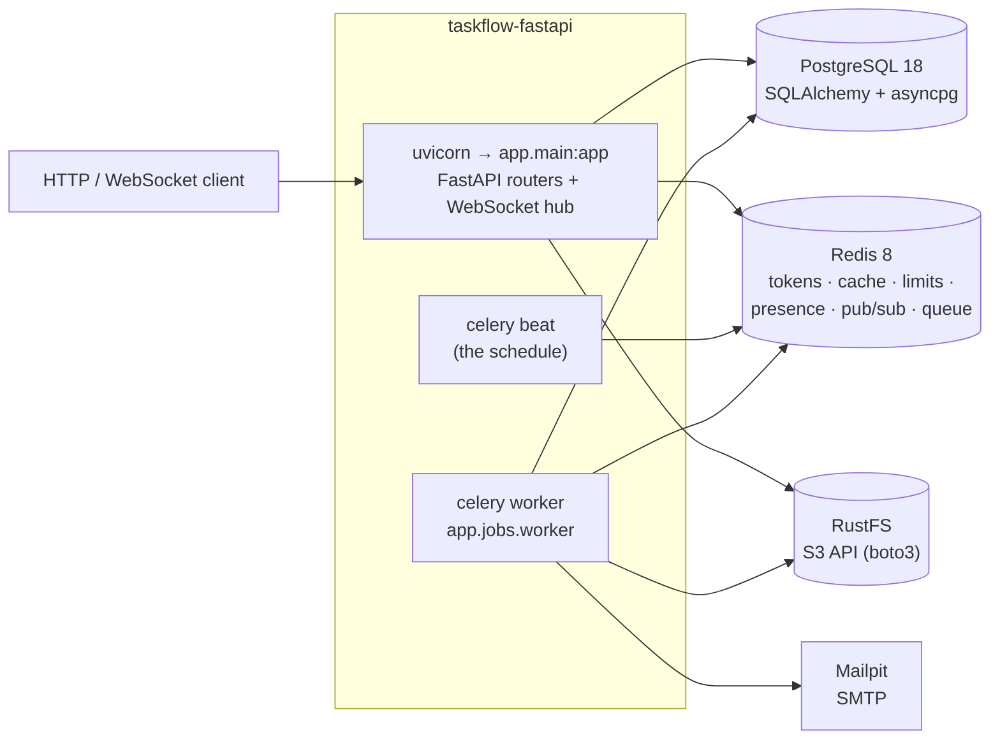
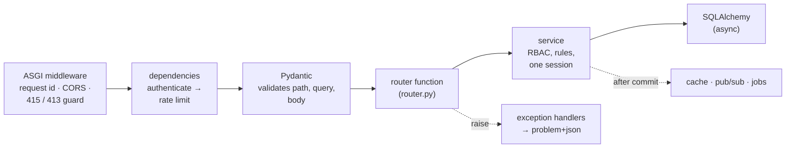

# STEPS · Rebuild `taskflow-fastapi` from an empty folder

You'll build the **TaskFlow API** (a Jira/Trello-lite backend) with **FastAPI, SQLAlchemy 2 (async), PostgreSQL 18 and Redis**, in **Python 3.14**, by hand, one small step at a time. At the end your repo behaves exactly like this one: the same endpoints, the same 79 tests, the same CI.

This is the **fourth** of six TaskFlow backends and the **first one in Python**. You built Express, Fastify and NestJS in TypeScript; this guide keeps their Part and Step numbers, so Step 7.2 here and Step 7.2 there do the same job. Two things change at once, and the guide spends its words on both:

1. **The language.** Every Python construct is explained the first time it appears, bridged from TypeScript ("this is like X in TS, but differs because Y"). Keep [docs/python-for-ts-devs.md](../../docs/python-for-ts-devs.md) open in another tab: it's the short language tour this guide links to instead of repeating, and [docs/gotchas.md](../../docs/gotchas.md#python) lists the traps.
2. **FastAPI's model.** FastAPI is minimal like Express and Fastify, but **type-driven**: the parameters you declare on a handler (their names, their types, their defaults) *are* the routing, parsing and validation instructions. **Dependency injection** is a plain function parameter, `Depends(...)`, instead of NestJS's container and decorators. You'll see that one idea do the work of Express middleware, Nest guards and Nest pipes.

The **data structures and algorithms** stay the same as in the TypeScript repos. Every non-trivial feature still gets its 🧠 box, shorter where the idea is unchanged, longer where Python or SQLAlchemy changes how it's done.

> **Design docs you'll want open:** [`../README.md`](../README.md) (the TaskFlow design: data model, RBAC, auth, real-time protocol, Redis keys) and [`contract/openapi.yaml`](contract/openapi.yaml) (the API). This guide implements them; it doesn't repeat them.

## What you'll build



**Inside the API process**, a request passes through these layers. Each box is something you'll write:



## Prerequisites

| Tool | Version used | Check |
|---|---|---|
| Python | 3.14 (uv can install it: `uv python install 3.14`) | `uv python find 3.14` |
| uv | 0.12+ | `uv --version` |
| Docker + Compose | Compose v5 | `docker compose version` |
| A GitHub account | | |

You've finished at least one of the TypeScript backends (or read its guide). Read sections 1 to 6 of the [Python primer](../../docs/python-for-ts-devs.md) before you start; the rest is linked from the steps that need it.

## The finished repo

```text
taskflow-fastapi/
├── .github/              dependabot.yml, workflows/ci.yml, workflows/codeql.yml
├── app/
│   ├── main.py           create_app(): middleware, error handlers, routers, lifespan
│   ├── config.py         typed, validated environment (pydantic-settings)
│   ├── deps.py           shared dependencies: database session, Redis, jobs, storage
│   ├── seed.py           `python -m app.seed`: the default development user
│   ├── core/             problem errors and handlers, middleware, logging, validation types,
│   │                     cursors, fractional indexing, rate limiter, path parameters
│   ├── db/               declarative base, engine and sessions, Postgres error codes
│   ├── models/           SQLAlchemy models
│   ├── infra/            resources opened at startup (pools, clients), S3 storage
│   ├── <feature>/        router.py → service.py, schemas.py: auth, users, workspaces,
│   │                     projects, tasks, comments, activity, search, attachments, realtime
│   └── jobs/             queue facade, Celery worker and schedule, job handlers, mailer
├── migrations/           Alembic: env.py, script template, versions/
├── tests/                pytest: integration tests; tests/unit for pure logic
├── contract/             openapi.yaml (copy of the master contract)
├── docker-compose.yml    local infra (+ the app under the "app" profile)
├── Dockerfile            multi-stage, non-root
├── alembic.ini           Alembic settings
├── pyproject.toml        the project, its dependencies and every tool's settings
├── uv.lock               exact versions of everything (commit it)
└── schemathesis.toml     contract-test settings
```

**Parts:** 0 Repo setup · 1 Infrastructure & config · 2 Database · 3 HTTP foundations · 4 Authentication · 5 Workspaces & RBAC · 6 Projects, columns & ordering · 7 Tasks · 8 Comments, activity & search · 9 Attachments · 10 Real-time · 11 Background jobs · 12 Contract testing · 13 Docker · 14 CI/CD · 15 Full stack & next steps

**How to read the code blocks:** each block says which file it belongs to and where it goes: **new file**, **continue** (append to the end of the file), **add after `<line>`** (insert the block right below that existing line), **add before `<line>`**, or **add at the top**. Type them in that order and your files will match the repo exactly. A file introduced as **new file** and then continued in the same step is one file typed top to bottom; it's split only where a later Part will insert lines.

**Imports, one per line.** Python files start with their imports, and this repo writes **one imported name per line** (`from x import a` and `from x import b`, never `from x import a, b`). The linter enforces it (Step 0.3). It costs a few lines, but it's why a later step can add an import without editing an existing line, and it keeps diffs to one line per name.

---
