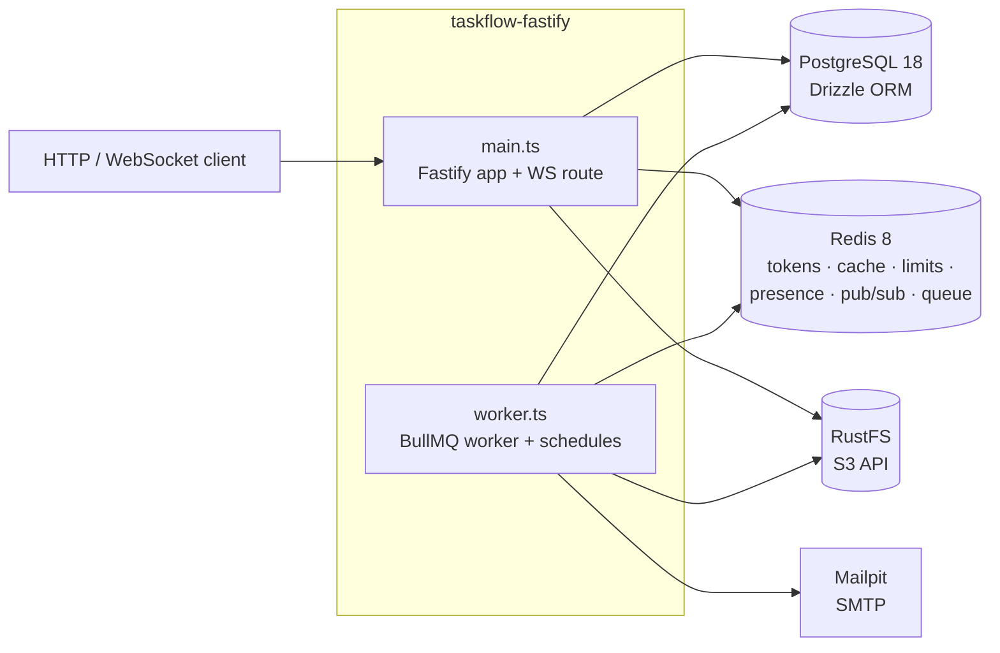
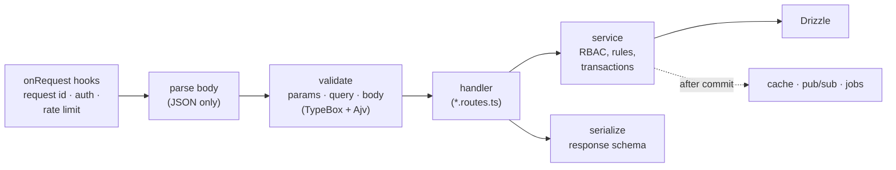

# STEPS · Rebuild `taskflow-fastify` from an empty folder

You'll build the **TaskFlow API** (a Jira/Trello-lite backend) with **Fastify 5, Drizzle ORM, PostgreSQL 18 and Redis**, by hand, one small step at a time. At the end your repo behaves exactly like this one: the same endpoints, the same 71 tests, the same CI.

This is the **second** of six TaskFlow backends. You built the first one, `taskflow-express`, and this guide keeps its Part and Step numbers, so Step 7.2 here and Step 7.2 there do the same job. It spends its words on what **changes** when the framework and the ORM change:

1. **Fastify's model.** Express is a chain of middleware functions. Fastify is a tree of **plugins** with **hooks** at fixed points in a request's lifecycle, **encapsulation** (what a plugin registers stays inside it), and a **schema on every route** that drives validation, serialization and TypeScript types at once.
2. **Drizzle instead of Prisma.** The schema is TypeScript, queries look like SQL, and the migration needs no hand-editing.
3. **The data structures and algorithms** stay the same as in Express. Every non-trivial feature still gets its 🧠 box (complexity, why it scales, rejected alternatives), shorter where the idea is unchanged.

> **Design docs you'll want open:** [`../README.md`](../README.md) (the TaskFlow design: data model, RBAC, auth, real-time protocol, Redis keys) and [`contract/openapi.yaml`](contract/openapi.yaml) (the API). This guide implements them; it doesn't repeat them.

## What you'll build



**Inside the API process**, a request passes Fastify's lifecycle. Each box is a place where your code can run:



## Prerequisites

| Tool | Version used | Check |
|---|---|---|
| Node.js | 24 (npm 11.17+) | `node -v && npm -v` |
| Docker + Compose | Compose v5 | `docker compose version` |
| uv (for the contract test) | 0.12+ | `uv --version` |
| A GitHub account | | |

You've finished `taskflow-express` (or at least read its guide). Where a file here is the same as there, this guide still shows all of it, so the repo stands on its own, but explains only what's new.

## The finished repo

```text
taskflow-fastify/
├── .github/            dependabot.yml, workflows/ci.yml, workflows/codeql.yml
├── contract/           openapi.yaml (copy of the master contract)
├── drizzle/            generated SQL migrations + drizzle-kit snapshots
├── src/
│   ├── main.ts         starts the server, graceful shutdown
│   ├── worker.ts       background job worker + cron schedules
│   ├── migrate.ts      applies migrations (production runs it with plain node)
│   ├── app.ts          builds the Fastify app: plugins, hooks, route contexts
│   ├── container.ts    creates infra clients and wires every service (manual DI)
│   ├── config.ts       typed, validated environment (TypeBox)
│   ├── db/             Drizzle schema, relations, client
│   ├── http/           validation, errors, 405, auth hooks, rate limiting, request log
│   ├── infra/          Redis, S3, logger factories
│   ├── jobs/           queue facade, processors, mailer
│   ├── lib/            problem errors, shared schemas, cursors, fractional indexing
│   ├── modules/        one folder per feature: routes (plugin) → service → (repository)
│   └── types/          Fastify type augmentation
├── tests/              unit/ and integration/ (real Postgres, Redis, S3, SMTP)
├── docker-compose.yml  local infra (+ the app under the "app" profile)
├── Dockerfile          multi-stage, non-root
└── schemathesis.toml   contract-test settings
```

**Parts:** 0 Repo setup · 1 Infrastructure & config · 2 Database · 3 HTTP foundations · 4 Authentication · 5 Workspaces & RBAC · 6 Projects, columns & ordering · 7 Tasks · 8 Comments, activity & search · 9 Attachments · 10 Real-time · 11 Background jobs · 12 Contract testing · 13 Docker · 14 CI/CD · 15 Full stack & next steps

**How to read the code blocks:** each block says which file it belongs to and where it goes: **new file**, **continue** (append to the end of the file), **add after `<line>`** (insert the block right below that existing line), **add before `<line>`**, or **add at the top**. Type them in that order and your files will match the repo exactly.

---
