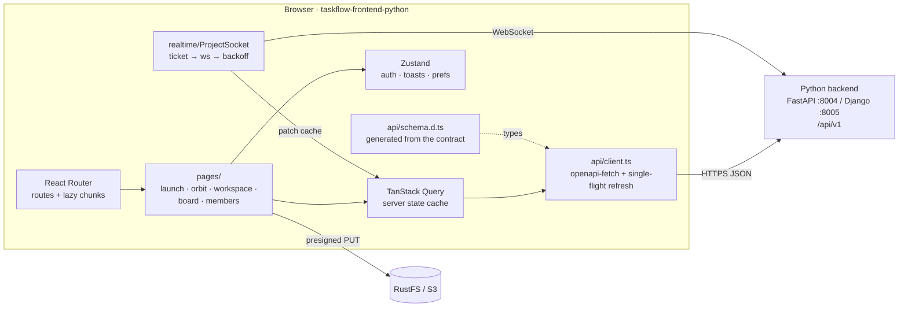

# STEPS · Rebuild `taskflow-frontend-python` from an empty folder

You'll build the **TaskFlow web app** (the "Orbit" UI: a 3D Kanban board in a starfield) with **React 19, Vite 8, TanStack Query 5, Zustand 5, React Router 8, react-hook-form + zod 4, Tailwind CSS 4 and shadcn/ui**, by hand, one small step at a time. At the end your repo behaves exactly like this one: same screens, same tests, same CI.

This frontend talks to **either Python backend** (`taskflow-fastapi` on port 8004, `taskflow-django` on 8005). They implement the same contract as the Node backends, so the only thing that changes is `VITE_API_URL`.

## The second time round: what's different from `taskflow-frontend-node`

You've built this UI once already (or you can: this guide doesn't assume it). The screens, the Orbit design and the client-side patterns are the same, because the contract is the same. This guide is complete on its own, so every file is here again, but four things are built differently, and they're the reason to build it twice:

| | `taskflow-frontend-node` | this repo |
|---|---|---|
| **Wire types** | Written by hand in `types.ts` from reading the contract | **Generated** from `contract/openapi.yaml` by `openapi-typescript`; CI fails if they drift (Step 1.3) |
| **HTTP client** | A hand-rolled `request<T>(method, path)`: the path is a string and `T` is a promise you make | **`openapi-fetch`**: the path, its parameters, the body and the response type are all checked against the contract at compile time (Steps 2.2–2.3) |
| **Scaffold** | `npm create vite`, then replace most of what it generated | **No generator.** You write every file yourself, so you know what each one is for (Part 0) |
| **Previewing UI** | A temporary `App.tsx`, deleted in Part 4 | A **dev-only `/kit` route**: a living style guide that never ships to production (Steps 1.2, 1.4) |

And one ordering change: **Real-time (Part 8) comes before the board page (Part 9)**, so the board is written once, with live updates from the start.

The idea behind the first two rows is called **contract-first**: the OpenAPI file is the source of truth, and the code that talks to it is derived from it. FastAPI works the same way from the other end (it *generates* its OpenAPI from Pydantic models), which makes this a natural pairing: you'll see the same schema names in both repos.

You already know React and TypeScript well, so this guide skips React basics and spends its words on:

1. **The libraries' specifics:** what TanStack Query owns versus Zustand, React Router 8's data router and `lazy` routes, react-hook-form with zod, Tailwind 4's CSS-first config, `openapi-typescript` + `openapi-fetch`, MSW 3, Vitest 5, Playwright.
2. **The production patterns** the backend contract forces on a client: a *single-flight* token refresh, cursor pagination, optimistic drag-and-drop with rollback, a WebSocket that reconnects with jittered backoff and refetches to close the gap, and RFC 9457 errors mapped onto form fields.
3. **The data structures and algorithms**, in a 🧠 box under every non-trivial piece.

> **Design docs you'll want open:** [`../README.md`](../README.md) (the TaskFlow design: auth, RBAC, real-time protocol) and [`contract/openapi.yaml`](contract/openapi.yaml) (the API). The visual design is the **TaskFlow Orbit** canvas; the colors, type and motion below come from it.

## What you'll build



**Who owns which state** is the most important design decision in a React app, so here it is up front:

| State | Lives in | Why |
|---|---|---|
| Anything the server owns (workspaces, the board, comments) | **TanStack Query cache** | It's a *cache* of remote data: it needs deduping, refetching, invalidation and optimistic updates, which is exactly what Query does |
| The access token, the current user | **Zustand** (`stores/auth.ts`) | Read by non-React code (the fetch client) as well as components; kept in memory only |
| Toasts, the 3D/flat toggle | **Zustand** | Global UI state; the toggle persists to `localStorage` |
| The open task | **The URL** (`?task=…`) | Survives reload, shareable, and the back button closes it |
| Form fields, drag targets | **Component state** | Nobody else needs them |

## Prerequisites

| Tool | Version used | Check |
|---|---|---|
| Node.js | 24 (npm 11.17+) | `node -v && npm -v` |
| Docker + Compose | Compose v5 | `docker compose version` |
| One Python backend | `taskflow-fastapi` (or `-django`) | its STEPS.md, Part 13 |
| A GitHub account | | |

## The finished repo

```text
taskflow-frontend-python/
├── .github/            dependabot.yml, workflows/ci.yml, workflows/codeql.yml
├── contract/           openapi.yaml (copy of the master contract)
├── e2e/                Playwright end-to-end spec
├── public/             favicon.svg
├── src/
│   ├── main.tsx        mounts QueryClientProvider + RouterProvider
│   ├── router.tsx      route table (lazy chunks behind sign-in, /kit in dev only)
│   ├── index.css       Tailwind 4 + the Orbit theme
│   ├── config.ts       VITE_API_URL → API and WebSocket base URLs
│   ├── components/
│   │   ├── ui/         shadcn/ui primitives (generated)
│   │   ├── orbit/      app chrome: brand, starfield, fields, dialogs, presence, toaster
│   │   └── board/      card, column, search, task dialog and its tabs
│   ├── hooks/          useDebouncedValue, useProjectRealtime
│   ├── lib/
│   │   ├── api/        schema.d.ts (generated), types, typed client, endpoints
│   │   ├── queries/    TanStack Query hooks, one file per feature
│   │   ├── realtime/   ProjectSocket + backoff
│   │   └── …           pure logic: board-cache, carousel, headline, permissions, format
│   ├── pages/          one component per route, plus the dev-only kit page
│   ├── stores/         Zustand: auth, toasts, preferences
│   └── test/           MSW server, fixtures, render helper
├── Dockerfile          build with Node, serve with unprivileged nginx
├── nginx.conf          SPA fallback + caching + security headers
└── playwright.config.ts
```

**Parts:** 0 Repo setup · 1 Styling & the Orbit theme · 2 Talking to the API · 3 Server state & client state · 4 Routing & the launch screen · 5 Workspaces & projects · 6 Board building blocks · 7 Task details · 8 Real-time · 9 The board page · 10 Members & invitations · 11 End-to-end tests · 12 Docker · 13 CI/CD · 14 Full stack & next steps

**How to read the code blocks:** each block names its file and where the code goes: **new file**, **continue** (append to the end), **add after / before `<line>`** (insert next to that existing line), or **add at the top**. Files only ever grow: no block asks you to replace or delete a line you typed earlier, so if your file and the guide disagree, the difference is a typo, not a missed edit. Type them in order and your files will match the repo exactly.

Every checkpoint that runs tests states the exact count you should see. Every one of them was verified by replaying this guide against the finished repo: the replay rebuilds the repo from an empty folder in guide order, runs each checkpoint's type check, lint and tests, and ends with every file byte-identical to this repo.

---
