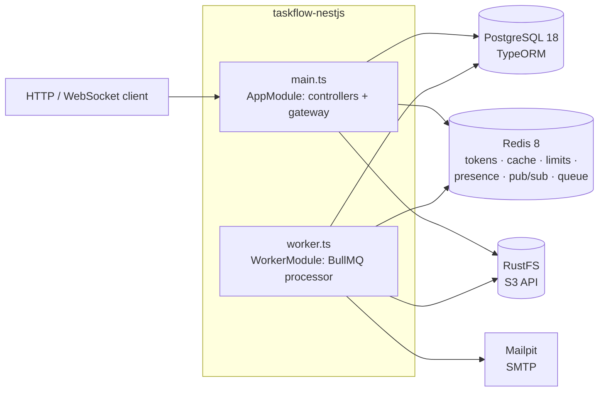
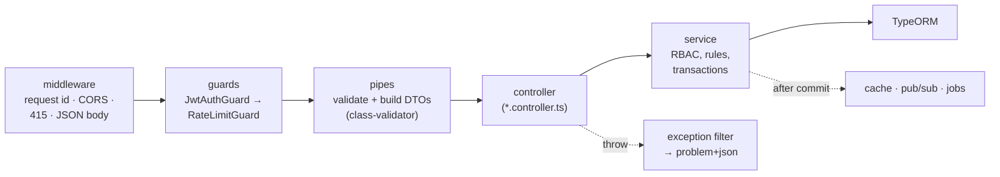

# STEPS · Rebuild `taskflow-nestjs` from an empty folder

You'll build the **TaskFlow API** (a Jira/Trello-lite backend) with **NestJS 12, TypeORM, PostgreSQL 18 and Redis**, by hand, one small step at a time. At the end your repo behaves exactly like this one: the same endpoints, the same 82 tests, the same CI.

This is the **third** of six TaskFlow backends, and the last one in TypeScript. You built `taskflow-express` and `taskflow-fastify`; this guide keeps their Part and Step numbers, so Step 7.2 here and Step 7.2 there do the same job. It spends its words on what **changes**:

1. **NestJS's model.** Express and Fastify gave you functions and left the structure to you. Nest gives you the structure: **modules** group related classes, a **dependency-injection container** creates those classes and hands each one what its constructor asks for, and **decorators** (`@Controller()`, `@Get()`, `@Injectable()`) attach metadata that the framework reads to wire everything up. You stop calling the framework; it calls you.
2. **TypeORM instead of Drizzle.** Tables are **classes with decorators** ("entities"), and you query through repositories or a query builder.
3. **The data structures and algorithms** stay the same. Every non-trivial feature still gets its 🧠 box, shorter where the idea is unchanged.

> **Why this repo matters for what comes next.** NestJS is deliberately modelled on Spring (via Angular). `@Module` ↔ `@Configuration`, `@Injectable()` ↔ `@Service`/`@Component`, constructor injection ↔ constructor injection, `@Controller`/`@Get` ↔ `@RestController`/`@GetMapping`, guards ↔ Spring Security filters, pipes ↔ Bean Validation, exception filters ↔ `@ControllerAdvice`, TypeORM entities ↔ JPA entities. Learn the ideas here in a language you know, and Spring Boot will read like a translation. This guide points out each parallel as it appears (look for **☕ Spring**).

> **Design docs you'll want open:** [`../README.md`](../README.md) (the TaskFlow design: data model, RBAC, auth, real-time protocol, Redis keys) and [`contract/openapi.yaml`](contract/openapi.yaml) (the API). This guide implements them; it doesn't repeat them.

## What you'll build



**Inside the API process**, a request passes Nest's lifecycle. Each box is a kind of class you'll write:



## Prerequisites

| Tool | Version used | Check |
|---|---|---|
| Node.js | 24 (npm 11.17+) | `node -v && npm -v` |
| Docker + Compose | Compose v5 | `docker compose version` |
| uv (for the contract test) | 0.12+ | `uv --version` |
| A GitHub account | | |

You've finished `taskflow-express` and `taskflow-fastify` (or at least read their guides). Where a file here is the same as there, this guide still shows all of it, so the repo stands on its own, but explains only what's new.

## The finished repo

```text
taskflow-nestjs/
├── .github/              dependabot.yml, workflows/ci.yml, workflows/codeql.yml
├── contract/             openapi.yaml (copy of the master contract)
├── src/
│   ├── main.ts           starts the HTTP server
│   ├── worker.ts         starts the worker (a Nest app without HTTP)
│   ├── migrate.ts        applies migrations (production runs it with plain node)
│   ├── app.module.ts     the API's root module: feature modules + global filter, pipe, guards
│   ├── worker.module.ts  the worker's root module
│   ├── core.module.ts    config, logging, Postgres, Redis: shared by both processes
│   ├── app.setup.ts      middleware, CORS, body parser, WebSocket adapter
│   ├── docs.ts           Swagger document and UI
│   ├── config/           typed, validated environment
│   ├── database/         entities, naming strategy, data source, migrations
│   ├── common/           problem errors, exception filter, 405, validation, rate limiting,
│   │                     cursors, fractional indexing
│   ├── infra/            Redis module, S3 storage, logger options
│   ├── jobs/             queue facade, job handlers, BullMQ processor, mailer
│   ├── modules/          one folder per feature: module + controller → service, DTOs
│   └── types/            Express type augmentation
├── test/                 *.e2e-spec.ts (real Postgres, Redis, S3, SMTP)
├── docker-compose.yml    local infra (+ the app under the "app" profile)
├── Dockerfile            multi-stage, non-root
├── nest-cli.json         Nest CLI build settings
└── schemathesis.toml     contract-test settings
```

**Parts:** 0 Repo setup · 1 Infrastructure & config · 2 Database · 3 HTTP foundations · 4 Authentication · 5 Workspaces & RBAC · 6 Projects, columns & ordering · 7 Tasks · 8 Comments, activity & search · 9 Attachments · 10 Real-time · 11 Background jobs · 12 Contract testing · 13 Docker · 14 CI/CD · 15 Full stack & next steps

**How to read the code blocks:** each block says which file it belongs to and where it goes: **new file**, **continue** (append to the end of the file), **add after `<line>`** (insert the block right below that existing line), **add before `<line>`**, or **add at the top**. Type them in that order and your files will match the repo exactly. A file introduced as **new file** and then continued in the same step is one file typed top to bottom; it's split only where a later Part will insert lines.

---
